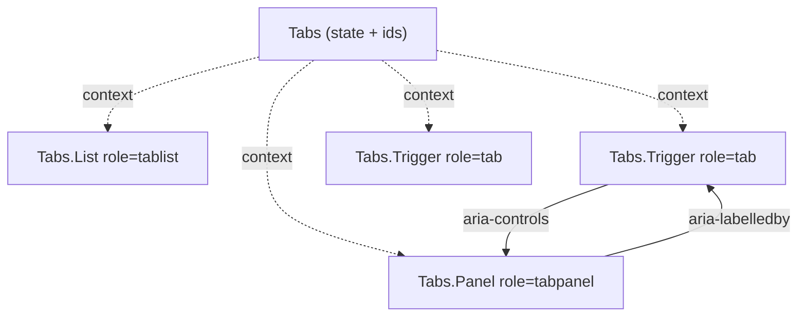

::part[Learn the Concept]{n="1"}

## 🎯 What you'll learn

- The **prop explosion** problem in reusable components
- **Compound components**: a root that owns state plus parts that read it from context
- API styles: `Tabs.Trigger` (static properties) vs `TabsTrigger` exports
- Controlled/uncontrolled roots (with `useControllableState`)
- Accessibility wiring: `useId`, ARIA relationships, keyboard support with **roving tabindex**
- Helpful errors for parts used outside the root
- Alternatives: slots, render props, `asChild`

## 🔤 Key words

| Word | In simple words | Bahasa Indonesia |
|---|---|---|
| **Compound components** | A group of components that work together as one feature | Komponen yang bekerja berpasangan |
| **Prop explosion** | A component growing endless props for every new need | Ledakan jumlah prop |
| **Root component** | The outer part that owns the shared state | Komponen induk pemilik state |
| **Context** | How the parts read that shared state | Cara berbagi state |
| **Part** | One piece of the group (`Tabs.Trigger`) | Bagian dari kelompok |
| **`useId`** | React's way to generate ids that match on server and client | Pembuat id unik |
| **ARIA relationship** | The attributes telling screen readers which part controls which | Kaitan untuk screen reader |
| **Roving tabindex** | Arrow keys move focus inside a group; Tab moves past it | Fokus berpindah dengan panah |
| **`asChild` / slot** | Letting the caller decide which element is rendered | Menyerahkan elemen ke pemanggil |

## 🧠 The big idea

Think of **HTML's `<select>` and `<option>`**: you don't pass `options={[…]}` to `<select>` — you put `<option>` elements inside, and they work together. Compound components give your own components that same feel: `<Tabs>` with `<Tabs.List>`, `<Tabs.Trigger>` and `<Tabs.Panel>` inside, arranged however the page needs.

## ❓ Why it matters

A "configurable" component starts with `tabs={[{label, content}]}`. Then somebody needs an icon, then a badge, then a disabled tab, then a panel rendered elsewhere in the layout, then a different class for the active tab — so you add `renderLabel`, `badgeFor`, `disabledTabs`, `activeClassName`, `panelWrapper`. Every new design adds a prop, and the component turns into a settings panel nobody understands.

Compound components flip it around: the root keeps the state, and the caller arranges the parts — exactly how HTML already works with `<select>` and `<option>`.

## 📖 Step by step

### 1. The shape

```tsx
<Tabs defaultValue="notes" onValueChange={track}>
  <Tabs.List aria-label="Application sections">
    <Tabs.Trigger value="notes"><NoteIcon /> Notes <Badge>3</Badge></Tabs.Trigger>
    <Tabs.Trigger value="files" disabled>Files</Tabs.Trigger>
  </Tabs.List>
  <Tabs.Panel value="notes"><Notes /></Tabs.Panel>
  <Tabs.Panel value="files"><Files /></Tabs.Panel>
</Tabs>
```

The caller controls markup and order; the component controls **state and accessibility**.

### 2. Root owns state, context shares it

```tsx
const TabsContext = createContext<{ baseId: string; selected?: string; select(v: string): void } | null>(null);

function useTabsContext(part: string) {
  const ctx = useContext(TabsContext);
  if (!ctx) throw new Error(`Tabs.${part} must be used inside <Tabs>`);
  return ctx;
}

function TabsRoot({ value, defaultValue, onValueChange, children }: TabsProps) {
  const [selected, setSelected] = useControllableState({ value, defaultValue, onChange: onValueChange });
  const baseId = useId();                                     // unique per instance, SSR-safe
  return <TabsContext.Provider value={{ baseId, selected, select: setSelected }}>{children}</TabsContext.Provider>;
}
```

### 3. Parts read context and wire ARIA

This is where accessibility becomes free for the caller: the parts connect the right ids themselves, so screen readers get correct relationships without anyone remembering to add them.

```tsx
function Trigger({ value, disabled, children }: TriggerProps) {
  const { baseId, selected, select } = useTabsContext("Trigger");
  const isSelected = selected === value;
  return (
    <button
      type="button" role="tab" id={`${baseId}-tab-${value}`}
      aria-selected={isSelected} aria-controls={`${baseId}-panel-${value}`}
      tabIndex={isSelected ? 0 : -1}                           // roving tabindex
      disabled={disabled} onClick={() => select(value)} onKeyDown={moveWithArrows}
    >{children}</button>
  );
}

function Panel({ value, children }: PanelProps) {
  const { baseId, selected } = useTabsContext("Panel");
  if (selected !== value) return null;
  return <div role="tabpanel" id={`${baseId}-panel-${value}`} aria-labelledby={`${baseId}-tab-${value}`} tabIndex={0}>{children}</div>;
}

export const Tabs = Object.assign(TabsRoot, { List, Trigger, Panel });
```



### 4. Keyboard: roving tabindex

WAI-ARIA's Tabs pattern: **Tab** moves into the tab list (only the selected tab has `tabIndex=0`) and then to the panel; **Arrow keys** move between tabs; **Home/End** jump to first/last; disabled tabs are skipped. With *automatic activation*, focusing a tab selects it; *manual activation* requires Enter/Space (better when panels are expensive to load).

### 5. Export styles

Both styles are fine — `Tabs.Trigger` reads nicely, while separate `TabsTrigger` exports are friendlier to bundlers and auto-import. Pick one and stay consistent.

| Style | Example | Notes |
|---|---|---|
| Static properties | `Tabs.Trigger` | discoverable; needs care with `"use client"` boundaries and tree-shaking |
| Named exports | `TabsTrigger` (shadcn/ui) | works well with Server Components importing client parts; explicit imports |
| Namespace import | `import * as Tabs from "@radix-ui/react-tabs"` → `Tabs.Root` | Radix style |

### 6. Related composition patterns

- **Slots / `asChild`**: `<Dialog.Trigger asChild><Button/></Dialog.Trigger>` merges behavior into your element.
- **Render props**: `<Combobox>{({ open }) => …}</Combobox>` exposes internal state for custom rendering.
- **Prop getters** (hooks): `getTabProps(value)` — the headless variant from the previous lesson.

### Choosing your setup

Every option here is a trade-off:

| | ✅ | ❌ |
|---|---|---|
| Compound components | flexible markup, readable, accessible wiring centralized | more parts to learn; parts must be inside the root |
| Config props (`tabs=[…]`) | short for simple cases, easy to generate from data | prop explosion for anything custom |
| Headless hooks | maximum control | caller must wire ARIA correctly |

- ✅ Components with related parts: tabs, accordion, menu, select, dialog, stepper, card with header/body/footer.
- ✅ Design-system components used in many different layouts.
- 🚫 Simple leaf components (`<Badge tone="success">`) — props are clearer.
- 🚫 Rebuilding complex widgets (combobox, date picker) from scratch in a product team — use Radix/React Aria.

## ⚠️ Common mistakes

- Using array indexes to match triggers and panels (breaks when parts are reordered) — use explicit `value`s.
- Every tab focusable with Tab (no roving tabindex) → keyboard users tab through 10 tabs.
- Hard-coded ids → duplicates when the component appears twice.
- Relying on `React.Children.map` to inject props — breaks with fragments and wrapper components; use context.

## 🏆 Best practices

- [ ] Root owns state (controlled + uncontrolled); parts read it through a private context.
- [ ] Throw a clear error when a part is used outside its root.
- [ ] Generate ids with `useId`; wire `aria-controls` / `aria-labelledby`.
- [ ] Implement the WAI-ARIA keyboard pattern for the widget; test it with Testing Library.
- [ ] Pass through native props (`aria-label`, `className`) with `...props`.
- [ ] Memoize context values if parts are many or expensive.
- [ ] Prefer battle-tested primitives (Radix, React Aria) for complex widgets; build your own for learning or simple cases.

::part[Explain & Design]{n="2"}

## 🗣️ Explain it

Explain the `<select>`/`<option>` analogy, then explain to a teammate why roving tabindex makes tabs faster for keyboard users.

## 📐 Design it

Design a compound **`Stepper`** for CareerPilot's 3-step "Add application" wizard: parts, what the root owns, ARIA roles/attributes, keyboard behavior, how a step can block "Next" until it's valid, and controlled use with React Hook Form.

:::quiz
Show a possible design

```tsx
<Stepper value={step} onValueChange={setStep} canContinue={canContinue}>
  <Stepper.List aria-label="Add application">
    <Stepper.Step value="company">Company</Stepper.Step>
    <Stepper.Step value="role">Role</Stepper.Step>
    <Stepper.Step value="skills">Skills</Stepper.Step>
  </Stepper.List>
  <Stepper.Panel value="company"><CompanyFields /></Stepper.Panel>
  <Stepper.Panel value="role"><RoleFields /></Stepper.Panel>
  <Stepper.Panel value="skills"><SkillsFields /></Stepper.Panel>
  <Stepper.Previous>Back</Stepper.Previous>
  <Stepper.Next>Next</Stepper.Next>
</Stepper>
```

- **Root** owns `value` (controllable), ordered step values registered by `Stepper.Step`, `completed` set, and `canContinue(current) => Promise<boolean>` (e.g. `() => form.trigger(fieldsFor(step))`).
- **List** is an `<ol>`; each **Step** renders `aria-current="step"` for the current one, a visually hidden "completed" label, and is a button only for completed steps (can't jump ahead).
- **Next** awaits `canContinue`; on failure focuses the first invalid field; on the last step it becomes the submit button. **Previous** disabled on the first step.
- **Panel** renders only the current step but keeps values in RHF (`shouldUnregister: false`); moves focus to the panel heading when the step changes (announce progress).
- Errors if parts are outside `<Stepper>`; ids from `useId`.
:::

### 📝 Self-review checklist

- [ ] State in the root, markup in the caller
- [ ] Focus management on step change
- [ ] Validation hook instead of hard-coded rules

::ai-review{task="design"}

::part[Toy Exercise]{n="3"}

:::exercise{path="exercises/web/architecture/g-frontend-patterns/03-compound-components" ai="no-ai" title="Accessible compound Tabs"}
Build `Tabs`, `Tabs.List`, `Tabs.Trigger` and `Tabs.Panel` with context, controlled and uncontrolled modes, unique ids, ARIA wiring, roving tabindex and arrow/Home/End keyboard support that skips disabled tabs.
:::

:::hints
- Query the enabled tabs from the list element (`querySelectorAll('[role="tab"]:not([disabled])')`) in the key handler.
- Focus the target tab and select it (automatic activation).
- `useId()` in the root, then derive tab and panel ids from it plus the `value`.
:::

## ✅ Quick check

:::quiz
Why use context instead of `React.Children.map` + `cloneElement` to pass the selected value to triggers?

Children mapping only reaches direct children; wrapping a trigger in a `<Tooltip>` or fragment breaks it. Context reaches any depth and keeps parts independent of structure.
:::

:::quiz
What does `aria-controls` on a tab point to, and why does it matter?

The id of the panel it shows. Assistive technology can announce and navigate the relationship between tab and panel.
:::


## 📚 Keep learning

- [WAI-ARIA APG: Tabs pattern](https://www.w3.org/WAI/ARIA/apg/patterns/tabs/)
- [Radix Primitives: Tabs](https://www.radix-ui.com/primitives/docs/components/tabs)
- [patterns.dev: Compound pattern](https://www.patterns.dev/react/compound-pattern/)
