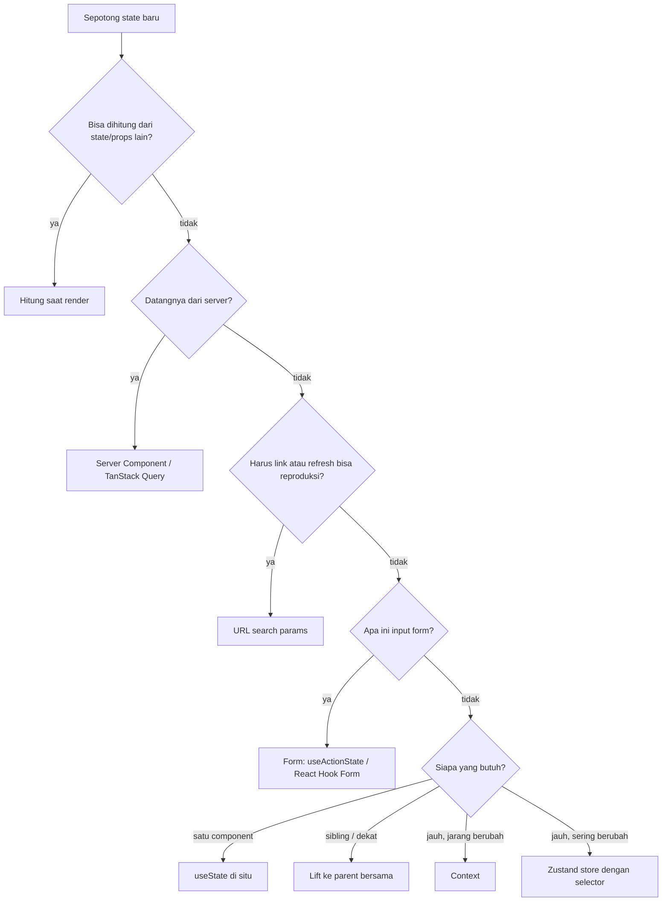

::part[Pelajari Konsepnya]{n="1"}

## 🎯 Yang akan kamu pelajari

- **Jenis-jenis state** di web app dan tempat aslinya yang benar
- **Panduan keputusan** yang bisa kamu pakai di code review
- **URL state** di Next.js: parsing dan validasi search param, `push` vs `replace`, buat typing tetap cepat
- **Derived state** — nilai yang harus kamu hitung, bukan simpan
- Lifting state up vs pushing it down (colocation)
- Refactor yang perbaiki bug "state di tempat salah"

## 🔤 Istilah penting

| Istilah | Artinya (sederhana) |
|---|---|
| **Server state** | Data yang benar-benar tinggal di backend; client hanya memegang salinan |
| **URL state** | State yang disimpan di alamat halaman, jadi link bisa dibagikan |
| **Form state** | Apa yang user ketik sekarang di form |
| **Local state** | State yang satu component simpan sendiri |
| **Lifted state** | State yang dipindahkan ke parent terdekat yang memerlukannya |
| **Colocation** | Menaruh state sedekat mungkin dengan tempat dipakai |
| **Derived state** | Nilai yang dihitung, bukan disimpan |
| **Client store** | Wadah state bersama (Zustand) untuk state di browser saja |

## 🧠 Ide besarnya

State itu seperti **barang-barang di rumah**. Paspor kamu (server data) disimpan di brankas bank — kamu hanya membawa **fotokopi**. Alamat rumah (URL) adalah apa yang kamu kasih ke teman supaya dia sampai di tempat yang sama. Daftar belanja (form input) tertempel di kulkas sampai kamu pergi berbelanja. Remote TV (local UI state) tinggal di ruang keluarga. Kalau barang-barang ditaruh di tempat yang salah — paspor di kulkas, remote di brankas — hidup jadi repot.

## ❓ Kenapa ini penting

Sebagian besar bug React dan kompleksitas React datang dari state yang **diduplikasi**, **di tempat salah**, atau **terlalu global**: salinan server data yang ketinggalan, filter yang hilang saat refresh, global store yang render seluruh app setiap keystroke, effect yang nyinkronin dua state yang harusnya satu.

Bayangan rumah itu membuat keputusan jadi cepat: paspor ada di brankas (server), alamat adalah apa yang kamu kasih teman (URL), daftar belanja ada di kulkas (form), dan remote tinggal di ruang keluarga (lokal).

## 📖 Langkah demi langkah

### 1. Jenis-jenis state

| Jenis | Contoh | Tempat |
|---|---|---|
| **Server state** | job listing, aplikasi, user login | Server Component (fetch saat request), **TanStack Query** di browser — API/DB adalah sumber kebenaran |
| **URL state** | search, filter, sort, page, tab yang dibagikan | `searchParams` / `useSearchParams` |
| **Form state** | nilai yang diketik, error validasi, pending | form: `useActionState`, React Hook Form |
| **Local UI state** | dropdown buka, hover, draft di input | `useState` di component yang pakai |
| **Shared UI state** (dekat) | baris yang dipilih di list + detail panel | lift ke parent terdekat yang sama-sama butuh |
| **Shared UI state** (jauh) | theme, toast API, compare tray | Context (jarang berubah) atau **Zustand** (sering berubah) |
| **Derived state** | list yang sudah difilter, count, "bisa submit" | **hitung saat render** — jangan simpan |
| **Session/auth** | siapa yang login | httpOnly cookie di server; DTO yang dipass turun |

### 2. Panduan keputusan

Pakai daftar ini di code review. Sebagian besar argumen tentang state management hilang begitu kamu tanya "siapa yang benar-benar punya nilai ini?" duluan.



### 3. URL state yang benar

**Parse dan validasi** — URL adalah input user:

```ts
export function parseJobFilters(input: URLSearchParams | Record<string, string | string[] | undefined>): JobFilters {
  const first = (k: string) => (input instanceof URLSearchParams ? input.get(k) ?? undefined : [input[k]].flat()[0]);
  const page = Number(first("page"));
  return {
    q: (first("q") ?? "").trim().slice(0, 100),
    status: oneOf(["open", "closed", "all"], first("status"), "open"),
    remote: first("remote") === "1",
    sort: oneOf(["newest", "salary"], first("sort"), "newest"),
    page: Number.isInteger(page) && page >= 1 ? page : 1,
  };
}
```

Parser yang **sama** berjalan di server (`await searchParams` di page, untuk fetch data) dan di client (`useSearchParams()` di filter bar). Serialize tanpa default supaya URL tetap pendek dan stabil.

**Push atau replace?**

| Perubahan | Metode | Alasan |
|---|---|---|
| status, sort, remote, page | `router.push` | user harap Back bisa undo |
| setiap keystroke di search (debounced) | `router.replace` | jangan ada history entry per huruf |

**Buat typing tetap instant**: input punya **local** state; URL diupdate setelah jeda. Saat URL berubah dari luar (tombol Back), input menyesuaikan.

```tsx
const [draft, setDraft] = useState(filters.q);
const [syncedQ, setSyncedQ] = useState(filters.q);
if (filters.q !== syncedQ) { setSyncedQ(filters.q); setDraft(filters.q); }   // adjust state during render when the source changes

useEffect(() => {
  if (draft.trim() === filters.q) return;
  const t = setTimeout(() => setFilters({ q: draft }, { history: "replace" }), 300);
  return () => clearTimeout(t);
});
```

Reset `page` ke 1 kapan pun filter lain berubah. Di App Router, ubah search param re-render Server Component page dengan data baru — bungkus bagian lambat di `<Suspense>` dan pakai `useTransition`/`useLinkStatus` untuk tampilkan pending UI. Library seperti **nuqs** bungkus pola ini dengan typed parser.

### 4. Derived state

```tsx
const visibleJobs = jobs.filter((j) => matches(j, filters));   // no useState, no useEffect
const count = visibleJobs.length;
const canCompare = selectedIds.length >= 2;
```

Pakai `useMemo` hanya kalau hitungannya beneran mahal.

### 5. Lift up, push down

- **Lift** state ke parent terdekat kalau dua component harus sependapat.
- **Push down** (colocation) state yang cuma satu component pakai — search draft di page component re-render seluruh page setiap keystroke.
- Pakai `key` untuk reset state saat identity berubah: `<NotesEditor key={applicationId} />`.

### 6. Server state adalah cache, bukan milikmu

Copy server data ke store sendiri membuat kamu yang tanggung jawab menjaganya tetap segar — pekerjaan yang TanStack Query sudah kerjakan, dan lebih bagus lagi.

Jangan copy API data ke `useState`/Zustand lalu ubah. Fetch di Server Component atau TanStack Query, mutate lewat Server Action/mutation, dan **invalidate** (`updateTag`, `invalidateQueries`) supaya sumber kebenaran menang.

### Pilih setup-mu

Setiap pilihan ada trade-off:

| Tempat | ✅ | ❌ |
|---|---|---|
| URL | bisa dibagikan, bisa di-bookmark, Back jalan, server bisa baca | string doang, terlihat, ada limit panjang; perlu parsing |
| Local state | simpel, cepat, private | hilang saat unmount/refresh |
| Context | tanpa prop drilling | re-render consumer; tanpa selector |
| Zustand | selector, di luar React | library lagi; gampang berlebihan |
| TanStack Query | caching, refetch, dedupe | konsep harus dipelajari; client JS |
| Server Component | tanpa client JS, aman | cuma saat request; interaktif butuh client island |

- ✅ Jalankan panduan keputusan di code review untuk setiap `useState` atau field store baru.
- ✅ URL untuk apapun yang user mungkin bagikan, bookmark, atau harap Back restore.
- 🚫 Jangan masukkan secret atau data pribadi di URL (muncul di log dan analytics).
- 🚫 Jangan buat global store "untuk nanti".

## ⚠️ Kesalahan umum

- Simpan nilai yang diturunkan dan sync pake effect.
- Push history entry per keystroke — Back jadi guna.
- Percaya `searchParams` tanpa validasi (`page=-1`, `sort=DROP TABLE`).
- Copy props ke state (`useState(props.value)`) lalu heran kenapa tidak update.
- Pakai Zustand/Context sebagai cache untuk API data.

## 🏆 Praktik terbaik

- [ ] Satu sumber kebenaran per data; hitung yang lain.
- [ ] Server data lewat Server Component atau TanStack Query — jangan salinan yang disync tangan.
- [ ] Filter yang bisa dibagikan di URL, parse dan validasi dengan satu fungsi bersama.
- [ ] `push` untuk pilihan diskrit, `replace` untuk input terus-menerus; reset pagination saat filter berubah.
- [ ] Colocation state serendah mungkin; lift cuma kalau perlu.
- [ ] Context untuk nilai app-wide yang stabil; Zustand dengan selector untuk shared client state yang sering berubah.
- [ ] Tanpa `useEffect` yang tugasnya cuma copy satu state ke state lain.

::part[Jelaskan & Rancang]{n="2"}

## 🗣️ Jelaskan

Pakai analogi rumah, jelaskan ke junior developer kenapa job list tidak boleh dicopy ke Zustand store dan kenapa filter ada di URL.

## 📐 Rancang

Audit halaman **application detail** CareerPilot — tentukan home untuk setiap state: data aplikasi, history status, list catatan, textarea "catatan baru", pilihan "pindah ke", tab aktif (Notes/History/AI match), dialog delete buka, toast setelah save, skor AI match (lambat, biaya), dan warning "belum disimpan" untuk catatan.

:::quiz
Lihat contoh jawab

| State | Home | Alasan |
|---|---|---|
| Aplikasi, history, catatan | Server Component (DAL) + `revalidatePath`/`updateTag` setelah action | server truth, tanpa salinan client |
| Teks catatan baru | form (uncontrolled, reset setelah berhasil) | form state |
| Pilihan "Pindah ke" | field form di dalam status form | form state, disubmit dengan action |
| Tab aktif | URL `?tab=history` (dengan `replace`) | bisa dibagikan ("lihat history"), survive refresh |
| Dialog delete buka | local state di component dialog (Radix) | local UI |
| Toast setelah save | toast context API (atau flash cookie untuk redirect) | app-wide, jarang berubah |
| Skor AI match | Server Component dengan `"use cache"` + `cacheTag(\`match:${id}\`)`, di-stream di `<Suspense>`; dihitung ulang lewat Server Action | lambat, mahal, state server |
| Belum disimpan | derived: `draft !== savedValue` di form catatan | jangan simpan terpisah |
:::

### 📝 Checklist review mandiri

- [ ] Tidak ada server data yang dicopy ke client state
- [ ] Nilai derived tidak disimpan
- [ ] Shared UI state yang bisa dibagikan ada di URL

::ai-review{task="design"}

::part[Latihan Kecil]{n="3"}

:::exercise{path="exercises/web/architecture/g-frontend-patterns/04-where-state-lives" ai="no-ai" title="Pindahkan job filter ke URL"}
Tulis parser yang validasi dan serializer yang canonical untuk job filter, hook `useJobFilters` di atas Next.js navigation (push vs replace, page reset, deteksi no-op), dan filter bar yang search box-nya tetap instant pake local state, dengan URL update yang debounce.
:::

:::hints
- Parser harus terima `URLSearchParams` dan plain `searchParams` object.
- Bandingkan query string yang sudah serialize untuk deteksi "tidak ada yang berubah".
- Sesuaikan state saat render (`if (source berubah) setState(...)`) menghindari effect untuk sync draft.
:::

## ✅ Cek cepat

:::quiz
Filtered list dan count-nya, dua-duanya di `useState`, diupdate lewat effect. Apa fixnya?

Hapus kedua state dan effect; hitung `filtered = items.filter(...)` dan `filtered.length` saat render.
:::

:::quiz
Kenapa pakai `router.replace` (bukan `push`) saat user ketik di search box?

`push` bakal buat history entry setiap update, jadi tombol Back nyasar di search parsial, bukan balik ke halaman sebelum.
:::


## 📚 Lanjut belajar

- [React docs: Choosing the State Structure](https://react.dev/learn/choosing-the-state-structure) · [Sharing State Between Components](https://react.dev/learn/sharing-state-between-components)
- [TkDodo: Practical React Query — server vs client state](https://tkdodo.eu/blog/practical-react-query)
- [nuqs: type-safe search params for Next.js](https://nuqs.dev)
- Dokumentasi Next.js (bundled): `useSearchParams`; `useRouter`
