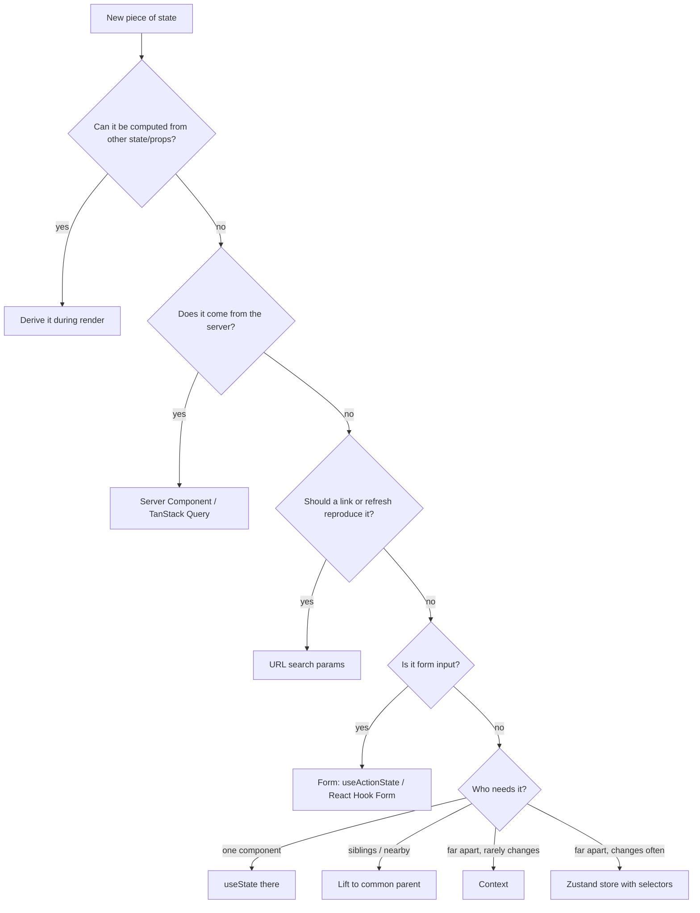

::part[Learn the Concept]{n="1"}

## 🎯 What you'll learn

- The **kinds of state** in a web app and their natural homes
- A **decision guide** you can apply in code reviews
- **URL state** in Next.js: parsing and validating search params, `push` vs `replace`, keeping typing fast
- **Derived state** — values you should compute, not store
- Lifting state up vs pushing it down (colocation)
- Refactors that fix common "state in the wrong place" bugs

## 🧠 The big idea

State is like **belongings in a house**. Your passport (server data) is kept in the bank's vault — you carry a **copy**. The house address (URL) is what you give friends so they arrive at the same place. Your shopping list (form input) is on the fridge until you go shopping. The TV remote (local UI state) stays in the living room. Putting things in the wrong place — the passport on the fridge, the remote in the vault — makes daily life painful.

## ❓ Why does this exist?

Most React bugs and complexity come from state that's **duplicated**, **in the wrong place** or **too global**: stale copies of server data, filters lost on refresh, a global store re-rendering the whole app on every keystroke, effects syncing two states that should be one.

## 💥 What happens if we DON'T?

```tsx
"use client";
export function JobSearch() {
  const [jobs, setJobs] = useState<Job[]>([]);                // server data copy, never refreshed
  const [query, setQuery] = useState("");                     // shareable filter lost on refresh
  const [filtered, setFiltered] = useState<Job[]>([]);        // derived → out of sync
  const [count, setCount] = useState(0);                      // derived → out of sync
  useEffect(() => { setFiltered(jobs.filter((j) => j.title.includes(query))); setCount(filtered.length); }, [jobs, query]);  // stale count bug
  …
}
```

## 📖 How it works, step by step

### 1. The kinds of state

| Kind | Examples | Home |
|---|---|---|
| **Server state** | jobs, applications, current user | Server Components (fetch at request), **TanStack Query** in the browser — the API/DB is the source of truth |
| **URL state** | search, filters, sort, page, selected tab to share | `searchParams` / `useSearchParams` |
| **Form state** | typed values, validation errors, pending | the form: `useActionState`, React Hook Form |
| **Local UI state** | dropdown open, hover, input draft | `useState` in the component that uses it |
| **Shared UI state** (nearby) | selected row used by list + details panel | lift to the nearest common parent |
| **Shared UI state** (far apart) | theme, toast API, compare tray | Context (rarely changes) or **Zustand** (changes often) |
| **Derived state** | filtered list, counts, "can submit" | **compute during render** — don't store |
| **Session/auth** | who is logged in | httpOnly cookie on the server; a DTO passed down |

### 2. A decision guide



### 3. URL state properly

**Parse and validate** — the URL is user input:

```ts
export function parseJobFilters(input: URLSearchParams | Record<string, string | string[] | undefined>): JobFilters {
  const first = (k: string) => (input instanceof URLSearchParams ? input.get(k) ?? undefined : [input[k]].flat()[0]);
  const page = Number(first("page"));
  return {
    q: (first("q") ?? "").trim().slice(0, 100),
    status: oneOf(["open", "closed", "all"], first("status"), "open"),
    remote: first("remote") === "1",
    sort: oneOf(["newest", "salary"], first("sort"), "newest"),
    page: Number.isInteger(page) && page >= 1 ? page : 1,
  };
}
```

The **same parser** runs on the server (`await searchParams` in the page, to fetch data) and on the client (`useSearchParams()` in the filter bar). Serialize without defaults so URLs stay short and stable.

**Push or replace?**

| Change | Method | Why |
|---|---|---|
| status, sort, remote, page | `router.push` | users expect Back to undo it |
| each keystroke in search (debounced) | `router.replace` | no history entry per letter |

**Keep typing instant**: the input has **local** state; the URL is updated after a pause. When the URL changes from outside (Back button), the input adopts it.

```tsx
const [draft, setDraft] = useState(filters.q);
const [syncedQ, setSyncedQ] = useState(filters.q);
if (filters.q !== syncedQ) { setSyncedQ(filters.q); setDraft(filters.q); }   // adjust state during render when the source changes

useEffect(() => {
  if (draft.trim() === filters.q) return;
  const t = setTimeout(() => setFilters({ q: draft }, { history: "replace" }), 300);
  return () => clearTimeout(t);
});
```

Reset `page` to 1 whenever another filter changes. In the App Router, changing search params re-renders the Server Component page with new data — wrap slow parts in `<Suspense>` and use `useTransition`/`useLinkStatus` to show pending UI. Libraries like **nuqs** package this pattern with typed parsers.

### 4. Derived state

```tsx
const visibleJobs = jobs.filter((j) => matches(j, filters));   // no useState, no useEffect
const count = visibleJobs.length;
const canCompare = selectedIds.length >= 2;
```

Use `useMemo` only if the computation is measurably expensive.

### 5. Lift up, push down

- **Lift** state to the nearest common parent when two components must agree.
- **Push down** (colocate) state that only one component uses — a search draft in the page component re-renders the whole page on every keystroke.
- Use `key` to reset state when identity changes: `<NotesEditor key={applicationId} />`.

### 6. Server state is a cache, not your state

Don't copy API data into `useState`/Zustand and mutate it. Fetch in Server Components or TanStack Query, mutate through Server Actions/mutations, and **invalidate** (`updateTag`, `invalidateQueries`) so the source of truth wins.

## ⚖️ Trade-offs

| Home | ✅ | ❌ |
|---|---|---|
| URL | shareable, bookmarkable, Back works, server can read it | strings only, visible, length limits; needs parsing |
| Local state | simple, fast, private | lost on unmount/refresh |
| Context | no prop drilling | re-renders consumers; no selectors |
| Zustand | selectors, outside React | another dependency; tempting to overuse |
| TanStack Query | caching, refetching, dedupe | concepts to learn; client JS |
| Server Components | no client JS, secure | request-time only; interactivity needs client islands |

## ✅ When to use it / 🚫 When NOT to use it

- ✅ Run the decision guide in code review for every new `useState` or store field.
- ✅ URL for anything a user might share, bookmark or expect Back to restore.
- 🚫 Don't put secrets or personal data in URLs (they end up in logs and analytics).
- 🚫 Don't create a global store "for later".

## 🏆 Best practices

- [ ] One source of truth per piece of data; derive the rest.
- [ ] Server data via Server Components or TanStack Query — never hand-synced copies.
- [ ] Shareable filters in the URL, parsed and validated with one shared function.
- [ ] `push` for discrete choices, `replace` for continuous input; reset pagination on filter changes.
- [ ] Colocate state as low as possible; lift only when needed.
- [ ] Context for stable app-wide values; Zustand with selectors for frequently changing shared client state.
- [ ] No `useEffect` whose only job is to copy one state into another.

## 🏭 How it's used in industry

- E-commerce, job boards and dashboards keep filters in the URL for SEO, sharing and analytics; `nuqs` is a popular Next.js library for type-safe search params.
- The "server state vs client state" split popularized by TanStack Query changed how teams use Redux — many removed most of their global store.
- Code review checklists at many companies include "is this state derivable?" and "should this be in the URL?".

## ⚠️ Common mistakes

- Storing derived values and syncing them with effects.
- Pushing a history entry per keystroke — Back becomes useless.
- Trusting `searchParams` without validation (`page=-1`, `sort=DROP TABLE`).
- Copying props into state (`useState(props.value)`) and wondering why it doesn't update.
- Using Zustand/Context as a cache for API data.

::part[Explain & Design]{n="2"}

## 🗣️ Explain it

Using the house analogy, explain to a junior developer why the job list shouldn't be copied into a Zustand store and why filters belong in the URL.

## 📐 Design it

Audit CareerPilot's **application detail page** state and assign each item a home: application data, status history, notes list, the "new note" textarea, "move to" selection, the active tab (Notes/History/AI match), whether the delete dialog is open, a toast after saving, the AI match score (slow, costs money), and "unsaved changes" warning for notes.

:::quiz
Show a possible answer

| State | Home | Reason |
|---|---|---|
| Application, history, notes | Server Component (DAL) + `revalidatePath`/`updateTag` after actions | server truth, no client copy |
| New note text | the form (uncontrolled, reset after success) | form state |
| "Move to" selection | form field inside the status form | form state, submitted with the action |
| Active tab | URL `?tab=history` (with `replace`) | shareable ("look at the history"), survives refresh |
| Delete dialog open | local state in the dialog component (Radix) | local UI |
| Toast after save | toast context API (or flash cookie for redirects) | app-wide, rarely changes |
| AI match score | Server Component with `"use cache"` + `cacheTag(\`match:${id}\`)`, streamed in `<Suspense>`; recalculated via Server Action | slow, expensive server state |
| Unsaved changes | derived: `draft !== savedValue` in the notes form | never stored separately |
:::

### 📝 Self-review checklist

- [ ] No server data copied into client state
- [ ] Derived values not stored
- [ ] Shareable UI state in the URL

::ai-review{task="design"}

::part[Toy Exercise]{n="3"}

:::exercise{path="exercises/web/architecture/g-frontend-patterns/04-where-state-lives" ai="no-ai" title="Move job filters into the URL"}
Write a validating parser and a canonical serializer for job filters, a `useJobFilters` hook on top of Next.js navigation (push vs replace, page reset, no-op detection), and a filter bar whose search box stays instant with local state and a debounced URL update.
:::

:::hints
- The parser must accept both `URLSearchParams` and a plain `searchParams` object.
- Compare serialized query strings to detect "nothing changed".
- Adjusting state during render (`if (source changed) setState(...)`) avoids an effect for syncing the draft.
:::

## ✅ Quick check

:::quiz
A filtered list and its count are both in `useState`, updated by an effect. What's the fix?

Delete both states and the effect; compute `filtered = items.filter(...)` and `filtered.length` during render.
:::

:::quiz
Why use `router.replace` (not `push`) while the user types in a search box?

`push` would add a history entry per update, so the Back button would step through partial searches instead of returning to the previous page.
:::

## 📖 Kamus (glossary)

| Term | Bahasa Indonesia |
|---|---|
| Server state | State milik server (data dari API) |
| URL state | State yang disimpan di URL |
| Derived state | State turunan (dihitung dari data lain) |
| Colocation | Menempatkan state dekat dengan pemakainya |
| Source of truth | Sumber kebenaran data |
| Lifting state up | Mengangkat state ke komponen induk |

## 📚 Keep learning

- [React docs: Choosing the State Structure](https://react.dev/learn/choosing-the-state-structure) · [Sharing State Between Components](https://react.dev/learn/sharing-state-between-components)
- [TkDodo: Practical React Query — server vs client state](https://tkdodo.eu/blog/practical-react-query)
- [nuqs: type-safe search params for Next.js](https://nuqs.dev)
- Next.js docs (bundled): `useSearchParams`; `useRouter`
