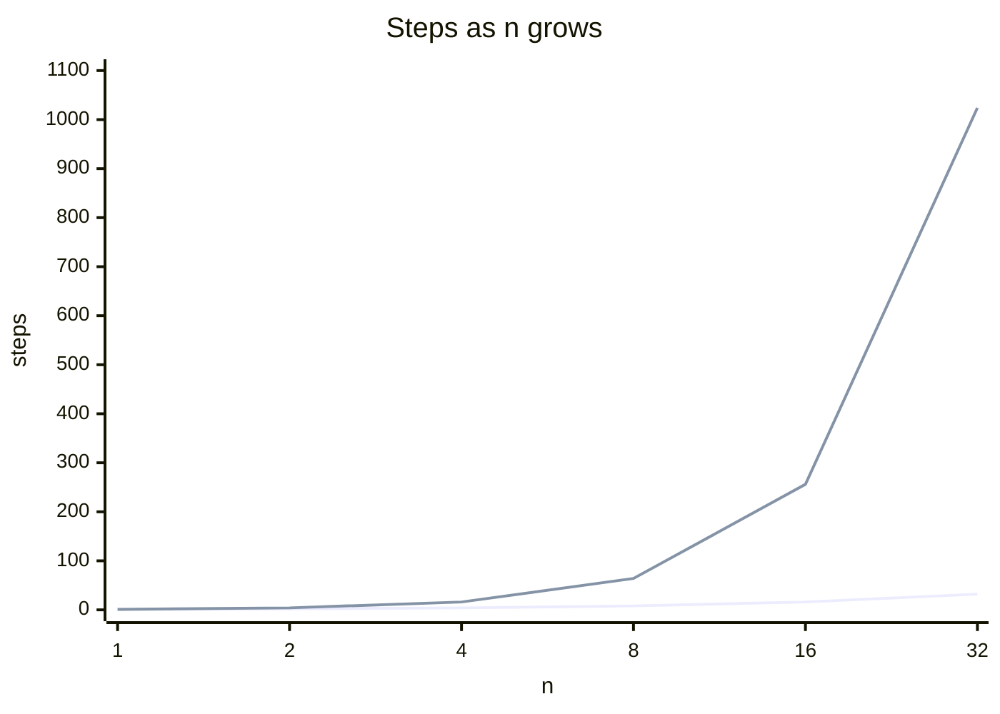

::part[Pelajari Konsepnya]{n="1"}

## 🎯 Yang akan kamu pelajari

- Apa yang :term[Big-O]{bahasa="notasi Big-O — cara menggambarkan seberapa cepat waktu/memori bertambah saat data bertambah"} ukur (dan apa yang diabaikan)
- Kelas umum: O(1), O(log n), O(n), O(n log n), O(n²), O(2ⁿ)
- Cara mencari Big-O kode dengan membacanya
- **Space** complexity, bukan hanya waktu
- Trade-off klasik: pakai memori (set/dict) untuk hemat waktu

## 🔤 Istilah penting

| Istilah | Artinya (sederhana) |
|---|---|
| **Big-O** | Seberapa cepat waktu atau memori bertambah saat data bertambah |
| **Input size (n)** | Berapa banyak item yang kamu kerjakan |
| **O(1) constant** | Biaya sama tidak peduli data seberapa besar |
| **O(log n)** | Biaya tumbuh sangat lambat — berkurang setengah setiap langkah |
| **O(n) linear** | Data dua kali lipat, kerja dua kali lipat |
| **O(n log n)** | Biaya pengurutan yang baik |
| **O(n²) quadratic** | Setiap data dibanding dengan setiap data |
| **Space complexity** | Berapa banyak memori ekstra yang algoritma butuhkan |
| **Trade-off** | Pakai lebih banyak memori untuk hemat waktu, atau sebaliknya |

## 🧠 Ide besarnya

Big-O tidak bilang "ini butuh 3 detik". Big-O bilang **seberapa cepat waktu bertambah saat input bertambah**.

Bayangkan mengantar undangan:

| Strategi | 10 tamu | 1.000 tamu | Pertumbuhan |
|---|---|---|---|
| Tempel 1 pengumuman di papan kantor | 1 perjalanan | 1 perjalanan | **O(1)** — tetap |
| Jalan ke meja setiap tamu | 10 perjalanan | 1.000 perjalanan | **O(n)** — sebanding |
| Setiap tamu berkenalan dengan semua tamu | 100 jabat tangan | 1.000.000 jabat tangan | **O(n²)** — kuadrat |

Pada data kecil semuanya terasa cepat. Big-O bilang apa yang terjadi **pada data sebenarnya**.

## ❓ Kenapa ini penting

Komputer punya kecepatan berbeda, begitu juga bahasa pemrograman. Kita butuh cara untuk membanding **algoritma**, bukan mesin. Big-O jawab satu pertanyaan: *"Kalau data ku bertambah 10× tahun depan, apakah kode ini 10× lebih lambat, 100× lebih lambat, atau tidak lambat sama sekali?"*

Ini juga bahasa bersama di interview: *"Bisa lebih cepat dari O(n²)?"*

Dan penting di produk sungguhan, bukan cuma interview. Kode yang lancar dengan 200 baris di laptopmu bisa mogok server dengan 200.000 baris — kode sama, skala beda.

## 📖 Langkah demi langkah

### 1. Kelas kompleksitas utama

| Big-O | Nama | Contoh | n = 1.000.000 → langkah |
|---|---|---|---|
| O(1) | constant | `d[key]`, `list[i]`, `x in set` | 1 |
| O(log n) | logarithmic | binary search | ~20 |
| O(n) | linear | satu loop di atas list | 1.000.000 |
| O(n log n) | linearithmic | pengurutan baik (`sorted`) | ~20.000.000 |
| O(n²) | quadratic | loop di dalam loop atas data yang sama | 10¹² |
| O(2ⁿ) | exponential | coba setiap subset | mustahil |



*(Garis bawah: O(n). Garis atas: O(n²).)*

### 2. Aturan membaca kode

**Aturan 1 — Langkah berturut-turut ditambah, kemudian ambil yang terbesar:**

```python
for x in items: ...      # O(n)
for y in items: ...      # O(n)
# O(n + n) = O(2n) → O(n)   (constants are dropped)
```

**Aturan 2 — Loop bersarang kalikan:**

```python
for x in items:          # n times
    for y in items:      #   n times each
        ...
# O(n × n) = O(n²)
```

**Aturan 3 — Input berbeda dapat huruf berbeda:**

```python
for job in jobs:             # n
    for skill in skills:     # m
        ...
# O(n × m) — not O(n²)
```

**Aturan 4 — Berkurang setengah setiap langkah adalah O(log n)** (binary search).

**Aturan 5 — Tahu biaya built-in mu.** Mereka sembunyikan loop!

| Operasi | list | set / dict |
|---|---|---|
| `x in` | **O(n)** | O(1) rata-rata |
| ambil index / key | O(1) | O(1) rata-rata |
| `append` / add | O(1) | O(1) rata-rata |
| `insert(0, x)` / `pop(0)` | **O(n)** (geser semuanya) | — |
| `sorted(...)` | O(n log n) | — |
| `list.remove(x)` | **O(n)** | O(1) rata-rata untuk `set.remove` |

```python
for email in new_emails:          # n
    if email in existing_list:    # O(m) hidden loop!
        ...
# O(n × m). Make existing a set → O(n).
```

### 3. Buang konstanta dan suku kecil

Big-O tentang **bentuk** pertumbuhan, bukan angka pasti: 3n + 50 dan n keduanya gambar garis lurus yang sama saat n besar, jadi keduanya O(n).

`O(3n + 20)` → `O(n)`. `O(n² + n)` → `O(n²)`. Big-O peduli dengan **bentuk** pertumbuhan saat n besar; konstanta penting dalam praktik, tapi mereka tidak ubah kelasnya.

### 4. Terbaik, rata-rata, terburuk

Pencarian linear untuk sesuatu di posisi 0 cepat (kasus terbaik), tapi Big-O biasanya jelaskan **kasus terburuk** — apa yang bisa kamu jamin.

### 5. Space complexity

Waktu bukan satu-satunya anggaran. Solusi yang dua kali lebih cepat tapi simpan salinan seluruh file di memori bisa jadi pilihan salah di server kecil.

Berapa banyak **memori ekstra** yang algoritma butuhkan saat n bertambah?

```python
def has_duplicate(emails):
    seen = set()              # can grow to n items → O(n) space
    for email in emails:      # O(n) time
        if email in seen:
            return True
        seen.add(email)
    return False
```

Versi nested-loop: O(n²) time, **O(1)** space. Versi set: O(n) time, **O(n)** space. Itu trade-off paling umum di DSA: **memori untuk kecepatan**.

### Pilih pengaturanmu

Setiap pilihan di sini adalah trade-off:

| Pilihan | Waktu | Memori | Kapan patut dilakukan |
|---|---|---|---|
| Nested loop | O(n²) | O(1) | input sangat kecil, memori sangat ketat |
| Set/dict lookup | O(n) | O(n) | hampir selalu untuk n > beberapa ribu |
| Urut dulu, kemudian scan | O(n log n) | O(1)–O(n) | saat urutan juga bantu (tetangga, jarak) |

Big-O bukan segalanya: algoritma O(n) dengan konstanta besar bisa kalah dari O(n log n) pada ukuran nyata. **Ukur** saat penting.

- ✅ Perkirakan kompleksitas kode apa pun yang jalan di data user, di loop, atau di setiap request.
- ✅ Tanya: *n di production berapa?* (100? 10 juta?)
- 🚫 Jangan micro-optimize kode yang jalan sekali di 50 item.
- 🚫 Jangan klaim "O(1)" untuk `x in my_list`.


## ⚠️ Kesalahan umum

- Hitung baris kode, bukan seberapa sering mereka jalan.
- Lupa hidden loop (`in` di list, `.index`, `.count`, slicing, penggabungan string di loop).
- Bilang O(n²) untuk dua **loop terpisah** (itu O(n)).
- Pakai n untuk dua input berbeda.

::part[Jelaskan & Rancang]{n="2"}

## 🗣️ Jelaskan

Jelaskan ke orang yang bukan programmer kenapa "cek setiap pasang" jadi sangat lambat saat kelompok besar, sementara "tulis nama di daftar tamu dan cek daftar" tidak. Pakai angka sungguhan.

## 📐 Rancang

Beri waktu **dan** space complexity masing-masing, kemudian usul versi lebih cepat untuk yang lambat:

```python
# A
def common_skills(a: list[str], b: list[str]) -> list[str]:
    return [skill for skill in a if skill in b]

# B
def last_item(items):
    return items[-1]

# C
def count_pairs_summing_to(nums, target):
    count = 0
    for i in range(len(nums)):
        for j in range(i + 1, len(nums)):
            if nums[i] + nums[j] == target:
                count += 1
    return count
```

:::quiz
Lihat jawaban

- **A**: O(n·m) time (hidden `in` di list `b`), O(k) space untuk hasil. Lebih cepat: `b_set = set(b)` → O(n + m) time, O(m) memori ekstra.
- **B**: O(1) time, O(1) space.
- **C**: O(n²) time, O(1) space. Lebih cepat: loop sekali dengan dict dari *jumlah yang sudah dilihat*; untuk setiap `x`, tambah `seen.get(target - x, 0)` ke jumlah, kemudian catat `x` → O(n) time, O(n) space.
:::

### 📝 Checklist self-review

- [ ] Aku menemukan hidden loop di A
- [ ] Aku beri space complexity juga, bukan hanya waktu
- [ ] Versi lebih cepat ku trade memori untuk waktu — dan aku sebutkan
- [ ] Ini

::ai-review{task="design"}

::part[Latihan Kecil]{n="3"}

:::problem{id="dsa-s1-pair-sum" title="Pasang Dengan Target Sum" difficulty="easy" path="exercises/dsa/stage-1/01-pair-sum"}
Beri list bilangan bulat dan target, kembalikan `True` jika **dua posisi berbeda** jumlahnya sama target.

Test-nya ada list 20.000 angka dan perlu selesai kurang dari setengah detik — solusi O(n²) akan gagal. Usahakan **O(n) time**.
:::

:::problem{id="dsa-s1-first-unique" title="Karakter Unik Pertama" difficulty="easy" path="exercises/dsa/stage-1/02-first-unique"}
Kembalikan index karakter pertama di string yang muncul **tepat sekali**, atau `-1`. `"pipeline"` → `4` (`l` — `p`, `i` dan `e` semua berulang). Usahakan **O(n) time**. Sebutkan space complexity mu.
:::

:::hints
- Pair sum: untuk setiap angka `x`, angka apa yang kamu mesti sudah **lihat sebelumnya**?
- Karakter unik: dua pass masih O(n). Hitung dulu, kemudian cari.
:::

## ✅ Cek cepat

:::quiz
Apa kompleksitas loop di atas `n` item yang, di dalamnya, lakukan binary search di list `m` item yang sudah urut?

O(n log m).
:::

:::quiz
Kenapa kita buang konstanta — kenapa O(2n) itu hanya O(n)?

Big-O jelaskan seberapa cepat waktu bertambah saat input bertambah. Gandakan konstanta tidak ubah bentuk linear; untuk n besar, pertumbuhan kelas dominasi.
:::

:::quiz
Kamu bikin lookup list di dalam loop lebih cepat dengan ubah list jadi set dulu. Apa yang kamu trade?

Memori: set pakai O(m) memori ekstra, dan membuat set harga O(m) sekali — sebagai imbalannya, setiap lookup turun dari O(m) ke O(1) rata-rata.
:::


## 📚 Lanjut belajar

- [Python wiki: TimeComplexity of built-in types](https://wiki.python.org/moin/TimeComplexity)
- [Big-O Cheat Sheet](https://www.bigocheatsheet.com/)
