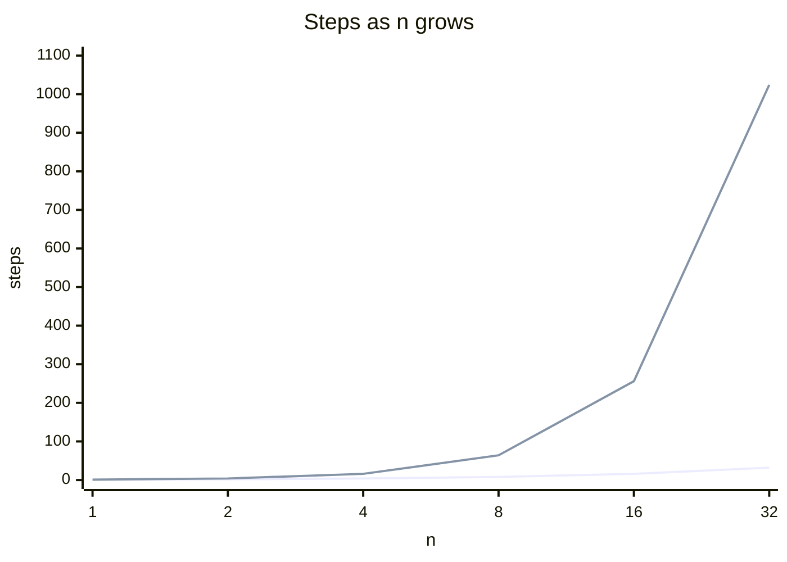

::part[Learn the Concept]{n="1"}

## 🎯 What you'll learn

- What :term[Big-O]{bahasa="notasi Big-O — cara menggambarkan seberapa cepat waktu/memori bertambah saat data bertambah"} measures (and what it ignores)
- The common classes: O(1), O(log n), O(n), O(n log n), O(n²), O(2ⁿ)
- How to find the Big-O of code by reading it
- **Space** complexity, not just time
- The classic trade: use memory (a set/dict) to save time

## 🔤 Key words

| Word | In simple words | Bahasa Indonesia |
|---|---|---|
| **Big-O** | How the time or memory grows when the data grows | Pertumbuhan waktu/memori |
| **Input size (n)** | How many items you're working with | Banyaknya data |
| **O(1) constant** | Same cost no matter how big the data is | Biaya tetap |
| **O(log n)** | Cost grows very slowly — halving each step | Tumbuh sangat lambat |
| **O(n) linear** | Twice the data, twice the work | Sebanding data |
| **O(n log n)** | The cost of good sorting | Biaya pengurutan baik |
| **O(n²) quadratic** | Every item compared with every item | Setiap data dibanding semua |
| **Space complexity** | How much extra memory the algorithm needs | Kebutuhan memori |
| **Trade-off** | Using more memory to save time, or the reverse | Tukar memori dengan waktu |

## 🧠 The big idea

Big-O doesn't tell you "this takes 3 seconds". It tells you **how the time grows when the input grows**.

Think of delivering invitations:

| Strategy | 10 guests | 1,000 guests | Growth |
|---|---|---|---|
| Post one notice on the office board | 1 trip | 1 trip | **O(1)** — constant |
| Walk to each guest's desk | 10 trips | 1,000 trips | **O(n)** — linear |
| Each guest introduces themselves to every other guest | 100 handshakes | 1,000,000 handshakes | **O(n²)** — quadratic |

On small data everything feels fast. Big-O tells you what happens **on real data**.

## ❓ Why it matters

Computers differ in speed, and so do programming languages. We need a way to compare **algorithms**, not machines. Big-O answers one question: *"If my data grows 10× next year, will this code be 10× slower, 100× slower, or not slower at all?"*

It's also the shared language of interviews: *"Can you do better than O(n²)?"*

And it matters in real products, not just interviews. Code that is fine with 200 rows on your laptop can lock up the server at 200,000 rows — same code, different scale.

## 📖 Step by step

### 1. The main complexity classes

| Big-O | Name | Example | n = 1,000,000 → steps |
|---|---|---|---|
| O(1) | constant | `d[key]`, `list[i]`, `x in set` | 1 |
| O(log n) | logarithmic | binary search | ~20 |
| O(n) | linear | one loop over the list | 1,000,000 |
| O(n log n) | linearithmic | good sorting (`sorted`) | ~20,000,000 |
| O(n²) | quadratic | loop inside a loop over the same data | 10¹² |
| O(2ⁿ) | exponential | trying every subset | impossible |



*(Lower line: O(n). Upper line: O(n²).)*

### 2. Rules for reading code

**Rule 1 — Sequential steps add, then keep the biggest:**

```python
for x in items: ...      # O(n)
for y in items: ...      # O(n)
# O(n + n) = O(2n) → O(n)   (constants are dropped)
```

**Rule 2 — Nested loops multiply:**

```python
for x in items:          # n times
    for y in items:      #   n times each
        ...
# O(n × n) = O(n²)
```

**Rule 3 — Different inputs get different letters:**

```python
for job in jobs:             # n
    for skill in skills:     # m
        ...
# O(n × m) — not O(n²)
```

**Rule 4 — Halving the problem each step is O(log n)** (binary search).

**Rule 5 — Know your built-ins' costs.** They hide loops!

| Operation | list | set / dict |
|---|---|---|
| `x in` | **O(n)** | O(1) average |
| get by index / key | O(1) | O(1) average |
| `append` / add | O(1) | O(1) average |
| `insert(0, x)` / `pop(0)` | **O(n)** (shifts everything) | — |
| `sorted(...)` | O(n log n) | — |
| `list.remove(x)` | **O(n)** | O(1) average for `set.remove` |

```python
for email in new_emails:          # n
    if email in existing_list:    # O(m) hidden loop!
        ...
# O(n × m). Make existing a set → O(n).
```

### 3. Drop constants and small terms

Big-O is about the **shape** of the growth, not the exact number: 3n + 50 and n both draw the same straight line once n is large, so both are O(n).

`O(3n + 20)` → `O(n)`. `O(n² + n)` → `O(n²)`. Big-O cares about the **shape** of growth as n gets huge; constants matter in practice, but they don't change the class.

### 4. Best, average, worst

Linear search for something at position 0 is fast (best case), but Big-O usually describes the **worst case** — what you can promise.

### 5. Space complexity

Time isn't the only budget. A solution that's twice as fast but keeps a copy of the whole file in memory can still be the wrong choice on a small server.

How much **extra memory** does the algorithm use as n grows?

```python
def has_duplicate(emails):
    seen = set()              # can grow to n items → O(n) space
    for email in emails:      # O(n) time
        if email in seen:
            return True
        seen.add(email)
    return False
```

Nested-loop version: O(n²) time, **O(1)** space. Set version: O(n) time, **O(n)** space. That's the most common trade in DSA: **memory for speed**.

### Choosing your setup

Every option here is a trade-off:

| Choice | Time | Space | When it's worth it |
|---|---|---|---|
| Nested loops | O(n²) | O(1) | tiny inputs, memory is extremely tight |
| Set/dict lookup | O(n) | O(n) | almost always for n > a few thousand |
| Sort first, then scan | O(n log n) | O(1)–O(n) | when order also helps (neighbors, ranges) |

Big-O is not everything: an O(n) algorithm with a huge constant can lose to O(n log n) on real sizes. **Measure** when it matters.

- ✅ Estimate complexity for any code that runs on user data, in loops, or on every request.
- ✅ Ask: *what's n in production?* (100? 10 million?)
- 🚫 Don't micro-optimize code that runs once on 50 items.
- 🚫 Don't claim "O(1)" for `x in my_list`.


## ⚠️ Common mistakes

- Counting lines of code instead of how often they run.
- Forgetting hidden loops (`in` on lists, `.index`, `.count`, slicing, string concatenation in loops).
- Saying O(n²) for two **separate** loops (it's O(n)).
- Using n for two different inputs.

::part[Explain & Design]{n="2"}

## 🗣️ Explain it

Explain to a non-programmer why "checking every pair" becomes painfully slow as a group grows, while "writing names on a guest list and checking it" doesn't. Use actual numbers.

## 📐 Design it

Give the time **and** space complexity of each, then propose a faster version for the slow one(s):

```python
# A
def common_skills(a: list[str], b: list[str]) -> list[str]:
    return [skill for skill in a if skill in b]

# B
def last_item(items):
    return items[-1]

# C
def count_pairs_summing_to(nums, target):
    count = 0
    for i in range(len(nums)):
        for j in range(i + 1, len(nums)):
            if nums[i] + nums[j] == target:
                count += 1
    return count
```

:::quiz
Show answers

- **A**: O(n·m) time (hidden `in` on list `b`), O(k) space for the result. Faster: `b_set = set(b)` → O(n + m) time, O(m) extra space.
- **B**: O(1) time, O(1) space.
- **C**: O(n²) time, O(1) space. Faster: loop once with a dict of *counts seen so far*; for each `x`, add `seen.get(target - x, 0)` to the count, then record `x` → O(n) time, O(n) space.
:::

### 📝 Self-review checklist

- [ ] I spotted the hidden loop in A
- [ ] I gave space complexity too, not only time
- [ ] My faster versions trade memory for time — and I said so

::ai-review{task="design"}

::part[Practice Problems]{n="3"}

:::problem{id="dsa-s1-pair-sum" title="Pair With Target Sum" difficulty="easy" path="exercises/dsa/stage-1/01-pair-sum"}
Given a list of integers and a target, return `True` if **two different positions** add up to the target.

The tests include a list of 20,000 numbers and require it to finish in under half a second — an O(n²) solution will fail. Aim for **O(n) time**.
:::

:::problem{id="dsa-s1-first-unique" title="First Unique Character" difficulty="easy" path="exercises/dsa/stage-1/02-first-unique"}
Return the index of the first character in a string that appears **exactly once**, or `-1`. `"pipeline"` → `4` (`l` — `p`, `i` and `e` all repeat). Aim for **O(n) time**. State your space complexity.
:::

:::hints
- Pair sum: for each number `x`, what number would you need to have **seen before**?
- First unique: two passes are still O(n). Count first, then find.
:::

## ✅ Quick check

:::quiz
What's the complexity of a loop over `n` items that, inside, does binary search on a sorted list of `m` items?

O(n log m).
:::

:::quiz
Why do we drop constants — why is O(2n) just O(n)?

Big-O describes how time grows as input grows. Doubling the constant doesn't change the linear shape; for large n, the growth class dominates.
:::

:::quiz
You make a list lookup inside a loop faster by converting the list to a set first. What did you trade?

Memory: the set uses O(m) extra space, and building it costs O(m) once — in exchange, each lookup drops from O(m) to O(1) average.
:::


## 📚 Keep learning

- [Python wiki: TimeComplexity of built-in types](https://wiki.python.org/moin/TimeComplexity)
- [Big-O Cheat Sheet](https://www.bigocheatsheet.com/)
