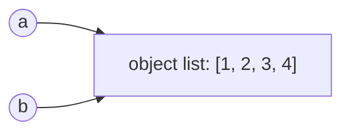

::part[Pelajari Konsepnya]{n="1"}

## 🎯 Yang akan kamu pelajari

- Variabel memegang **reference** (panah), bukan kotak berisi data
- Tipe **mutable** vs **immutable**, dan kenapa itu penting
- Bug **aliasing**: dua nama, satu object
- Shallow vs deep **copy**
- Cara Python list disimpan (dynamic array) dan kenapa `append` cepat tapi `insert(0, …)` lambat

## 🔤 Istilah penting

| Istilah | Artinya (sederhana) |
|---|---|
| **Reference** | Sebuah nama menunjuk ke object, bukan salinannya |
| **Aliasing** | Dua nama menunjuk ke object yang sama |
| **Mutable** | Bisa diubah isinya di tempat (list, dict, set) |
| **Immutable** | Tidak bisa diubah; kamu dapat object baru (str, tuple, int) |
| **`is` vs `==`** | Object sama vs nilai sama |
| **Shallow copy** | Salinan container luar, sharing object dalam |
| **Deep copy** | Salinan sampai ke dalam, tidak sharing apa pun |
| **Dynamic array** | Cara Python list tumbuh: ruang ekstra di belakang |
| **Garbage collection** | Python membebaskan object yang tidak ada yang tunjuk lagi |

## 🧠 Ide besarnya

Di Python, variabel adalah **panah** menunjuk ke object di memori — bukan kotak yang berisi object.

```python
a = [1, 2, 3]
b = a          # b points at THE SAME list
b.append(4)
print(a)       # [1, 2, 3, 4] 😮
```



Dua nama, satu list. Ubah melalui salah satu nama dan keduanya "lihat" perubahannya. Itu namanya :term[aliasing]{bahasa="aliasing — dua nama variabel menunjuk object yang sama di memori"}.

## ❓ Kenapa ini penting

Kalau setiap kali kirim data ke fungsi harus copy data besar itu, akan lambat dan buang memori. Jadi Python kirim **reference**: murah dan cepat — tapi mengejutkan kalau kamu tidak tahu.

Ini yang di belakang bug paling membingungkan pemula:

- Kamu "copy" list, ubah copynya, tapi list asli berubah juga.
- Fungsi seharusnya hanya baca dict, tapi data pengguna kembali berubah.
- Argumen default `def add(item, cart=[])` tetap simpan item dari panggilan sebelumnya, karena list dibuat sekali.

Tahu bahwa nama itu panah, bukan kotak, menjelaskan ketiga masalah sekaligus.

## 📖 Langkah demi langkah

### 1. `==` vs `is`

```python
a = [1, 2]
b = [1, 2]
c = a
print(a == b)   # True  — same VALUE
print(a is b)   # False — different OBJECTS
print(a is c)   # True  — same object
```

Pakai `==` untuk bandingkan nilai. Pakai `is` hanya untuk singleton seperti `None`: `if value is None:`.

### 2. Mutable vs immutable

| Immutable (tidak bisa diubah di tempat) | Mutable (bisa diubah di tempat) |
|---|---|
| `int`, `float`, `bool`, `str`, `tuple`, `None` | `list`, `dict`, `set`, kebanyakan object |

"Mengubah" nilai immutable sebenarnya membuat **object baru** dan menggerakkan panah:

```python
name = "ana"
other = name
name = name.upper()     # new string "ANA"; `name` now points at it
print(other)            # "ana" — unaffected
```

Dengan object mutable, method seperti `.append()` mengubah **object yang sama** — setiap alias lihatnya.

### 3. Argumen fungsi juga reference

```python
def add_bonus(salaries):
    salaries.append(1_000_000)    # mutates the caller's list!

def with_bonus(salaries):
    return salaries + [1_000_000] # creates a NEW list; caller's list untouched
```

Suka fungsi yang **kembalikan data baru** kecuali mutasi adalah tujuan eksplisit (dan nama bilang begitu).

### 4. Shallow vs deep copy

Shallow copy adalah **envelope baru dengan foto yang sama di dalamnya**: robek satu foto dan dua envelope lihat kerusakannya. Deep copy fotokopi foto-fotonya juga.

```python
import copy

original = [[1, 2], [3, 4]]

shallow = original.copy()        # or list(original), original[:]
shallow[0].append(99)
print(original)                  # [[1, 2, 99], [3, 4]] — inner lists are SHARED

deep = copy.deepcopy(original)
deep[0].append(42)
print(original)                  # unchanged
```

| Copy | Copy apa | Object bersarang |
|---|---|---|
| Assign `b = a` | tidak ada | shared |
| Shallow `a.copy()` | container luar | **tetap shared** |
| Deep `copy.deepcopy(a)` | semuanya, rekursif | independen |

Buat grid aman: `grid = [[0] * 3 for _ in range(3)]` — baris list **baru** setiap kali.

### 5. Cara list hidup di memori

Ini kenapa `append` murah dan `insert(0, …)` tidak: tambah di belakang pakai ruang yang sudah reserved, sedangkan tambah di depan geser setiap item satu tempat.

Python list adalah **dynamic array**: blok slot berjajar, setiap slot tahan satu reference.

```text
index:   0     1     2     3    [spare][spare]
       [ → ] [ → ] [ → ] [ → ]
```

- `items[i]` → lompat langsung ke slot i → **O(1)**
- `append(x)` → pakai spare slot → **O(1)** (kadang array tumbuh ke blok lebih besar, tapi rata-rata masih O(1))
- `insert(0, x)` / `pop(0)` → geser **setiap** element satu slot → **O(n)**

Butuh tambah/hapus cepat di **dua** ujung? Pakai `collections.deque`.

### 6. Garbage collection

Kalau tidak ada panah tunjuk ke object lagi, Python bebas memorinya otomatis. Jarang-jarang kamu manage memori dengan tangan di Python — tapi kamu perlu tahu **siapa lain yang tunjuk** data kamu.

### Pilih setup kamu

Setiap pilihan di sini ada trade-off:

| Pilihan | ✅ | ❌ |
|---|---|---|
| Mutasi di tempat | Tidak copy, memori rendah | Kejutan untuk reference lain |
| Kembalikan object baru | Prediktabel, mudah test | Memori dan waktu copy ekstra |
| Shallow copy | Murah | Data bersarang tetap shared |
| Deep copy | Sepenuhnya independen | Lambat dan memori berat untuk struktur besar |
| Tuple ganti list untuk data tetap | Tidak bisa dimutasi kebetulan | Tidak bisa diubah saat butuh |

- ✅ Treat argumen input sebagai **read-only** sebagai default.
- ✅ Pakai tuple atau data frozen untuk nilai yang tidak boleh berubah (config, constant).
- ✅ Mutasi di tempat dengan sengaja untuk performa data besar — dan dokumentasikan.
- 🚫 Jangan pernah pakai argumen default mutable.
- 🚫 Jangan `deepcopy` "biar aman" di data besar dalam hot path.


## ⚠️ Kesalahan umum

- `b = a` lalu percaya `b` itu salinan.
- `[[0] * n] * n` untuk grid.
- Shallow-copy dict bersarang, lalu ubah nilai dalam.
- Pakai `is` untuk bandingkan string atau number.
- Mutasi list saat iterasi.

::part[Jelaskan & Rancang]{n="2"}

## 🗣️ Jelaskan

Jelaskan aliasing pakai analogi kehidupan nyata (misalnya dua orang share satu link Google Doc vs satu orang download salinan). Lalu jelaskan kenapa shallow copy list berisi list seperti copy **daftar isi** tapi tetap share babaknya.

## 📐 Rancang

Prediksi output **sebelum** jalankan apa pun:

```python
settings = {"theme": "dark", "tags": ["a"]}
backup = settings.copy()
settings["theme"] = "light"
settings["tags"].append("b")
print(backup)
```

Lalu rancang ulang kode supaya `backup` sepenuhnya tidak terpengaruh.

:::quiz
Tunjukkan jawaban

Output: `{'theme': 'dark', 'tags': ['a', 'b']}`. Shallow copy punya entry `"theme"` sendiri (reassign key tidak pengaruh), tapi dua dict tunjuk ke **list** `tags` yang sama.

Perbaiki: `backup = copy.deepcopy(settings)` — atau jadikan `tags` tuple supaya tidak bisa dimutasi.
:::

### 📝 Cek diri sendiri

- [ ] Saya prediksi sebelum jalankan
- [ ] Saya bisa jelaskan kenapa `"theme"` beda tapi `"tags"` tidak
- [ ] Perbaikan saya membuat data bersarang independen

::ai-review{task="explain"}

::part[Latihan Kecil]{n="3"}

:::problem{id="dsa-s1-no-surprise-mutation" title="Tidak Ada Mutasi Kejutan" difficulty="easy" path="exercises/dsa/stage-1/03-no-surprise-mutation"}
Perbaiki tiga fungsi yang kebetulan ubah input atau share state: `add_tag`, `make_grid`, dan `apply_raise`. Test cek hasil **dan** input tetap tidak berubah.
:::

:::problem{id="dsa-s1-reverse-in-place" title="Balik di Tempat" difficulty="easy" path="exercises/dsa/stage-1/04-reverse-in-place"}
Balik list **di tempat** pakai O(1) memori ekstra — tanpa slice, tanpa `reversed()`, tanpa `.reverse()`, tanpa list baru. Swap dari dua ujung ke tengah.
:::

:::hints
- `add_tag`: kembalikan `tags + [tag]` ganti append.
- `make_grid`: comprehension buat baris baru setiap kali.
- Balik: dua index, `left` mulai dari 0 dan `right` di akhir. Swap pakai `a, b = b, a`. Berhenti saat ketemu.
:::

## ✅ Cek cepat

:::quiz
Setelah `x = [1]; y = x; x = x + [2]`, apa itu `y`?

`[1]`. `x + [2]` buat list **baru** dan reassign `x`. `y` tetap tunjuk ke yang asli. (Dengan `x.append(2)` atau `x += [2]`, `y` akan berubah.)
:::

:::quiz
Kenapa `pop(0)` di list besar lambat?

Setiap element sisa harus geser satu slot kiri: O(n). Pakai `collections.deque.popleft()` untuk O(1).
:::

:::quiz
Kapan kamu pakai `is` ganti `==`?

Cek identitas dengan singleton seperti `None` (`x is None`). Untuk nilai — number, string, list — pakai `==`.
:::


## 📚 Lanjut belajar

- [Python docs: copy — shallow and deep copy](https://docs.python.org/3/library/copy.html)
- [Python Tutor — visualize references step by step](https://pythontutor.com/)
