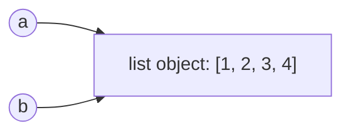

::part[Learn the Concept]{n="1"}

## 🎯 What you'll learn

- Variables hold **references** (arrows), not boxes of data
- **Mutable** vs **immutable** types, and why it matters
- **Aliasing** bugs: two names, one object
- Shallow vs deep **copies**
- How Python lists are stored (dynamic arrays) and why `append` is fast but `insert(0, …)` is slow

## 🧠 The big idea

In Python, a variable is an **arrow** pointing at an object in memory — not a box that contains it.

```python
a = [1, 2, 3]
b = a          # b points at THE SAME list
b.append(4)
print(a)       # [1, 2, 3, 4] 😮
```



Two names, one list. Change it through either name and both "see" the change. That's :term[aliasing]{bahasa="aliasing — dua nama variabel menunjuk objek yang sama di memori"}.

## ❓ Why does this exist?

Copying big data every time you pass it to a function would be slow and waste memory. So Python passes **references**: cheap, fast — and surprising if you don't know it.

## 💥 What happens if we DON'T understand it?

```python
DEFAULT_TAGS = ["new"]

def create_job(title, tags=DEFAULT_TAGS):
    tags.append("unreviewed")        # 🐛 modifies the shared list
    return {"title": title, "tags": tags}

job1 = create_job("QA")
job2 = create_job("Backend")
print(job2["tags"])   # ['new', 'unreviewed', 'unreviewed'] — and DEFAULT_TAGS changed too
```

```python
grid = [[0] * 3] * 3      # looks like a 3×3 grid…
grid[0][0] = 9
print(grid)               # [[9, 0, 0], [9, 0, 0], [9, 0, 0]] — all rows are the same list!
```

Bugs like these appear "randomly" depending on the order things run — some of the hardest to track down.

## 📖 How it works, step by step

### 1. `==` vs `is`

```python
a = [1, 2]
b = [1, 2]
c = a
print(a == b)   # True  — same VALUE
print(a is b)   # False — different OBJECTS
print(a is c)   # True  — same object
```

Use `==` to compare values. Use `is` only for singletons like `None`: `if value is None:`.

### 2. Mutable vs immutable

| Immutable (can't change in place) | Mutable (can change in place) |
|---|---|
| `int`, `float`, `bool`, `str`, `tuple`, `None` | `list`, `dict`, `set`, most objects |

"Changing" an immutable value actually creates a **new** object and moves the arrow:

```python
name = "ana"
other = name
name = name.upper()     # new string "ANA"; `name` now points at it
print(other)            # "ana" — unaffected
```

With mutable objects, methods like `.append()` change the **same** object — every alias sees it.

### 3. Function arguments are references too

```python
def add_bonus(salaries):
    salaries.append(1_000_000)    # mutates the caller's list!

def with_bonus(salaries):
    return salaries + [1_000_000] # creates a NEW list; caller's list untouched
```

Prefer functions that **return new data** unless mutation is the explicit purpose (and the name says so).

### 4. Shallow vs deep copy

```python
import copy

original = [[1, 2], [3, 4]]

shallow = original.copy()        # or list(original), original[:]
shallow[0].append(99)
print(original)                  # [[1, 2, 99], [3, 4]] — inner lists are SHARED

deep = copy.deepcopy(original)
deep[0].append(42)
print(original)                  # unchanged
```

| Copy | Copies | Nested objects |
|---|---|---|
| Assignment `b = a` | nothing | shared |
| Shallow `a.copy()` | the outer container | **still shared** |
| Deep `copy.deepcopy(a)` | everything, recursively | independent |

Build grids safely: `grid = [[0] * 3 for _ in range(3)]` — a **new** row list each time.

### 5. How lists live in memory

A Python list is a **dynamic array**: a block of slots in a row, each holding a reference.

```text
index:   0     1     2     3    [spare][spare]
       [ → ] [ → ] [ → ] [ → ]
```

- `items[i]` → jump straight to slot i → **O(1)**
- `append(x)` → use a spare slot → **O(1)** (occasionally the array grows into a bigger block, but on average it's still O(1))
- `insert(0, x)` / `pop(0)` → shift **every** element one slot → **O(n)**

Need fast adds/removes at **both** ends? Use `collections.deque`.

### 6. Garbage collection

When no arrows point to an object anymore, Python frees its memory automatically. You rarely manage memory by hand in Python — but you do need to know **who else is pointing** at your data.

## ⚖️ Trade-offs

| Choice | ✅ | ❌ |
|---|---|---|
| Mutate in place | No copying, low memory | Surprises for other references |
| Return new objects | Predictable, easy to test | Extra memory and copying time |
| Shallow copy | Cheap | Nested data still shared |
| Deep copy | Fully independent | Slow and memory-heavy for big structures |
| Tuples instead of lists for fixed data | Can't be mutated by accident | Can't be changed when you need to |

## ✅ When to use it / 🚫 When NOT to use it

- ✅ Treat input arguments as **read-only** by default.
- ✅ Use tuples or frozen data for values that should never change (config, constants).
- ✅ Mutate in place deliberately for performance on large data — and document it.
- 🚫 Never use mutable default arguments.
- 🚫 Don't `deepcopy` "just in case" on large data in hot paths.

## 🏭 How it's used in industry

- **React** (Module 4) relies on immutability: you create a **new** array/object for state updates, so React can detect changes with a cheap reference check.
- Web frameworks pass the same request/config objects around; accidental mutation causes cross-request bugs.
- Two-pointer and in-place algorithms in interviews often ask for **O(1) extra space** — meaning "modify in place".

## ⚠️ Common mistakes

- `b = a` and believing `b` is a copy.
- `[[0] * n] * n` for grids.
- Shallow-copying nested dicts, then modifying inner values.
- Using `is` to compare strings or numbers.
- Mutating a list while iterating over it.

::part[Explain & Design]{n="2"}

## 🗣️ Explain it

Explain aliasing using a real-life analogy (e.g. two people sharing one Google Doc link vs. one person downloading a copy). Then explain why a shallow copy of a list of lists is like copying a **table of contents** but still sharing the chapters.

## 📐 Design it

Predict the output **before** running anything:

```python
settings = {"theme": "dark", "tags": ["a"]}
backup = settings.copy()
settings["theme"] = "light"
settings["tags"].append("b")
print(backup)
```

Then redesign the code so `backup` is completely unaffected.

:::quiz
Show the answer

Output: `{'theme': 'dark', 'tags': ['a', 'b']}`. The shallow copy has its own `"theme"` entry (reassigning the key doesn't affect it), but both dicts point at the **same** `tags` list.

Fix: `backup = copy.deepcopy(settings)` — or make `tags` a tuple so it can't be mutated.
:::

### 📝 Self-review checklist

- [ ] I predicted before running
- [ ] I can explain why `"theme"` differs but `"tags"` doesn't
- [ ] My fix makes nested data independent

::ai-review{task="explain"}

::part[Practice Problems]{n="3"}

:::problem{id="dsa-s1-no-surprise-mutation" title="No Surprise Mutations" difficulty="easy" path="exercises/dsa/stage-1/03-no-surprise-mutation"}
Fix three functions that accidentally modify their inputs or share state: `add_tag`, `make_grid`, and `apply_raise`. The tests check both the results **and** that inputs stay unchanged.
:::

:::problem{id="dsa-s1-reverse-in-place" title="Reverse In Place" difficulty="easy" path="exercises/dsa/stage-1/04-reverse-in-place"}
Reverse a list **in place** using O(1) extra space — no slicing, no `reversed()`, no `.reverse()`, no new list. Swap from both ends towards the middle.
:::

:::hints
- `add_tag`: return `tags + [tag]` instead of appending.
- `make_grid`: a comprehension creates a new row each time.
- Reverse: two indexes, `left` starting at 0 and `right` at the end. Swap with `a, b = b, a`. Stop when they meet.
:::

## ✅ Quick check

:::quiz
After `x = [1]; y = x; x = x + [2]`, what is `y`?

`[1]`. `x + [2]` creates a **new** list and reassigns `x`. `y` still points at the original. (With `x.append(2)` or `x += [2]`, `y` would change too.)
:::

:::quiz
Why is `pop(0)` on a large list slow?

Every remaining element has to shift one slot left: O(n). Use `collections.deque.popleft()` for O(1).
:::

:::quiz
When should you use `is` instead of `==`?

To check identity with singletons like `None` (`x is None`). For values — numbers, strings, lists — use `==`.
:::

## 📖 Kamus (glossary)

| Term | Bahasa Indonesia |
|---|---|
| Reference | Referensi — penunjuk ke objek di memori |
| Mutable / Immutable | Bisa diubah / Tidak bisa diubah |
| Aliasing | Dua nama untuk objek yang sama |
| Shallow / Deep copy | Salinan dangkal / Salinan penuh |
| In place | Mengubah data aslinya langsung |

## 📚 Keep learning

- [Python docs: copy — shallow and deep copy](https://docs.python.org/3/library/copy.html)
- [Python Tutor — visualize references step by step](https://pythontutor.com/)
