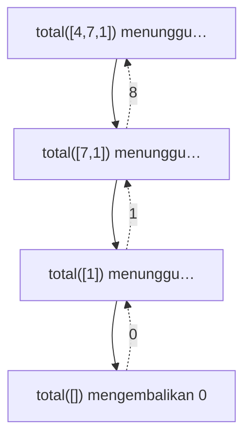

::part[Pelajari Konsepnya]{n="1"}

## 🎯 Yang akan kamu pelajari

- Dua bagian di setiap fungsi rekursif: **base case** dan **recursive case**
- Cara **call stack** menjalankan pemanggilan rekursif
- Kapan rekursi alami (data bersarang/berbentuk pohon) dan kapan loop lebih baik
- Batas rekursi dan pengenalan pertama **memoization**

## 🔤 Istilah penting

| Istilah | Artinya (sederhana) |
|---|---|
| **Recursion** | Fungsi memanggil dirinya sendiri dengan versi masalah yang lebih kecil |
| **Base case** | Versi terkecil yang sudah kamu tahu jawabannya |
| **Recursive case** | Langkah membuat masalah lebih kecil lalu memanggil lagi |
| **Call stack** | Tumpukan pemanggilan yang menunggu jawabannya |
| **Stack overflow** | Terlalu banyak pemanggilan tertumpuk — Python berhenti dengan error |
| **Nested data** | Data di dalam data: folder, reply, JSON |
| **Memoization** | Menyimpan jawaban yang sudah kamu hitung |
| **Tail-call style** | Menulis ulang rekursi menjadi loop (Python tidak mengoptimalnya) |

## 🧠 Ide besarnya

:term[Recursion]{bahasa="fungsi yang memanggil dirinya sendiri dengan masalah lebih kecil"} berarti: *"Saya tidak tahu jawaban lengkapnya, tapi saya tahu cara membuat masalah sedikit lebih kecil, dan saya tahu jawaban untuk versi terkecilnya."*

Bayangkan kamu di antrean panjang di bioskop dan ingin tahu posisimu. Kamu tanya orang di depan: "Posisimu berapa?" Orang itu bertanya ke orang di depannya, dan seterusnya. Orang paling depan bilang "1" (**base case**). Setiap orang menjawab "jawaban mereka + 1" kembali ke belakang (**recursive case**).

```python
def position(person):
    if person.is_first:            # base case: smallest version, answer known
        return 1
    return position(person.in_front) + 1   # recursive case: smaller problem + a step
```

## ❓ Kenapa ini penting

Ada data yang **bersarang**: folder di dalam folder, komentar dengan balasan yang punya balasan, JSON di dalam JSON, bagan organisasi perusahaan, HTML halaman web. Loop menangani satu tingkat; rekursi menangani **tingkat apa saja** secara alami, karena setiap tingkat terlihat seperti salinan kecil dari keseluruhan.

Rekursi juga dasar dari pohon dan graf (DSA Stage 4), merge sort, dan backtracking.

Kalau salah, hasilnya jelek: lupa base case dan antrean orang tidak pernah mencapai depan — Python menghentikanmu dengan `RecursionError` setelah sekitar seribu pemanggilan.

## 📖 Langkah demi langkah

### 1. Base case + recursive case

```python
def total(numbers: list[int]) -> int:
    if not numbers:                       # base case: empty list sums to 0
        return 0
    return numbers[0] + total(numbers[1:])  # first + total of the rest
```

Checklist untuk setiap fungsi rekursif:

1. **Base case(s)**: kapan kita berhenti? (kosong, nol, satu item, ketemu…)
2. **Progress**: apakah setiap pemanggilan bergerak **lebih dekat** ke base case?
3. **Trust**: asumsikan pemanggilan rekursif mengembalikan jawaban yang benar untuk input lebih kecil, lalu gunakan.

### 2. Call stack

Stack adalah **antrean orang yang masih menunggu jawaban**: masing-masing ditunda, menahan posisi mereka, sampai orang di depan menjawab.

Setiap pemanggilan mendapat "frame" sendiri dengan variabel lokal sendiri, ditumpuk di atas yang sebelumnya:

```text
total([4, 7, 1])
  = 4 + total([7, 1])
          = 7 + total([1])
                  = 1 + total([])
                          = 0          ← base case, start returning
                  = 1 + 0 = 1
          = 7 + 1 = 8
  = 4 + 8 = 12
```



Pemanggilan turun **ke bawah** sampai base case, lalu hasil mengalir kembali **ke atas**.

### 3. Rekursi di data bersarang

```python
def count_files(folder: dict) -> int:
    """folder = {"files": [...], "folders": [subfolder, ...]}"""
    count = len(folder["files"])
    for subfolder in folder["folders"]:
        count += count_files(subfolder)   # same problem, smaller folder
    return count
```

Di sini base case implisit: folder tanpa subfolder tidak buat pemanggilan rekursif.

### 4. Rekursi vs loop

Aturan jempol: rekursi untuk data yang bercabang (pohon, folder), loop untuk data yang garis lurus (list). Keduanya bekerja; salah satu jauh lebih mudah dibaca dari yang lain.

```python
def factorial_recursive(n):
    return 1 if n <= 1 else n * factorial_recursive(n - 1)

def factorial_loop(n):
    result = 1
    for i in range(2, n + 1):
        result *= i
    return result
```

Apapun rekursif bisa ditulis dengan loop (plus stack kalau perlu), dan sebaliknya.

### 5. Batas

Python membatasi kedalaman rekursi (sekitar 1.000 frame secara default). `factorial_recursive(5000)` raise `RecursionError`. Juga, setiap frame pakai memori: kedalaman rekursi d berarti **O(d) space**, bahkan kalau kamu tidak bikin list apapun.

:::warning[Hidden cost]
`numbers[1:]` menyalin list setiap pemanggilan → contoh `total` di atas adalah O(n²) time. Kirim index sebaliknya menghindari penyalinan: `total(numbers, i + 1)`.
:::

### 6. Memoization (pengenalan pertama)

Beberapa fungsi rekursif menghitung ulang hal yang sama berkali-kali:

```python
def fib(n):
    return n if n < 2 else fib(n - 1) + fib(n - 2)   # fib(35) takes seconds: O(2ⁿ)
```

Ingat jawaban yang sudah kamu hitung:

```python
from functools import cache

@cache
def fib(n):
    return n if n < 2 else fib(n - 1) + fib(n - 2)   # fib(300) instantly: O(n)
```

Ide ini berkembang jadi **dynamic programming** di Stage 5.

### Memilih setup kamu

Setiap pilihan di sini adalah trade-off:

| Pilihan | ✅ | ❌ |
|---|---|---|
| Rekursi | Alami untuk data bersarang/pohon, pendek, mencerminkan definisi | Batas kedalaman, stack memory, bisa sembunyikan pekerjaan berulang |
| Loop | Tidak ada batas kedalaman, sering lebih cepat di Python | Canggung untuk data bersarang (butuh manual stack) |
| Memoization | Ubah eksponensial jadi linear untuk submasalah tumpang tindih | Memori untuk cache |

- ✅ Data bersarang atau berbentuk pohon: sistem file, JSON, komentar, bagan organisasi, DOM.
- ✅ Algoritma divide-and-conquer (merge sort, binary search).
- 🚫 Pekerjaan linear sederhana di list rata — loop lebih jelas dan tidak ada batas kedalaman.
- 🚫 Input sangat dalam (puluhan ribu tingkat) di Python.


## ⚠️ Kesalahan umum

- Tidak ada base case, atau base case yang tidak pernah tercapai (misal `n == 0` saat `n` lompat 2).
- Lupa **return** hasil pemanggilan rekursif (`total(rest)` bukan `return … total(rest)`).
- Tidak pakai hasil pemanggilan rekursif.
- Penyalinan list tersembunyi dengan slicing setiap pemanggilan.

::part[Jelaskan & Rancang]{n="2"}

## 🗣️ Jelaskan

Jelaskan rekursi pakai boneka bersarang Rusia (matryoshka): bagaimana kamu hitung berapa banyak boneka, kalau kamu hanya bisa buka satu boneka setiap kali? Tunjukkan base case dan recursive case.

## 📐 Rancang

Thread komentar disimpan sebagai `{"text": str, "replies": [comment, ...]}`. Rancang fungsi rekursif (pseudocode) untuk:

1. Hitung semua komentar di thread (termasuk yang paling atas)
2. Temukan **kedalaman maksimal** reply (komentar tanpa reply punya kedalaman 1)
3. Kembalikan semua teks komentar dalam urutan baca (parent sebelum replynya)

:::quiz
Lihat contoh rancangan

```text
count(comment):
    return 1 + sum(count(reply) for reply in comment.replies)

depth(comment):
    if no replies: return 1
    return 1 + max(depth(reply) for reply in comment.replies)

texts(comment):
    result = [comment.text]
    for reply in comment.replies:
        result += texts(reply)
    return result
```

Ketiga-tiganya punya bentuk yang sama: *tangani node ini + gabungkan jawaban dari anak-anak.* Bentuk itulah tepat cara kamu traverse pohon di Stage 4.
:::

### 📝 Checklist review mandiri

- [ ] Setiap fungsi punya base case yang jelas (eksplisit atau "tanpa anak")
- [ ] Setiap pemanggilan rekursif bekerja di bagian lebih kecil (satu reply)
- [ ] Saya gabung hasil anak dengan benar (sum, max, concatenate)

::ai-review{task="design"}

::part[Latihan Kecil]{n="3"}

:::problem{id="dsa-s1-recursive-basics" title="Dasar Rekursi" difficulty="easy" path="exercises/dsa/stage-1/05-recursive-basics"}
Implementasikan `sum_digits`, `power`, `is_palindrome`, dan `count_down` **secara rekursif** — tanpa loop (ada tes yang cek). Setiap punya base case berbeda; sebutkan di komentar.
:::

:::problem{id="dsa-s1-flatten" title="Ratakan List Bersarang" difficulty="medium" path="exercises/dsa/stage-1/06-flatten"}
`flatten([1, [2, [3, 4]], [], 5])` → `[1, 2, 3, 4, 5]`, untuk kedalaman apa saja. Lalu `max_depth` dari bersarangnya. Rekursi cocok banget di sini.
:::

:::hints
- `sum_digits(n)`: digit terakhir adalah `n % 10`, sisanya `n // 10`.
- `power(base, exp)`: `base ** 0 == 1`. Tantangan: pakai `power(base, exp // 2)` buat bikinnya O(log n).
- `is_palindrome`: bandingkan karakter pertama dan terakhir, terus rekursi di tengahnya.
- `flatten`: untuk setiap elemen — kalau list, extend dengan `flatten(element)`; kalau tidak append saja. Cek pakai `isinstance(x, list)`.
:::

## ✅ Cek cepat

:::quiz
Dua hal apa yang harus ada di setiap fungsi rekursif?

Base case yang hentikan rekursi, dan recursive case yang bergerak lebih dekat ke base case.
:::

:::quiz
Kenapa fungsi rekursif dengan kedalaman `n` pakai O(n) memori bahkan kalau tidak bikin list?

Setiap pemanggilan yang belum selesai simpan satu frame di call stack sampai pemanggilan dalamnya kembali.
:::

:::quiz
Kenapa naive recursive Fibonacci lambat, dan `@cache` bantu gimana?

Itu hitung ulang submasalah yang sama berkali-kali secara eksponensial. `@cache` simpan setiap hasil pertama kali, jadi setiap `fib(k)` dihitung sekali → O(n).
:::


## 📚 Lanjut belajar

- [Python Tutor — lihat call stack tumbuh dan menyusut](https://pythontutor.com/)
- [Dokumentasi Python: functools.cache](https://docs.python.org/3/library/functools.html#functools.cache)

## 📣 Stage 1 selesai — bagikan

:::linkedin{type="dsa"}
🧩 Dasar DSA, selesai: Big-O, memori & referensi, dan rekursi.

Ide yang ubah cara saya baca kode: [misalnya "`x in my_list` di dalam loop itu hidden O(n²)"].

Masalah yang saya selesaikan: [nama problem] — saya mulai dengan [pendekatan pertama, complexity], terus improve ke [pendekatan lebih baik, complexity] dengan [ide kuncinya].

Selanjutnya: hash map, stack, queue dan linked list. 🚀

#LearningInPublic #DataStructures #Algorithms #Python
:::
