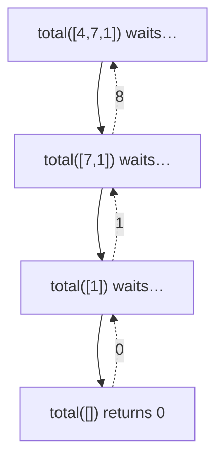

::part[Learn the Concept]{n="1"}

## 🎯 What you'll learn

- The two parts of every recursive function: **base case** and **recursive case**
- How the **call stack** runs recursive calls
- When recursion is natural (nested/tree-shaped data) and when a loop is better
- Recursion limits, and a first taste of **memoization**

## 🧠 The big idea

:term[Recursion]{bahasa="rekursi — fungsi yang memanggil dirinya sendiri dengan masalah yang lebih kecil"} means: *"I don't know the whole answer, but I know how to make the problem a bit smaller, and I know the answer for the tiniest version."*

Imagine you're in a long cinema queue and want to know your position. You ask the person in front: "What's your position?" They ask the person in front of them, and so on. The first person says "1" (**base case**). Each person answers "their answer + 1" back down the line (**recursive case**).

```python
def position(person):
    if person.is_first:            # base case: smallest version, answer known
        return 1
    return position(person.in_front) + 1   # recursive case: smaller problem + a step
```

## ❓ Why does this exist?

Some data is **nested**: folders inside folders, comments with replies to replies, JSON inside JSON, a company org chart, the HTML of a web page. A loop handles one level; recursion handles **any** depth naturally, because each level looks like a smaller copy of the whole.

Recursion is also the foundation for trees and graphs (DSA Stage 4), merge sort, and backtracking.

## 💥 What happens if we DON'T use it (or use it wrong)?

Without recursion, counting all files in nested folders needs a manual stack and bookkeeping. With recursion done **wrong**:

```python
def countdown(n):
    print(n)
    countdown(n - 1)     # 🐛 no base case
countdown(3)
# 3, 2, 1, 0, -1, -2, ... RecursionError: maximum recursion depth exceeded
```

## 📖 How it works, step by step

### 1. Base case + recursive case

```python
def total(numbers: list[int]) -> int:
    if not numbers:                       # base case: empty list sums to 0
        return 0
    return numbers[0] + total(numbers[1:])  # first + total of the rest
```

Checklist for every recursive function:

1. **Base case(s)**: when do we stop? (empty, zero, one item, found it…)
2. **Progress**: does every call move **closer** to the base case?
3. **Trust**: assume the recursive call returns the right answer for the smaller input, and use it.

### 2. The call stack

Each call gets its own "frame" with its own local variables, stacked on top of the previous one:

```text
total([4, 7, 1])
  = 4 + total([7, 1])
          = 7 + total([1])
                  = 1 + total([])
                          = 0          ← base case, start returning
                  = 1 + 0 = 1
          = 7 + 1 = 8
  = 4 + 8 = 12
```



Calls go **down** until a base case, then results flow back **up**.

### 3. Recursion on nested data

```python
def count_files(folder: dict) -> int:
    """folder = {"files": [...], "folders": [subfolder, ...]}"""
    count = len(folder["files"])
    for subfolder in folder["folders"]:
        count += count_files(subfolder)   # same problem, smaller folder
    return count
```

Here the base case is implicit: a folder with no subfolders makes no recursive calls.

### 4. Recursion vs loops

```python
def factorial_recursive(n):
    return 1 if n <= 1 else n * factorial_recursive(n - 1)

def factorial_loop(n):
    result = 1
    for i in range(2, n + 1):
        result *= i
    return result
```

Anything recursive can be written with a loop (plus a stack if needed), and vice versa.

### 5. Limits

Python limits recursion depth (about 1,000 frames by default). `factorial_recursive(5000)` raises `RecursionError`. Also, each frame uses memory: recursion depth d means **O(d) space**, even if you don't create any lists.

:::warning[Hidden cost]
`numbers[1:]` copies the list on every call → the `total` example above is O(n²) time. Passing an index instead avoids copying: `total(numbers, i + 1)`.
:::

### 6. Memoization (a preview)

Some recursive functions recompute the same thing many times:

```python
def fib(n):
    return n if n < 2 else fib(n - 1) + fib(n - 2)   # fib(35) takes seconds: O(2ⁿ)
```

Remember answers you already computed:

```python
from functools import cache

@cache
def fib(n):
    return n if n < 2 else fib(n - 1) + fib(n - 2)   # fib(300) instantly: O(n)
```

This idea grows into **dynamic programming** in Stage 5.

## ⚖️ Trade-offs

| Choice | ✅ | ❌ |
|---|---|---|
| Recursion | Natural for nested/tree data, short, mirrors the definition | Depth limit, stack memory, can hide repeated work |
| Loop | No depth limit, often faster in Python | Awkward for nested data (needs a manual stack) |
| Memoization | Turns exponential into linear for overlapping subproblems | Memory for the cache |

## ✅ When to use it / 🚫 When NOT to use it

- ✅ Nested or tree-shaped data: file systems, JSON, comments, org charts, the DOM.
- ✅ Divide-and-conquer algorithms (merge sort, binary search).
- 🚫 Simple linear work over a flat list — a loop is clearer and has no depth limit.
- 🚫 Very deep inputs (tens of thousands of levels) in Python.

## 🏭 How it's used in industry

- Rendering nested comment threads or menus in React (a component that renders itself for children).
- Walking JSON configs, file trees, and ASTs in linters and compilers (the exercise tests in this handbook use Python's `ast` module to walk your code!).
- Interview favorites: tree traversal, permutations, flattening nested structures.

## ⚠️ Common mistakes

- No base case, or a base case that's never reached (e.g. `n == 0` when `n` jumps by 2).
- Forgetting to **return** the recursive call's result (`total(rest)` instead of `return … total(rest)`).
- Not using the result of the recursive call.
- Hidden list copies with slicing on every call.

::part[Explain & Design]{n="2"}

## 🗣️ Explain it

Explain recursion using Russian nesting dolls (matryoshka): how would you count how many dolls there are, if you can only open one doll at a time? Point out the base case and the recursive case.

## 📐 Design it

A comment thread is stored as `{"text": str, "replies": [comment, ...]}`. Design recursive functions (pseudocode) for:

1. Count all comments in a thread (including the top one)
2. Find the **maximum depth** of replies (a comment with no replies has depth 1)
3. Return all comment texts in reading order (parent before its replies)

:::quiz
Show a possible design

```text
count(comment):
    return 1 + sum(count(reply) for reply in comment.replies)

depth(comment):
    if no replies: return 1
    return 1 + max(depth(reply) for reply in comment.replies)

texts(comment):
    result = [comment.text]
    for reply in comment.replies:
        result += texts(reply)
    return result
```

All three share the shape: *handle this node + combine the answers from the children.* That shape is exactly how you'll traverse trees in Stage 4.
:::

### 📝 Self-review checklist

- [ ] Every function has a clear base case (explicit or "no children")
- [ ] Each recursive call works on a smaller piece (a reply)
- [ ] I combine children's results (sum, max, concatenate) correctly

::ai-review{task="design"}

::part[Practice Problems]{n="3"}

:::problem{id="dsa-s1-recursive-basics" title="Recursive Basics" difficulty="easy" path="exercises/dsa/stage-1/05-recursive-basics"}
Implement `sum_digits`, `power`, `is_palindrome` and `count_down` **recursively** — no loops allowed (a test checks). Each one has a different base case; name it in a comment.
:::

:::problem{id="dsa-s1-flatten" title="Flatten Nested Lists" difficulty="medium" path="exercises/dsa/stage-1/06-flatten"}
`flatten([1, [2, [3, 4]], [], 5])` → `[1, 2, 3, 4, 5]`, for any depth. Then `max_depth` of the nesting. Recursion is the natural fit here.
:::

:::hints
- `sum_digits(n)`: the last digit is `n % 10`, the rest is `n // 10`.
- `power(base, exp)`: `base ** 0 == 1`. Stretch: use `power(base, exp // 2)` to make it O(log n).
- `is_palindrome`: compare first and last characters, then recurse on the middle.
- `flatten`: for each element — if it's a list, extend with `flatten(element)`; else append it. Check with `isinstance(x, list)`.
:::

## ✅ Quick check

:::quiz
What two things must every recursive function have?

A base case that stops the recursion, and a recursive case that moves closer to the base case.
:::

:::quiz
Why does a recursive function with depth `n` use O(n) memory even if it creates no lists?

Each unfinished call keeps a frame on the call stack until its inner call returns.
:::

:::quiz
Why is naive recursive Fibonacci so slow, and how does `@cache` help?

It recomputes the same subproblems exponentially many times. `@cache` stores each result the first time, so each `fib(k)` is computed once → O(n).
:::

## 📖 Kamus (glossary)

| Term | Bahasa Indonesia |
|---|---|
| Recursion | Rekursi |
| Base case | Kasus dasar — kondisi berhenti |
| Call stack | Tumpukan pemanggilan fungsi |
| Memoization | Menyimpan hasil perhitungan agar tidak dihitung ulang |
| Nested | Bersarang |

## 📚 Keep learning

- [Python Tutor — watch the call stack grow and shrink](https://pythontutor.com/)
- [Python docs: functools.cache](https://docs.python.org/3/library/functools.html#functools.cache)

## 📣 Stage 1 done — share it

:::linkedin{type="dsa"}
🧩 DSA foundations, done: Big-O, memory & references, and recursion.

The idea that changed how I read code: [e.g. "`x in my_list` inside a loop is a hidden O(n²)"].

A problem I solved: [problem name] — I started with [first approach, complexity], then improved it to [better approach, complexity] by [the key idea].

Next: hash maps, stacks, queues and linked lists. 🚀

#LearningInPublic #DataStructures #Algorithms #Python
:::
