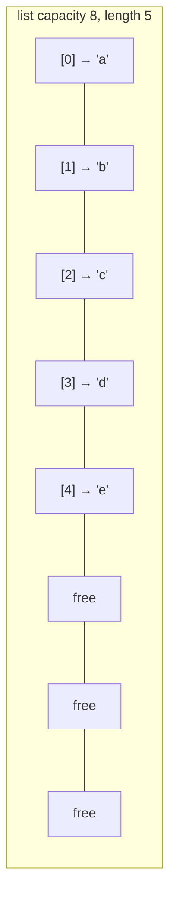

::part[Pelajari Konsepnya]{n="1"}

## 🎯 Yang akan kamu pelajari

- Cara Python `list` (sebuah **larik dinamis**) disimpan, dan kenapa `append` cepat tapi `insert(0, x)` lambat
- Big-O setiap operasi list dan string yang umum
- Kenapa string **tidak bisa diubah**, dan aturan `"".join()`
- Algoritma **di tempat** dengan penunjuk baca/tulis
- Aritmatika index: modulo untuk rotasi, batas untuk grid 2D

## 🔤 Istilah penting

| Istilah | Artinya (sederhana) |
|---|---|
| **Larik (Array)** | Elemen berdampingan di memori |
| **Index** | Nomor posisi elemen |
| **Berdampingan** | Langsung bersebelahan, tanpa celah |
| **Larik dinamis** | Larik yang membesar sendiri (Python list) |
| **Rata-rata O(1)** | Biasanya instant; kadang list disalin ke ruang lebih besar |
| **String tidak berubah** | Mengubah string membuat string baru |
| **`"".join()`** | Menyusun string sekali, bukan menambah dalam loop |
| **Di tempat** | Mengubah list yang sama, bukan bikin list baru |
| **Penunjuk baca/tulis** | Dua posisi: satu baca, satu tulis item yang dipertahankan |

## 🧠 Ide besarnya

Bayangkan sebuah :term[larik]{bahasa="larik — elemen berurutan yang disimpan berdampingan di memori"} seperti **barisan loker bernomor berdampingan**. Karena berdampingan, kamu bisa lompat langsung ke loker #5.000 — tidak perlu jalan. Tapi kalau mau tambah loker baru di **depan**, setiap item harus bergeser satu loker ke kanan.

Satu gambar ini menjelaskan sebagian besar pertanyaan performa larik di interview.

## ❓ Kenapa ini penting

Menyimpan item berdampingan membuat larik:

- **cepat di-index** — `nums[i]` satu perhitungan, bukan pencarian,
- **CPU ramah** — CPU memuat item tetangga bersama-sama,
- **hemat memori**.

Hampir semua dibangun atas larik: Python list, string, NumPy array, halaman database, JSON array yang API-mu kembalikan.

Tidak tahu biayanya adalah cara baris innocent menjadi 100× lambat:

```python
queue = []
for request in requests:        # 100,000 requests
    queue.insert(0, request)     # 🐢 each insert shifts every item: O(n) → O(n²) total
```

## 📖 Langkah demi langkah

### 1. Python list adalah larik dinamis

List menyimpan **referensi** dalam blok berdampingan dengan **kapasitas ekstra**. Kalau penuh, Python alokasikan blok lebih besar (kira-kira 1.125× plus sedikit) dan salin semuanya. Salin jarang, jadi `append` adalah **O(1) rata-rata**.



### 2. Biaya operasi umum

| Operasi | Big-O | Kenapa |
|---|---|---|
| `nums[i]`, `nums[i] = x` | O(1) | alamat langsung |
| `len(nums)` | O(1) | tersimpan |
| `nums.append(x)` / `nums.pop()` | O(1) rata-rata | di akhir, tidak ada yang geser |
| `nums.insert(0, x)` / `nums.pop(0)` | **O(n)** | semuanya geser |
| `x in nums`, `nums.index(x)`, `nums.remove(x)` | **O(n)** | scan |
| `nums[a:b]` | O(b − a) | salin |
| `nums.sort()` / `sorted(nums)` | O(n log n) | Timsort |
| `min`, `max`, `sum` | O(n) | scan |

Butuh cepat tambah/hapus di **kedua** ujung? Pakai `collections.deque` (pelajaran berikutnya).

### 3. String adalah larik karakter yang tidak berubah

Menambah ke string dalam loop seperti retulis surat utuh untuk tambah satu kata tiap kali. `"".join(parts)` tulis sekali di akhir.

```python
s = "careerpilot"
s[0]            # 'c' — O(1)
s[0] = "C"      # TypeError: strings can't be changed
s = "C" + s[1:] # creates a NEW string — O(n)
```

Aturan: **bangun string dengan list, lalu join sekali.**

```python
parts = []
for line in lines:
    parts.append(line)
report = "\n".join(parts)   # one O(total length) pass
```

### 4. Di tempat dengan penunjuk baca/tulis

Bayangkan rapihkan rak dengan dua tangan: satu tangan bergerak baca, tangan lain letakkan item yang patut disimpan. Tidak perlu ekstra, dan rak akhirnya benar.

Hapus nol dari list **tanpa** list baru (O(1) ruang ekstra):

```python
def move_zeros(nums):
    write = 0
    for read in range(len(nums)):      # read scans everything
        if nums[read] != 0:            # keep it → put it at write
            nums[write], nums[read] = nums[read], nums[write]
            write += 1
```

```text
read →  0 3 0 1 2
write→  ^
step 2: 3 0 0 1 2   (swap 3 into position 0)
step 4: 3 1 0 0 2
step 5: 3 1 2 0 0 ✅
```

Ide baca/tulis ini kembali di **dua penunjuk** (Stage 3).

### 5. Aritmatika index

- **Putar balik** dengan modulo: posisi setelah rotasi kanan k adalah `(i + k) % n`. Rotasi k = `10¹²` tetap instant.
- **Grid 2D**: `grid[row][col]`; tetangga adalah `(row±1, col)` dan `(row, col±1)`; cek `0 <= row < rows` sebelum akses.
- **Pass prefiks/sufiks**: hitung dari kiri dalam satu loop, dari kanan di loop lain (product-except-self).

### 6. Gotcha spesifik Python

```python
grid = [[0] * 3] * 3      # 🐛 three references to the SAME row
grid[0][0] = 1            # [[1,0,0],[1,0,0],[1,0,0]]
grid = [[0] * 3 for _ in range(3)]   # ✅ three separate rows
```

Dan ingat pelajaran Stage 1 tentang referensi: fungsi yang mutasi argument list mengubah list pemanggil.

### Pilih setup-mu

Setiap opsi di sini adalah trade-off:

| Pilihan | ✅ | ❌ |
|---|---|---|
| List baru (gaya functional) | sederhana, tidak mengejutkan pemanggil | O(n) memori ekstra |
| Di tempat | O(1) memori ekstra | mutasi input; trickier |
| `list` | index cepat, padat | insert/delete depan lambat, cari lambat |
| `deque` | O(1) kedua ujung | O(n) index tengah |
| Sort lebih dulu | aktifkan binary search, dua penunjuk | O(n log n), hilang urutan asli |

- ✅ Data berurutan yang kamu index by posisi, append, atau iterate.
- ✅ Algoritma di tempat saat memori sempit atau interviewer minta O(1) ruang.
- 🚫 Cari `x in list` sering → pakai `set` (pelajaran berikutnya).
- 🚫 Perilaku queue (`pop(0)`) → pakai `deque`.

## ⚠️ Kesalahan umum

- `pop(0)` atau `insert(0, …)` dalam loop.
- Ubah list saat iterate dengan `for x in nums` (skip item).
- Error off-by-one di batas (`range(len(nums) - 1)`).
- `[[0] * cols] * rows` baris bersama.

## 🏆 Praktik terbaik

- [ ] Ucapkan **kompleksitas setiap baris** keras, terutama O(n) tersembunyi (`in`, `index`, `insert(0)`, slice).
- [ ] Jelaskan dulu: input bisa kosong? negatif? ubah atau return baru?
- [ ] Bangun string dengan list dan `"".join()`.
- [ ] Pakai modulo untuk wrap-around; jaga input kosong sebelum bagi atau mod dengan `len`.
- [ ] Algoritma di tempat, beri nama penunjuk by peran (`read`, `write`, `left`, `right`), bukan `i`, `j`.
- [ ] Test edge case: kosong, satu elemen, semua sama, sudah selesai (tidak ada nol, k = 0).
- [ ] Lebih suka built-in (`sum`, `sorted`, slice) di kode asli; di interview, implementasi logika inti kalau diminta.

::part[Jelaskan & Rancang]{n="2"}

## 🗣️ Jelaskan

Jelaskan ke orang non-programmer kenapa tambah orang di **depan** antrean bernomor lambat, tapi di **belakang** cepat. Pakai gambar loker.

## 📐 Rancang

Job board simpan **1.000 query pencarian terakhir** untuk widget "trending", dengan query baru tiba setiap beberapa milidetik. Rancang struktur data pakai list ukuran tetap: cara tambah query O(1), dan cara baca dari terlama ke terbaru?

:::quiz
Lihat desain yang mungkin

**Ring buffer**: list ukuran 1.000, index `start` (terlama) dan `count`.
- **Tambah**: `buffer[(start + count) % 1000] = query`; kalau `count < 1000`, `count += 1`, else `start = (start + 1) % 1000` (timpa terlama). O(1), tidak geser.
- **Baca terlama → terbaru**: `[buffer[(start + i) % 1000] for i in range(count)]`. O(n).

Python kamu juga bisa pakai `collections.deque(maxlen=1000)`, yang lakukan ini untuk kamu — tapi tahu ring buffer tunjukkan kamu paham kenapa O(1).
:::

### 📝 Checklist review mandiri

- [ ] Tidak ada `insert(0)` / `pop(0)` di list
- [ ] Modulo tangani wrap-around
- [ ] Urutan baca benar setelah buffer wrap

::ai-review{task="design"}

::part[Latihan Kecil]{n="3"}

:::problem{id="dsa-s2-array-string-basics" title="Array & String Basics" difficulty="easy" path="exercises/dsa/stage-2/01-array-string-basics"}
Tiga pemanasan: rotasi list k (bahkan k besar), pindahkan nol ke akhir **di tempat**, dan compress string run-length. Test cek kebenaran vs brute force dan tangkap O(n²) tersembunyi.
:::

:::problem{id="dsa-s2-product-except-self" title="Product of Everything Else" difficulty="medium" path="exercises/dsa/stage-2/02-product-except-self"}
Setiap posisi, hasil kali elemen lain — O(n), tanpa pembagian.
:::

:::problem{id="dsa-s2-longest-common-prefix" title="Longest Common Prefix" difficulty="medium" path="exercises/dsa/stage-2/03-longest-common-prefix"}
Cari prefiks bersama setiap job slug, berhenti saat mismatch.
:::

:::problem{id="dsa-s2-spiral-order" title="Spiral Seat Map" difficulty="hard" path="exercises/dsa/stage-2/04-spiral-order"}
Stretch: jalan grid 2D spiral order pakai empat batas mengecil.
:::

:::hints
- `rotate_right`: `k %= len(nums)` (jaga list kosong dulu), lalu dua slice.
- `compress`: cari akhir setiap run dengan `while` inner, lalu lompat `i` — tetap O(n) overall.
- `product_except_self`: pass pertama simpan hasil kali **kiri** i; pass kedua (dari kanan) kali dengan hasil kali **kanan** i.
- `spiral_order`: setelah jalan baris atas, `top += 1`; setelah kolom kanan, `right -= 1`; cek `top <= bottom` sebelum jalan baris bawah.
:::

## ✅ Cek cepat

:::quiz
Kenapa `append` O(1) rata-rata, bukan selalu O(1)?

Kadang list penuh dan Python salin semuanya ke blok lebih besar (O(n)), tapi jarang cukup hingga biaya rata-rata per append tetap konstan.
:::

:::quiz
Biaya `result += piece` string dalam loop, dan perbaikannya?

Berpotensi O(n²) total karena setiap gabung bisa buat string baru; kumpul piece dalam list dan `"".join()` sekali.
:::


## 📚 Lanjut belajar

- [Python wiki: TimeComplexity (list, deque, dict, set)](https://wiki.python.org/moin/TimeComplexity)
- [Python docs: collections.deque](https://docs.python.org/3/library/collections.html#collections.deque)
