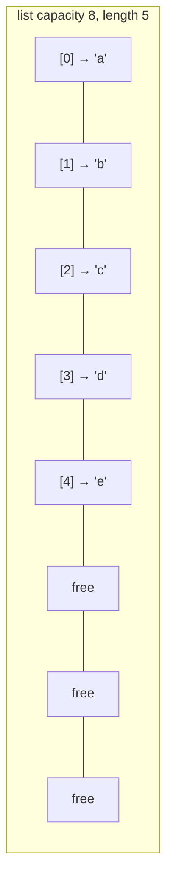

::part[Learn the Concept]{n="1"}

## 🎯 What you'll learn

- How a Python `list` (a **dynamic array**) is stored, and why `append` is fast but `insert(0, x)` is slow
- The Big-O of every common list and string operation
- Why strings are **immutable**, and the `"".join()` rule
- **In-place** algorithms with a read/write pointer
- Index arithmetic: modulo for rotation, boundaries for 2D grids

## 🧠 The big idea

An :term[array]{bahasa="larik — kumpulan elemen berurutan yang disimpan berdampingan di memori"} is a row of **numbered lockers side by side**. Because they're side by side, you can jump straight to locker #5,000 — no walking. But if you want to add a new locker at the **front**, every item has to move one locker to the right.

That single picture explains most array performance questions in interviews.

## ❓ Why does this exist?

Contiguous memory makes arrays:
- **fast to index** (`nums[i]` is O(1): address = start + i × size),
- **cache-friendly** (the CPU loads neighbors together),
- **compact**.

Nearly everything is built on them: Python lists, strings, NumPy arrays, database pages, the JSON arrays your API returns.

## 💥 What happens if we DON'T understand it?

```python
queue = []
for request in requests:        # 100,000 requests
    queue.insert(0, request)     # 🐢 each insert shifts every item: O(n) → O(n²) total
```

```python
report = ""
for line in lines:               # 100,000 lines
    report += line + "\n"        # 🐢 may copy the whole string each time
```

Both "work" in a demo with 10 items and crawl in production with 100,000.

## 📖 How it works, step by step

### 1. Python lists are dynamic arrays

A list stores **references** in a contiguous block with **extra capacity**. When it's full, Python allocates a bigger block (about 1.125× plus a bit) and copies everything. Copies are rare, so `append` is **amortized O(1)**.



### 2. Cost of common operations

| Operation | Big-O | Why |
|---|---|---|
| `nums[i]`, `nums[i] = x` | O(1) | direct address |
| `len(nums)` | O(1) | stored |
| `nums.append(x)` / `nums.pop()` | O(1) amortized | at the end, nothing shifts |
| `nums.insert(0, x)` / `nums.pop(0)` | **O(n)** | everything shifts |
| `x in nums`, `nums.index(x)`, `nums.remove(x)` | **O(n)** | scans |
| `nums[a:b]` | O(b − a) | copies |
| `nums.sort()` / `sorted(nums)` | O(n log n) | Timsort |
| `min`, `max`, `sum` | O(n) | scans |

Need fast adds/removes at **both** ends? Use `collections.deque` (next lessons).

### 3. Strings are immutable arrays of characters

```python
s = "careerpilot"
s[0]            # 'c' — O(1)
s[0] = "C"      # TypeError: strings can't be changed
s = "C" + s[1:] # creates a NEW string — O(n)
```

Rule: **build strings with a list, then join once.**

```python
parts = []
for line in lines:
    parts.append(line)
report = "\n".join(parts)   # one O(total length) pass
```

### 4. In-place with read/write pointers

Remove zeros from a list **without** a new list (O(1) extra space):

```python
def move_zeros(nums):
    write = 0
    for read in range(len(nums)):      # read scans everything
        if nums[read] != 0:            # keep it → put it at write
            nums[write], nums[read] = nums[read], nums[write]
            write += 1
```

```text
read →  0 3 0 1 2
write→  ^
step 2: 3 0 0 1 2   (swap 3 into position 0)
step 4: 3 1 0 0 2
step 5: 3 1 2 0 0 ✅
```

This read/write idea returns in **two pointers** (Stage 3).

### 5. Index arithmetic

- **Wrap around** with modulo: position after rotating right by k is `(i + k) % n`. Rotating by `k = 10¹²` should still be instant.
- **2D grids**: `grid[row][col]`; neighbors are `(row±1, col)` and `(row, col±1)`; check `0 <= row < rows` before accessing.
- **Prefix/suffix passes**: compute something from the left in one loop, from the right in another (product-except-self).

### 6. Python-specific gotchas

```python
grid = [[0] * 3] * 3      # 🐛 three references to the SAME row
grid[0][0] = 1            # [[1,0,0],[1,0,0],[1,0,0]]
grid = [[0] * 3 for _ in range(3)]   # ✅ three separate rows
```

And remember Stage 1's lesson on references: a function that mutates a list argument changes the caller's list.

## ⚖️ Trade-offs

| Choice | ✅ | ❌ |
|---|---|---|
| New list (functional style) | simple, no surprises for the caller | O(n) extra memory |
| In place | O(1) extra memory | mutates input; trickier to get right |
| `list` | fast index, compact | slow front insert/delete, slow search |
| `deque` | O(1) at both ends | O(n) index in the middle |
| Sorting first | enables binary search, two pointers | O(n log n), loses original order |

## ✅ When to use it / 🚫 When NOT to use it

- ✅ Ordered data you index by position, append to, or iterate.
- ✅ In-place algorithms when memory is tight or the interviewer asks for O(1) space.
- 🚫 Frequent `x in list` lookups → use a `set` (next lesson).
- 🚫 Queue behavior (`pop(0)`) → use `deque`.

## 🏆 Best practices

- [ ] Say the **complexity of each line** out loud, especially hidden O(n) ones (`in`, `index`, `insert(0)`, slicing).
- [ ] Clarify first: can the input be empty? negative? should I modify it or return a new one?
- [ ] Build strings with a list and `"".join()`.
- [ ] Use modulo for wrap-around; guard empty inputs before dividing or modding by `len`.
- [ ] For in-place algorithms, name pointers by role (`read`, `write`, `left`, `right`), not `i`, `j`.
- [ ] Test edge cases: empty, one element, all same, already done (no zeros, k = 0).
- [ ] Prefer built-ins (`sum`, `sorted`, slicing) in real code; in interviews, implement the core logic when asked.

## 🏭 How it's used in industry

- Pagination and batching over lists of records; ring buffers (modulo) for metrics and logs.
- Text processing: tokenizers, log parsing, CSV cleaning (Phase 1!).
- Image and ML data are big 2D/3D arrays (NumPy) — row/column thinking is the same.

## ⚠️ Common mistakes

- `pop(0)` or `insert(0, …)` inside loops.
- Modifying a list while iterating over it with `for x in nums` (skips items).
- Off-by-one errors at boundaries (`range(len(nums) - 1)`).
- `[[0] * cols] * rows` shared rows.

::part[Explain & Design]{n="2"}

## 🗣️ Explain it

Explain to a non-programmer why adding a person at the **front** of a numbered queue is slow, but adding at the **back** is fast. Use the lockers picture.

## 📐 Design it

A job board keeps the **last 1,000 search queries** for a "trending" widget, with a new query arriving every few milliseconds. Design the data structure using a fixed-size list: how do you add a query in O(1), and how do you read them from oldest to newest?

:::quiz
Show a possible design

A **ring buffer**: a list of size 1,000, a `start` index (oldest) and a `count`.
- **Add**: `buffer[(start + count) % 1000] = query`; if `count < 1000`, `count += 1`, else `start = (start + 1) % 1000` (overwrite the oldest). O(1), no shifting.
- **Read oldest → newest**: `[buffer[(start + i) % 1000] for i in range(count)]`. O(n).

In Python you could also use `collections.deque(maxlen=1000)`, which does this for you — but knowing the ring buffer shows you understand why it's O(1).
:::

### 📝 Self-review checklist

- [ ] No `insert(0)` / `pop(0)` on a list
- [ ] Modulo handles wrap-around
- [ ] Reading order is correct after the buffer wraps

::ai-review{task="design"}

::part[Practice Problems]{n="3"}

:::problem{id="dsa-s2-array-string-basics" title="Array & String Basics" difficulty="easy" path="exercises/dsa/stage-2/01-array-string-basics"}
Three warm-ups: rotate a list by k (even when k is huge), move zeros to the end **in place**, and run-length compress a string. Tests check correctness against brute force and catch hidden O(n²).
:::

:::problem{id="dsa-s2-product-except-self" title="Product of Everything Else" difficulty="medium" path="exercises/dsa/stage-2/02-product-except-self"}
For each position, the product of all other elements — in O(n), without division.
:::

:::problem{id="dsa-s2-longest-common-prefix" title="Longest Common Prefix" difficulty="medium" path="exercises/dsa/stage-2/03-longest-common-prefix"}
Find the prefix shared by every job slug, stopping as soon as a mismatch appears.
:::

:::problem{id="dsa-s2-spiral-order" title="Spiral Seat Map" difficulty="hard" path="exercises/dsa/stage-2/04-spiral-order"}
Stretch: walk a 2D grid in spiral order using four shrinking boundaries.
:::

:::hints
- `rotate_right`: `k %= len(nums)` (guard the empty list first), then two slices.
- `compress`: find the end of each run with an inner `while`, then jump `i` to it — still O(n) overall.
- `product_except_self`: first pass stores the product of everything **left** of i; second pass (from the right) multiplies by everything **right** of i.
- `spiral_order`: after walking the top row, `top += 1`; after the right column, `right -= 1`; check `top <= bottom` before walking the bottom row.
:::

## ✅ Quick check

:::quiz
Why is `append` O(1) amortized, not always O(1)?

Occasionally the list is full and Python copies everything to a bigger block (O(n)), but that happens rarely enough that the average cost per append stays constant.
:::

:::quiz
What's the cost of `result += piece` for strings in a loop, and the fix?

Potentially O(n²) total because each concatenation can create a new string; collect pieces in a list and `"".join()` once.
:::

## 📖 Kamus (glossary)

| Term | Bahasa Indonesia |
|---|---|
| Array / dynamic array | Larik / larik dinamis |
| Contiguous memory | Memori yang berdampingan |
| Amortized | Rata-rata biaya dalam jangka panjang |
| Immutable | Tidak dapat diubah |
| In place | Di tempat — tanpa membuat struktur baru |
| Ring buffer | Buffer melingkar |

## 📚 Keep learning

- [Python wiki: TimeComplexity (list, deque, dict, set)](https://wiki.python.org/moin/TimeComplexity)
- [Python docs: collections.deque](https://docs.python.org/3/library/collections.html#collections.deque)
