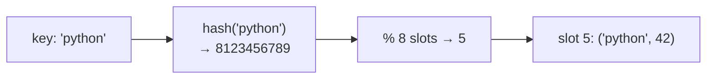

::part[Pelajari Konsepnya]{n="1"}

## 🎯 Yang akan kamu pelajari

- Bagaimana :term[hash table]{bahasa="tabel hash — struktur data yang memetakan kunci ke nilai memakai fungsi hash"} memberikan pencarian O(1) rata-rata
- Collision, load factor, dan kenapa worst case adalah O(n)
- Apa yang bisa jadi kunci (hashable, immutable) dan kenapa
- Pola utama: **seen-set**, **counting**, **grouping by key**, **index lookup**
- `Counter`, `defaultdict`, dan pandangan pertama tentang **heap** untuk top-k

## 🔤 Istilah penting

| Istilah | Artinya (sederhana) |
|---|---|
| **Hash map (dict)** | Simpan nilai di bawah kunci, temukan langsung |
| **Set** | Ide yang sama, tapi hanya kunci: "ada di sini?" |
| **Hash function** | Ubah kunci jadi nomor slot |
| **Collision** | Dua kunci jatuh ke slot yang sama |
| **Hashable** | Nilai stabil cukup jadi kunci (str, int, tuple) |
| **Average O(1)** | Biasanya langsung, ukuran berapa pun |
| **Seen-set** | Ingat apa yang sudah pernah kamu lihat saat looping |
| **Counting** | Hitung berapa kali setiap nilai muncul |
| **Grouping** | Masukkan item ke ember berdasarkan kunci bersama |

## 🧠 Ide besarnya

Hash map itu seperti **layanan coat check**. Kamu serahkan jas (nilai) dan dapat nomor tiket dihitung dari namamu (kunci → hash → slot). Untuk ambil jas lagi, petugas tidak cari setiap gantungan — mereka hitung nomor yang sama dan langsung ke gantungan itu.

Array lompat ke posisi pakai **index**. Hash map lompat ke posisi pakai **kunci**.

## ❓ Kenapa ini penting

Banyak masalah bermuara pada *"sudah pernah ketemu ini?"*, *"berapa banyak yang masing-masing?"* atau *"di mana item dengan kunci ini?"*. Pakai list, setiap pertanyaan adalah scan — O(n) — dan dalam loop itu jadi O(n²). Hash map jawab dalam O(1) rata-rata, ubah solusi O(n²) jadi O(n).

Itulah kenapa *"bisa pakai hash map di sini?"* adalah pertanyaan pertama di kebanyakan masalah interview.

Tanpa hash map:

```python
def has_duplicate(emails):          # 100,000 sign-ups
    for i, email in enumerate(emails):
        if email in emails[:i]:     # O(n) scan inside an O(n) loop → O(n²)
            return True
    return False
```

Sepuluh miliar perbandingan, untuk pertanyaan yang set jawab dalam satu pass.

## 📖 Langkah demi langkah

### 1. Hash → slot



1. `hash(key)` ubah kunci jadi integer besar.
2. Tabel memetakannya ke slot (konsepnya `hash % capacity`).
3. Lookup ulangi perhitungan yang sama dan cek kunci cocok.

### 2. Collision dan resizing

Kalau dua jas dapat nomor gantungan yang sama, petugas simpan dua di sana dan cek namanya. Collision jarang terjadi, hampir tidak ada biaya; itulah kenapa rata-rata tetap O(1) walaupun worst case O(n).

Dua kunci bisa jatuh ke slot yang sama (sebuah **collision**). Python pakai **open addressing**: coba slot lain dalam urutan tetap. Kalau tabel terlalu penuh (high **load factor**), Python alokasi tabel lebih besar dan masukkan ulang semuanya — jarang, jadi insert tetap **amortized O(1)**.

Worst case (banyak collision) adalah O(n), tapi dengan fungsi hash yang baik, itu praktis tidak pernah jadi masalah untuk tipe built-in.

### 3. Apa yang bisa jadi kunci?

Kunci tidak boleh berubah setelah diisi, atau nomor tiket berhenti cocok dengan gantungan. Itulah kenapa list tidak bisa jadi kunci tapi tuple bisa.

Kunci harus **hashable**: hash-nya tidak boleh berubah. Built-in yang immutable berhasil: `str`, `int`, `tuple` (dari yang hashable), `frozenset`. List dan dict tidak:

```python
seen = set()
seen.add((2, 3))        # ✅ tuple
seen.add([2, 3])        # ❌ TypeError: unhashable type: 'list'
```

Butuh kunci gabungan? Pakai tuple: `(user_id, date)`.

### 4. Biaya

| Operasi | dict / set rata-rata | list |
|---|---|---|
| lookup `x in s`, `d[k]` | **O(1)** | O(n) |
| insert / delete | **O(1)** amortized | O(n) di tengah |
| iterate | O(n) | O(n) |
| memori | lebih banyak (slot kosong) | lebih sedikit |

Sejak Python 3.7, dict jaga **insertion order** (set tidak jamin urutan).

### 5. Pola: seen-set

```python
def first_repeat(items):
    seen = set()
    for item in items:
        if item in seen:
            return item
        seen.add(item)
    return None
```

### 6. Pola: counting

```python
counts = {}
for word in words:
    counts[word] = counts.get(word, 0) + 1

from collections import Counter
counts = Counter(words)              # same, in one line
counts.most_common(3)
```

### 7. Pola: grouping by a key

Pilih kunci yang **sama untuk semuanya dalam grup**:

```python
from collections import defaultdict

groups = defaultdict(list)
for word in words:
    groups["".join(sorted(word))].append(word)   # anagrams share sorted letters
```

Rancang kuncinya adalah bagian kreatif: huruf terurut, tuple hitung huruf, `(city, role)`, `email.lower()`.

### 8. Pola: index lookup (complement)

Stage 1's pair-sum: simpan `value → index`, dan untuk setiap angka tanya *"apakah `target − number` sudah tersimpan?"* Satu pass, O(n).

### 9. Set untuk membership dan set algebra

```python
mine = {"python", "sql"}
wanted = {"python", "docker", "sql"}
mine & wanted     # {'python', 'sql'}   intersection
wanted - mine     # {'docker'}          what to learn next
```

### 10. Top-k dengan heap (preview Stage 4)

Setelah counting, kamu sering butuh k terbesar. Urutkan semua d item unik adalah O(d log d). Sebuah **min-heap ukuran k** (`heapq`) simpan hanya best k yang pernah dilihat: O(d log k). Kalau k kecil dan d besar, itu kemenangan besar.

### Memilih setup-mu

Setiap pilihan di sini adalah trade-off:

| Pilihan | ✅ | ❌ |
|---|---|---|
| dict / set | pencarian O(1) rata-rata | memori lebih banyak; tidak urut by value; kunci harus hashable |
| sorted list + binary search | memori lebih sedikit, urut, range query | pencarian O(log n), insert O(n) |
| `Counter.most_common(k)` | sederhana | urutkan atau pakai heap dalam — bagus dalam praktek |
| string key (sorted letters) | mudah dibaca | O(k log k) per kata |
| count-tuple key | O(k) per kata | kode sedikit lebih banyak |

- ✅ "Pernah lihat?", "berapa banyak?", "grup by", "cari pasangan/komplemen", cache hasil (memoization).
- 🚫 Kamu butuh item **dalam urutan** atau **range query** ("semua gaji antara 10M dan 15M") → sorting / binary search / B-tree index.
- 🚫 Memori sangat ketat dan solusi two-pointer pada data terurut ada.
- 🚫 Kunci adalah object mutable.

## ⚠️ Kesalahan umum

- `if x in some_list` dalam loop.
- Pakai list jadi kunci, atau object mutable yang field-nya mempengaruhi hash-nya.
- `d[key] += 1` pada kunci yang tidak ada (`KeyError`) — pakai `get` atau `defaultdict(int)`.
- Asumsikan set jaga insertion order.

## 🏆 Praktik terbaik

- [ ] Tanya awal: *"Bisa dict atau set buat lookup ini jadi O(1)?"* — lalu sebutkan trade-off O(n) extra space.
- [ ] Pakai `set` untuk membership, `dict` untuk key → value, `Counter` untuk count, `defaultdict(list)` untuk groups.
- [ ] Pakai tuple untuk composite key; normalisasi kunci (`strip().lower()`) sebelum hash.
- [ ] Jangan pernah ubah dict/set saat iterate — iterate atas salinan (`list(d.items())`).
- [ ] Jangan andalkan set ordering; urutkan output kalau urutan penting.
- [ ] Saat return "top k", jelaskan aturan tie-breaking dulu.
- [ ] Sebutkan bahwa O(1) rata-rata bisa turun ke O(n) dengan collision adversarial (Python acakkan string hash untuk pertahanan).

::part[Jelaskan & Rancang]{n="2"}

## 🗣️ Jelaskan

Jelaskan ke teman kenapa mencari nomor telepon di **contact app search** langsung walau ada 5,000 kontak, tapi mencari "kontak dengan pesan paling banyak" harus lihat semuanya. Hubungkan ke hash lookup vs scan.

## 📐 Rancang

CareerPilot terima job posting dari 3 job board. Pekerjaan yang sama sering muncul di beberapa board dengan perbedaan kecil: spasi ekstra, huruf besar berbeda, `"Sr."` vs `"Senior"`. Rancang langkah deduplikasi: kunci apa yang akan kamu hash, bagaimana normalize field, dan kompleksitas berapa untuk n posting?

:::quiz
Lihat contoh rancangan

**Normalize** setiap posting ke tuple kunci:
- `company`: trim, lowercase, hapus akhiran seperti `pt`, `tbk`, tanda baca → `"kopi data"`
- `title`: trim, lowercase, runtuhkan spasi, map singkat (`sr.` → `senior`, `jr.` → `junior`, `eng` → `engineer`)
- `city`: lowercase; `remote` sebagai boolean

`key = (company, title, city, remote)`

**Dedupe**: `seen = {}`; untuk setiap posting hitung kunci; jika baru, simpan; jika sudah ada, gabung (jaga `posted_on` paling awal, kumpulkan semua source URL). Waktu **O(n · L)** di mana L adalah panjang teks untuk normalisasi; space O(n).

**Trade-off:** kunci tepat lewatkan near-duplicate ("Backend Engineer (Python)" vs "Python Backend Engineer"). Peningkatan nanti: urutkan token title dalam kunci, atau fuzzy/embedding similarity dalam company yang sama (Module 7), lebih mahal, jadi hanya bandingkan posting yang share company key.
:::

### 📝 Checklist review mandiri

- [ ] Kunci immutable (tuple dari string/bool)
- [ ] Normalisasi terjadi sebelum hash
- [ ] Kompleksitas tertulis, termasuk biaya normalisasi
- [ ] Batas exact matching diakui

::ai-review{task="design"}

::part[Latihan Kecil]{n="3"}

:::problem{id="dsa-s2-hashing-basics" title="Hashing Basics" difficulty="easy" path="exercises/dsa/stage-2/05-hashing-basics"}
Item unik pertama berulang, cek anagram by counting (tanpa sorting), dan skill umum terurut — setiap dalam O(n).
:::

:::problem{id="dsa-s2-group-anagrams" title="Group Anagram Tags" difficulty="medium" path="exercises/dsa/stage-2/06-group-anagrams"}
Kelompokkan tag acak dengan rancang kunci dictionary yang tepat, jaga input order.
:::

:::problem{id="dsa-s2-longest-streak" title="Longest Streak" difficulty="medium" path="exercises/dsa/stage-2/07-longest-consecutive"}
Run konsekutif study hari paling panjang dalam O(n) tanpa sort.
:::

:::problem{id="dsa-s2-top-k-skills" title="Top K Searched Skills" difficulty="hard" path="exercises/dsa/stage-2/08-top-k-frequent"}
Stretch: count, lalu jaga hanya best k dalam heap dengan tie-break benar.
:::

:::hints
- `first_repeat`: cek **sebelum** tambahkan ke set.
- `is_anagram`: tambah count untuk `a`, kurang untuk `b`; count jadi negatif berarti "bukan anagram".
- `group_anagrams`: `"".join(sorted(word))` jadi kunci; tuple hitung huruf hindari sort kata.
- `longest_streak`: `if day - 1 not in present:` baris yang buat O(n).
- `top_k_skills`: `heapq` adalah **min**-heap, jadi top-nya harus **terburuk** dari best k sekarang. Untuk tie, istilah **lebih akhir** alfabet lebih buruk — class kecil dengan `__lt__` buat eksplisit.
:::

## ✅ Cek cepat

:::quiz
Kenapa list tidak bisa jadi dict key?

List mutable, jadi hash-nya bisa berubah setelah insert dan entry hilang di slot salah; Python larang. Pakai tuple.
:::

:::quiz
Waktu dan space berapa untuk "cari duplicate pertama" dengan set?

O(n) waktu dan O(n) space — tukar memori untuk kecepatan vs O(n²) waktu dan O(1) space.
:::


## 📚 Lanjut belajar

- [Dokumentasi Python: collections — Counter, defaultdict](https://docs.python.org/3/library/collections.html)
- [Dokumentasi Python: heapq](https://docs.python.org/3/library/heapq.html)
- [Python wiki: TimeComplexity](https://wiki.python.org/moin/TimeComplexity)
