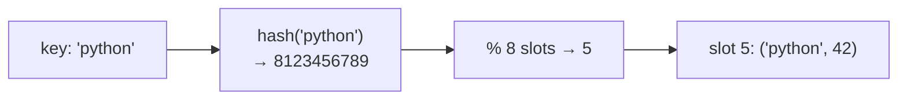

::part[Learn the Concept]{n="1"}

## 🎯 What you'll learn

- How a :term[hash table]{bahasa="tabel hash — struktur data yang memetakan kunci ke nilai memakai fungsi hash"} gives O(1) average lookups
- Collisions, load factor, and why the worst case is O(n)
- What can be a key (hashable, immutable) and why
- The core patterns: **seen-set**, **counting**, **grouping by key**, **index lookup**
- `Counter`, `defaultdict`, and a first look at **heaps** for top-k

## 🔤 Key words

| Word | In simple words | Bahasa Indonesia |
|---|---|---|
| **Hash map (dict)** | Store values under keys, and find them instantly | Peta kunci ke nilai |
| **Set** | The same idea, but only keys: "is this in it?" | Kumpulan nilai unik |
| **Hash function** | Turns a key into a slot number | Pengubah kunci jadi posisi |
| **Collision** | Two keys landing in the same slot | Dua kunci satu slot |
| **Hashable** | A value stable enough to be a key (str, int, tuple) | Bisa dijadikan kunci |
| **Average O(1)** | Usually instant, whatever the size | Biasanya langsung |
| **Seen-set** | Remembering what you've already met while looping | Penanda sudah pernah ada |
| **Counting** | Tallying how many times each value appears | Menghitung kemunculan |
| **Grouping** | Putting items into buckets by a shared key | Mengelompokkan data |

## 🧠 The big idea

A hash map is a **coat check**. You hand over your coat (value) and get a ticket number computed from your name (key → hash → slot). To get your coat back, the attendant doesn't search every hook — they compute the same number and go straight to the hook.

Arrays jump to a position by **index**. Hash maps jump to a position by **key**.

## ❓ Why it matters

So many problems come down to *"have I seen this before?"*, *"how many of each?"* or *"where is the item with this key?"*. With a list each of those is a scan — O(n) — and inside a loop that becomes O(n²). A hash map answers in O(1) on average, turning O(n²) solutions into O(n).

That's why *"can I use a hash map here?"* is the first question to ask in most interview problems.

Without one:

```python
def has_duplicate(emails):          # 100,000 sign-ups
    for i, email in enumerate(emails):
        if email in emails[:i]:     # O(n) scan inside an O(n) loop → O(n²)
            return True
    return False
```

Ten billion comparisons, for a question a set answers in one pass.

## 📖 Step by step

### 1. Hash → slot



1. `hash(key)` turns the key into a big integer.
2. The table maps it to a slot (conceptually `hash % capacity`).
3. Lookup repeats the same computation and checks the key matches.

### 2. Collisions and resizing

When two coats get the same hook number, the attendant keeps both there and checks the names. Rare collisions cost almost nothing; that's why the average stays O(1) even though the worst case is O(n).

Two keys can land in the same slot (a **collision**). Python uses **open addressing**: probe other slots in a fixed sequence. When the table gets too full (high **load factor**), Python allocates a larger table and re-inserts everything — rare, so insertion stays **amortized O(1)**.

Worst case (many collisions) is O(n), but with good hash functions that's practically never an issue for built-in types.

### 3. What can be a key?

A key must not change after it's filed, or the ticket number stops matching the hook. That's why lists can't be keys and tuples can.

Keys must be **hashable**: their hash must never change. Immutable built-ins work: `str`, `int`, `tuple` (of hashables), `frozenset`. Lists and dicts don't:

```python
seen = set()
seen.add((2, 3))        # ✅ tuple
seen.add([2, 3])        # ❌ TypeError: unhashable type: 'list'
```

Need a composite key? Use a tuple: `(user_id, date)`.

### 4. Costs

| Operation | dict / set average | list |
|---|---|---|
| lookup `x in s`, `d[k]` | **O(1)** | O(n) |
| insert / delete | **O(1)** amortized | O(n) in the middle |
| iterate | O(n) | O(n) |
| memory | more (empty slots) | less |

Since Python 3.7, dicts keep **insertion order** (sets don't guarantee order).

### 5. Pattern: seen-set

```python
def first_repeat(items):
    seen = set()
    for item in items:
        if item in seen:
            return item
        seen.add(item)
    return None
```

### 6. Pattern: counting

```python
counts = {}
for word in words:
    counts[word] = counts.get(word, 0) + 1

from collections import Counter
counts = Counter(words)              # same, in one line
counts.most_common(3)
```

### 7. Pattern: grouping by a key

Choose a key that's the **same for everything in a group**:

```python
from collections import defaultdict

groups = defaultdict(list)
for word in words:
    groups["".join(sorted(word))].append(word)   # anagrams share sorted letters
```

Designing the key is the creative part: sorted letters, a letter-count tuple, `(city, role)`, `email.lower()`.

### 8. Pattern: index lookup (complement)

Stage 1's pair-sum: store `value → index`, and for each number ask *"is `target − number` already stored?"* One pass, O(n).

### 9. Sets for membership and set algebra

```python
mine = {"python", "sql"}
wanted = {"python", "docker", "sql"}
mine & wanted     # {'python', 'sql'}   intersection
wanted - mine     # {'docker'}          what to learn next
```

### 10. Top-k with a heap (preview of Stage 4)

After counting, you often need the k largest. Sorting all d distinct items is O(d log d). A **min-heap of size k** (`heapq`) keeps only the best k seen so far: O(d log k). When k is tiny and d is huge, that's a big win.

### Choosing your setup

Every option here is a trade-off:

| Choice | ✅ | ❌ |
|---|---|---|
| dict / set | O(1) average lookup | extra memory; no ordering by value; keys must be hashable |
| sorted list + binary search | less memory, ordered, range queries | O(log n) lookup, O(n) insert |
| `Counter.most_common(k)` | simple | sorts or uses a heap internally — fine in practice |
| string key (sorted letters) | easy to read | O(k log k) per word |
| count-tuple key | O(k) per word | slightly more code |

- ✅ "Seen before?", "how many?", "group by", "find the partner/complement", caching results (memoization).
- 🚫 You need items **in sorted order** or **range queries** ("all salaries between 10M and 15M") → sorting / binary search / a B-tree index.
- 🚫 Memory is extremely tight and a two-pointer solution on sorted data exists.
- 🚫 Keys are mutable objects.

## ⚠️ Common mistakes

- `if x in some_list` inside a loop.
- Using a list as a key, or a mutable object whose fields affect its hash.
- `d[key] += 1` on a missing key (`KeyError`) — use `get` or `defaultdict(int)`.
- Assuming sets keep insertion order.

## 🏆 Best practices

- [ ] Ask early: *"Can a dict or set make this lookup O(1)?"* — then mention the O(n) extra space trade-off.
- [ ] Use `set` for membership, `dict` for key → value, `Counter` for counts, `defaultdict(list)` for groups.
- [ ] Use tuples for composite keys; normalize keys (`strip().lower()`) before hashing.
- [ ] Never mutate a dict/set while iterating over it — iterate over a copy (`list(d.items())`).
- [ ] Don't rely on set ordering; sort the output if the order matters.
- [ ] When returning "top k", clarify tie-breaking rules first.
- [ ] Mention that average O(1) can degrade to O(n) with adversarial collisions (Python randomizes string hashes to defend against this).

::part[Explain & Design]{n="2"}

## 🗣️ Explain it

Explain to a friend why finding a phone number in a **contact app search** is instant even with 5,000 contacts, but finding "the contact with the most messages" requires looking at everyone. Connect it to hash lookups vs scans.

## 📐 Design it

CareerPilot receives job postings from 3 job boards. The same job often appears on several boards with small differences: extra spaces, different casing, `"Sr."` vs `"Senior"`. Design a deduplication step: what key would you hash, how do you normalize fields, and what's the complexity for n postings?

:::quiz
Show a possible design

**Normalize** each posting into a key tuple:
- `company`: trim, lowercase, remove suffixes like `pt`, `tbk`, punctuation → `"kopi data"`
- `title`: trim, lowercase, collapse spaces, map abbreviations (`sr.` → `senior`, `jr.` → `junior`, `eng` → `engineer`)
- `city`: lowercase; `remote` as a boolean

`key = (company, title, city, remote)`

**Dedupe**: `seen = {}`; for each posting compute the key; if new, store it; if seen, merge (keep the earliest `posted_on`, collect all source URLs). Time **O(n · L)** where L is the text length for normalization; space O(n).

**Trade-offs:** exact keys miss near-duplicates ("Backend Engineer (Python)" vs "Python Backend Engineer"). Later improvements: sort title tokens in the key, or fuzzy/embedding similarity within the same company (Module 7), which is more expensive, so only compare postings that share a company key.
:::

### 📝 Self-review checklist

- [ ] Key is immutable (tuple of strings/bools)
- [ ] Normalization happens before hashing
- [ ] Complexity stated, including normalization cost
- [ ] Limits of exact matching acknowledged

::ai-review{task="design"}

::part[Practice Problems]{n="3"}

:::problem{id="dsa-s2-hashing-basics" title="Hashing Basics" difficulty="easy" path="exercises/dsa/stage-2/05-hashing-basics"}
First repeated item, anagram check by counting (no sorting), and ordered common skills — each in O(n).
:::

:::problem{id="dsa-s2-group-anagrams" title="Group Anagram Tags" difficulty="medium" path="exercises/dsa/stage-2/06-group-anagrams"}
Group scrambled tags by designing the right dictionary key, keeping input order.
:::

:::problem{id="dsa-s2-longest-streak" title="Longest Streak" difficulty="medium" path="exercises/dsa/stage-2/07-longest-consecutive"}
Longest run of consecutive study days in O(n) without sorting.
:::

:::problem{id="dsa-s2-top-k-skills" title="Top K Searched Skills" difficulty="hard" path="exercises/dsa/stage-2/08-top-k-frequent"}
Stretch: count, then keep only the best k in a heap with correct tie-breaking.
:::

:::hints
- `first_repeat`: check **before** adding to the set.
- `is_anagram`: increment counts for `a`, decrement for `b`; a count going below zero means "not an anagram".
- `group_anagrams`: `"".join(sorted(word))` works as a key; a tuple of letter counts avoids sorting the word.
- `longest_streak`: `if day - 1 not in present:` is the line that makes it O(n).
- `top_k_skills`: `heapq` is a **min**-heap, so its top should be the *worst* of your current best k. For ties, the alphabetically **later** term is worse — a small class with `__lt__` makes this explicit.
:::

## ✅ Quick check

:::quiz
Why can't a list be a dict key?

Lists are mutable, so their hash could change after insertion and the entry would be lost in the wrong slot; Python forbids it. Use a tuple.
:::

:::quiz
What's the time and space of "find the first duplicate" with a set?

O(n) time and O(n) space — trading memory for speed compared with O(n²) time and O(1) space.
:::


## 📚 Keep learning

- [Python docs: collections — Counter, defaultdict](https://docs.python.org/3/library/collections.html)
- [Python docs: heapq](https://docs.python.org/3/library/heapq.html)
- [Python wiki: TimeComplexity](https://wiki.python.org/moin/TimeComplexity)
