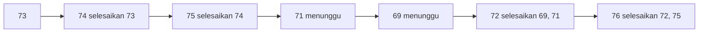

::part[Pelajari Konsepnya]{n="1"}

## 🎯 Yang akan kamu pelajari

- :term[Stack]{bahasa="tumpukan — yang terakhir masuk, pertama keluar (LIFO)"} (LIFO) dan :term[queue]{bahasa="antrian — yang pertama masuk, pertama keluar (FIFO)"} (FIFO) — dan masalah nyata yang masing-masing selesaikan
- Membuat stack dan antrian di Python: `list` sebagai stack, `collections.deque` sebagai antrian
- Masalah stack klasik: pencocokan kurung, undo/backspace, evaluasi ekspresi
- Stack yang diperkuat (O(1) minimum)
- Pola **monotonic stack** untuk masalah "nilai lebih besar berikutnya"
- Antrian di sistem backend: antrian kerja, preview BFS, rate limiting dengan jendela geser

## 🔤 Istilah penting

| Istilah | Artinya (sederhana) |
|---|---|
| **Stack (LIFO)** | Tumpukan — yang masuk terakhir keluar pertama, seperti tumpukan piring |
| **Queue (FIFO)** | Antrian — yang masuk duluan keluar duluan, seperti antrean di bank |
| **Push / pop** | Menaruh di atas / mengambil dari atas | 
| **Enqueue / dequeue** | Masuk ke belakang antrean / keluar dari depan antrean |
| **`deque`** | Antrean dua ujung di Python, cepat di kedua sisinya |
| **Augmented stack** | Stack yang juga mencatat informasi tambahan (seperti nilai minimum) |
| **Monotonic stack** | Stack yang selalu bertambah atau berkurang |
| **Next greater element** | Masalah klasik yang monotonic stack selesaikan |
| **Job queue** | Pekerjaan yang menunggu untuk dikerjakan oleh pekerja |

## 🧠 Ide besarnya

- **Stack** itu tumpukan piring: kamu menambah dan mengambil dari bagian **atas**. Piring terakhir yang kamu letakkan adalah yang pertama kamu ambil.
- **Antrian** itu barisan di bank: orang bergabung di **belakang** dan dilayani dari **depan**. Yang tiba duluan dilayani duluan.

Satu pelajaran besar: pilih tumpukan atau antrian yang tepat — dan pilih tipe Python yang membuat kedua operasi menjadi O(1).

## ❓ Kenapa ini penting

Banyak proses punya urutan alami:

| Stack (LIFO) | Antrian (FIFO) |
|---|---|
| Undo di editor | Print job, pengirim email |
| Tombol "kembali" browser | Tiket dukungan pelanggan |
| Call stack fungsi (Tahap 1) | Request menunggu worker Gunicorn |
| Pencocokan `(` dengan `)` | Pencarian breadth-first (Tahap 4) |

Pilih yang salah — atau tipe Python yang salah — akan merusak performa diam-diam: `list.pop(0)` menggeser semua elemen lainnya, jadi "antrian" dengan list adalah O(n) per pelanggan, bukan O(1).

## 📖 Langkah demi langkah

### 1. Stack di Python: sebuah list

```python
stack = []
stack.append("a")    # push  — O(1)
stack.append("b")
stack[-1]            # peek  — 'b', O(1)
stack.pop()          # pop   — 'b', O(1)
not stack            # empty? — O(1)
```

Selalu gunakan **ujung** list-nya.

### 2. Antrian di Python: sebuah deque

```python
from collections import deque

queue = deque()
queue.append("job-1")     # enqueue at the right — O(1)
queue.append("job-2")
queue.popleft()           # dequeue from the left — 'job-1', O(1)
```

`deque` adalah antrian berujung dua: O(1) di kedua ujung (tapi O(n) untuk indexing di tengah). `queue.Queue` juga ada — itu untuk komunikasi **thread-safe** antar thread, bukan untuk algoritma.

### 3. Pencocokan kurung

Ini adalah trik istimewa stack: setiap kurung buka diletakkan di tumpukan, setiap kurung tutup harus cocok dengan piring di paling atas. Jika tumpukan tidak kosong di akhir, ada kurung yang tidak ditutup.

```python
PAIRS = {")": "(", "]": "[", "}": "{"}

def is_balanced(text):
    stack = []
    for char in text:
        if char in "([{":
            stack.append(char)
        elif char in PAIRS:
            if not stack or stack.pop() != PAIRS[char]:
                return False
    return not stack         # leftovers = unclosed brackets
```

```text
"{[()]}"   push {  push [  push (  ) cocok (  ] cocok [  } cocok {  → kosong ✅
"([)]"     push (  push [  ) vs [ ❌
```

Tiga cara gagal yang perlu ingat: **kurung tutup salah**, **kurung tutup tapi stack kosong**, **kurung buka tertinggal di akhir**.

### 4. Augmented stack: minimum dalam O(1)

Simpan bersama nilai setiap elemen nilai minimum **saat itu juga**:

```text
push 5 → (5, min 5)
push 2 → (2, min 2)
push 7 → (7, min 2)
pop    → kembali ke (2, min 2) — nilai min sudah diketahui, tanpa scan
```

Trik yang sama menjawab "max sampai sini", "jumlah sampai sini" — habiskan sedikit memori untuk query O(1).

### 5. Evaluasi ekspresi (RPN)

Di `3 4 + 2 *`, masukkan angka; operator pop dua, hitung, push hasilnya. Compiler dan kalkulator mengubah ekspresi infix biasa ke bentuk ini (algoritma shunting-yard) karena mudah dievaluasi dengan stack.

### 6. Monotonic stack

Bayangkan orang berbaris menurut tinggi, di mana siapa pun lebih pendek dari yang baru tiba mundur ke belakang: siapa yang tertinggal adalah persis jawaban untuk "siapa yang lebih tinggi berikutnya?".

**Bentuk masalah**: *"untuk setiap elemen, cari elemen berikutnya ke kanan yang lebih besar (atau lebih kecil)."*

Cara brute force lihat ke depan dari setiap elemen: O(n²). **Monotonic stack** menjaga indeks yang belum terjawab, dalam urutan nilai menurun. Setiap nilai baru **selesaikan** setiap nilai lebih kecil di puncak stack:

```python
answer = [0] * len(prices)
waiting = []                                  # indices, prices non-increasing
for day, price in enumerate(prices):
    while waiting and prices[waiting[-1]] < price:
        earlier = waiting.pop()
        answer[earlier] = day - earlier       # found its next higher price
    waiting.append(day)
```

Setiap indeks dimasukkan sekali dan dikeluarkan paling sekali → **O(n)** total, meskipun ada loop dalam loop.



:::tip[🧭 Cara mengenali monotonic stack]
"Elemen lebih besar/lebih kecil berikutnya", "hari sampai lebih hangat", "stock span", "persegi panjang terbesar di histogram", "buang digit untuk buat angka terkecil". Jika cara brute force **lihat ke depan atau belakang sampai nilai lebih besar/kecil**, pikir monotonic stack.
:::

### 7. Antrian di sistem backend

- **Antrian kerja**: request web menambahkan "kirim email sambutan"; pekerja mengeluarkan dan prosesnya (Modul 5).
- **Rate limiting jendela geser**: simpan timestamp request terbaru pengguna di deque; buang timestamp lebih tua dari jendela dari kiri, tambah yang baru di kanan. Setiap timestamp masuk dan keluar sekali → amortized O(1).

### Pilih setup-mu

Setiap pilihan di sini adalah trade-off:

| Pilihan | ✅ | ❌ |
|---|---|---|
| `list` sebagai stack | tercepat, paling sederhana | `pop(0)` adalah O(n) — jangan pernah pakai sebagai antrian |
| `deque` | O(1) di kedua ujung, `maxlen` untuk buffer terbatas | akses acak di tengah lambat |
| `queue.Queue` | thread-safe, `get()` memblok | overhead locking; bukan untuk algoritma single-threaded |
| Sliding log rate limiter | akurat | memori per timestamp request |
| Fixed window counter | memori kecil | boleh burst di tepi jendela |
| Token bucket | mulus, memori kecil | sedikit lebih banyak math (Arsitektur F) |

- ✅ Stack: struktur bertumpuk, undo, "paling baru yang belum cocok", DFS, masalah next-greater.
- ✅ Antrian: proses sesuai urutan tiba, BFS, buffering, scheduling.
- 🚫 Butuh elemen **terkecil/prioritas tertinggi** bukan yang tertua → **heap** (priority queue).
- 🚫 Perlu cari atau index di tengah sering → list/dict.

## ⚠️ Kesalahan umum

- `pop()` di list kosong → `IndexError` di edge case yang tidak kamu test.
- Lupa cek sisa di akhir pencocokan kurung.
- Simpan nilai bukan indeks di monotonic stack, lalu tidak bisa hitung jarak.
- Gunakan `<=` vs `<` salah untuk "strictly lebih besar" di kondisi stack.

## 🏆 Praktik terbaik

- [ ] Gunakan `list` untuk stack dan `collections.deque` untuk antrian — jangan pernah `list.pop(0)` dalam loop.
- [ ] Cek stack/antrian kosong **sebelum** pop; tentukan API-mu berbuat apa saat kosong (raise `IndexError`, return `None`).
- [ ] Simpan **indeks** di monotonic stack, bukan nilai — biasanya kamu butuh jarak atau posisi.
- [ ] Jelaskan analisis amortized: "setiap elemen dimasukkan dan dikeluarkan sekali, jadi loop bertumpuk adalah O(n) keseluruhan".
- [ ] Untuk concurrency antar thread gunakan `queue.Queue`; lintas proses/server gunakan broker asli (Redis, SQS, RabbitMQ).
- [ ] Di rate limiter production, simpan state di toko terbagi (Redis) — deque di memori hanya kerja satu proses.

::part[Jelaskan & Rancang]{n="2"}

## 🗣️ Jelaskan

Jelaskan ke seseorang bukan programmer kenapa editor **undo** pakai stack, dan apa yang **redo** stack lakukan setelah kamu undo dua kali lalu ketik huruf baru.

## 📐 Rancang

CareerPilot kirim pengingat email ("follow up dengan Kopi Data"). Sampai 5.000 pengingat jatuh tempo jam 09:00. Penyedia email memungkinkan **10 email per detik**. Rancang alur menggunakan antrian dan rate limiter: apa yang dimasukkan antrian, siapa yang mengeluarkan, bagaimana kamu hormati batas penyedia, dan apa yang terjadi kalau kirim gagal.

:::quiz
Lihat contoh rancangan

1. **Scheduler** (jalan setiap menit): cari pengingat jatuh tempo dan **masukkan** satu job per pengingat `{reminder_id, attempt: 1}` — FIFO jadi pengingat awal duluan. Tandai `queued` hindari double-enqueue.
2. **Worker loop**: `popleft()` satu job → tanya **rate limiter** (10/s jendela geser atau token bucket). Tidak boleh, tidur sampai timestamp tertua keluar dari jendela (atau ~100 ms) lalu coba lagi.
3. **Kirim** lewat penyedia dengan timeout. Sukses → tandai `sent`. Gagal temporer (timeout, 429, 5xx) → masukkan ulang dengan `attempt + 1` dan delay (exponential backoff, Minggu 5). Gagal permanen (email tidak valid) → tandai `failed`, jangan retry. Setelah max attempts → dead-letter list untuk review manual.
4. **Math throughput**: 5.000 email ÷ 10/s = 500 s ≈ 8,3 menit — bisa terima untuk pengingat; katakan pengguna "sekitar 09:00".

Di production, deque di memori jadi antrian tahan lama (Redis/SQS) jadi job selamat dari restart, dan state limiter hidup di Redis ada beberapa worker.
:::

### 📝 Checklist review mandiri

- [ ] Urutan FIFO dan tanpa pengiriman dobel
- [ ] Batas rate dihormati bahkan saat retry
- [ ] Kegagalan temporer vs permanen ditangani berbeda
- [ ] Throughput dihitung

::ai-review{task="design"}

::part[Latihan Kecil]{n="3"}

:::problem{id="dsa-s2-stack-queue-basics" title="Stack & Antrian Dasar" difficulty="easy" path="exercises/dsa/stage-2/09-stack-queue-basics"}
Pencocokan kurung, editing backspace dengan stack, dan `MinStack` dengan minimum O(1).
:::

:::problem{id="dsa-s2-evaluate-rpn" title="Kalkulator RPN" difficulty="medium" path="exercises/dsa/stage-2/10-evaluate-rpn"}
Evaluasi Reverse Polish Notation dengan stack — pembagian potong dan input tidak valid termasuk.
:::

:::problem{id="dsa-s2-days-until-higher" title="Hari Sampai Harga Lebih Tinggi" difficulty="medium" path="exercises/dsa/stage-2/11-next-higher"}
Pola monotonic stack: nilai strictly lebih tinggi berikutnya untuk setiap hari dalam O(n).
:::

:::problem{id="dsa-s2-rate-limiter" title="Rate Limiter Jendela Geser" difficulty="hard" path="exercises/dsa/stage-2/12-rate-limiter"}
Stretch: batas per-pengguna dengan deque timestamp — algoritma yang API gateway asli pakai.
:::

:::hints
- `apply_backspaces`: list karakter yang disimpan adalah stack; `#` pop jika tidak kosong.
- `MinStack`: push `(value, min(value, current_min))`.
- `evaluate_rpn`: pop **kanan** dulu, lalu kiri (urutan penting untuk `-` dan `/`). Potong ke nol dengan `int(left / right)` untuk angka kecil, atau dengan `abs` dan tanda untuk math integer eksak.
- `days_until_higher`: kondisi while-loop pakai `<` untuk **strictly** lebih tinggi.
- `RateLimiter`: buang dengan `while log and now - log[0] >= window: log.popleft()`.
:::

## ✅ Cek cepat

:::quiz
Kenapa `list.pop(0)` operasi antrian yang jelek?

Ia menggeser setiap elemen sisa satu posisi ke kiri — O(n) per dequeue. `deque.popleft()` adalah O(1).
:::

:::quiz
Solusi monotonic stack punya `while` dalam `for`. Kenapa tetap O(n)?

Setiap indeks dimasukkan sekali dan dikeluarkan paling sekali di seluruh jalannya, jadi total kerja semua inner loop paling banyak n.
:::


## 📚 Lanjut belajar

- [Dokumen Python: Menggunakan list sebagai stack dan antrian](https://docs.python.org/3/tutorial/datastructures.html#using-lists-as-stacks)
- [Dokumen Python: collections.deque](https://docs.python.org/3/library/collections.html#collections.deque)
- [Blog Cloudflare: Cara kami membangun rate limiting yang bisa scale ke jutaan domain](https://blog.cloudflare.com/counting-things-a-lot-of-different-things/)
