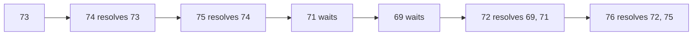

::part[Learn the Concept]{n="1"}

## 🎯 What you'll learn

- :term[Stack]{bahasa="tumpukan — yang terakhir masuk, pertama keluar (LIFO)"} (LIFO) and :term[queue]{bahasa="antrean — yang pertama masuk, pertama keluar (FIFO)"} (FIFO) — and which real problems each models
- Implementing them in Python: `list` as a stack, `collections.deque` as a queue
- Classic stack problems: matching brackets, undo/backspace, expression evaluation
- Augmented stacks (O(1) minimum)
- The **monotonic stack** pattern for "next greater" problems
- Queues in backend systems: job queues, BFS preview, sliding-window rate limiting

## 🔤 Key words

| Word | In simple words | Bahasa Indonesia |
|---|---|---|
| **Stack (LIFO)** | Last in, first out — like a pile of plates | Tumpukan |
| **Queue (FIFO)** | First in, first out — like a bank queue | Antrean |
| **Push / pop** | Add to the top / take from the top | Menaruh / mengambil |
| **Enqueue / dequeue** | Join the back / leave the front | Masuk antrean / keluar antrean |
| **`deque`** | Python's double-ended queue, fast at both ends | Antrean dua ujung |
| **Augmented stack** | A stack that also tracks something extra (like the minimum) | Tumpukan dengan info tambahan |
| **Monotonic stack** | A stack kept always increasing or decreasing | Tumpukan berurutan |
| **Next greater element** | The classic problem a monotonic stack solves | Nilai lebih besar berikutnya |
| **Job queue** | Work waiting to be handled by a worker | Antrean pekerjaan |

## 🧠 The big idea

- A **stack** is a pile of plates: you add and remove from the **top**. The last plate you put down is the first you pick up.
- A **queue** is the line at a bank: people join at the **back** and are served from the **front**. First come, first served.

The whole lesson is choosing the right pile or line — and the right Python type so both operations are O(1).

## ❓ Why it matters

Many processes have a natural order:

| Stack (LIFO) | Queue (FIFO) |
|---|---|
| Undo in an editor | Print jobs, email sending jobs |
| Browser back button | Customer support tickets |
| The function call stack (Stage 1) | Requests waiting for a Gunicorn worker |
| Matching `(` with `)` | Breadth-first search (Stage 4) |

Choosing the wrong one — or the wrong Python type — quietly costs performance: `list.pop(0)` shifts every remaining item, so a "queue" built on a list is O(n) per customer instead of O(1).

## 📖 Step by step

### 1. Stack in Python: a list

```python
stack = []
stack.append("a")    # push  — O(1)
stack.append("b")
stack[-1]            # peek  — 'b', O(1)
stack.pop()          # pop   — 'b', O(1)
not stack            # empty? — O(1)
```

Always use the **end** of the list.

### 2. Queue in Python: a deque

```python
from collections import deque

queue = deque()
queue.append("job-1")     # enqueue at the right — O(1)
queue.append("job-2")
queue.popleft()           # dequeue from the left — 'job-1', O(1)
```

`deque` is a doubly-ended queue: O(1) at both ends (but O(n) indexing in the middle). `queue.Queue` exists too — it's for **thread-safe** communication between threads, not for algorithms.

### 3. Matching brackets

This is the stack's party trick: every opening bracket goes on the pile, every closing bracket must match the plate on top. If the pile isn't empty at the end, something was never closed.

```python
PAIRS = {")": "(", "]": "[", "}": "{"}

def is_balanced(text):
    stack = []
    for char in text:
        if char in "([{":
            stack.append(char)
        elif char in PAIRS:
            if not stack or stack.pop() != PAIRS[char]:
                return False
    return not stack         # leftovers = unclosed brackets
```

```text
"{[()]}"   push {  push [  push (  ) matches (  ] matches [  } matches {  → empty ✅
"([)]"     push (  push [  ) vs [ ❌
```

Three failure modes to remember: **wrong closer**, **closer with empty stack**, **openers left at the end**.

### 4. Augmented stack: minimum in O(1)

Store alongside each value the minimum **at that moment**:

```text
push 5 → (5, min 5)
push 2 → (2, min 2)
push 7 → (7, min 2)
pop    → back to (2, min 2) — the min is already known, no scan
```

The same trick answers "max so far", "sum so far" — pay a little memory for O(1) queries.

### 5. Expression evaluation (RPN)

In `3 4 + 2 *`, push numbers; an operator pops two, computes, pushes the result. Compilers and calculators convert normal infix expressions to this form (the shunting-yard algorithm) because it's trivial to evaluate with a stack.

### 6. The monotonic stack

Think of people queueing by height, where anyone shorter than the newcomer steps aside: whoever is left is exactly the answer to "who's the next taller person?".

**Problem shape**: *"for each element, find the next element to the right that is greater (or smaller)."*

Brute force looks ahead from every element: O(n²). A **monotonic stack** keeps indices whose answer is still unknown, in decreasing order of value. Each new value **resolves** every smaller value on top of the stack:

```python
answer = [0] * len(prices)
waiting = []                                  # indices, prices non-increasing
for day, price in enumerate(prices):
    while waiting and prices[waiting[-1]] < price:
        earlier = waiting.pop()
        answer[earlier] = day - earlier       # found its next higher price
    waiting.append(day)
```

Each index is pushed once and popped at most once → **O(n)** total, even though there's a loop inside a loop.



:::tip[🧭 How to spot a monotonic stack]
"Next greater/smaller element", "days until warmer", "stock span", "largest rectangle in a histogram", "remove digits to make the smallest number". If a brute force looks **ahead or back until a bigger/smaller value**, think monotonic stack.
:::

### 7. Queues in backend systems

- **Job queues**: a web request enqueues "send welcome email"; a worker dequeues and processes it (Module 5).
- **Sliding-window rate limiting**: keep each user's recent request timestamps in a deque; evict timestamps older than the window from the left, append new ones on the right. Each timestamp enters and leaves once → amortized O(1).

### Choosing your setup

Every option here is a trade-off:

| Choice | ✅ | ❌ |
|---|---|---|
| `list` as stack | fastest, simplest | `pop(0)` is O(n) — never use it as a queue |
| `deque` | O(1) at both ends, `maxlen` for bounded buffers | slow random access in the middle |
| `queue.Queue` | thread-safe, blocking `get()` | locking overhead; not for single-threaded algorithms |
| Sliding log rate limiter | exact | memory per request timestamp |
| Fixed window counter | tiny memory | allows bursts at window edges |
| Token bucket | smooth, small memory | slightly more math (Architecture F) |

- ✅ Stack: nested structures, undo, "most recent unmatched", DFS, next-greater problems.
- ✅ Queue: processing in arrival order, BFS, buffering, scheduling.
- 🚫 Need the **smallest/highest-priority** item rather than the oldest → a **heap** (priority queue).
- 🚫 Need to search or index in the middle often → list/dict.

## ⚠️ Common mistakes

- `pop()` on an empty list → `IndexError` in an edge case you didn't test.
- Forgetting to check leftovers at the end of bracket matching.
- Storing values instead of indices in a monotonic stack, then being unable to compute distances.
- Using `<=` vs `<` wrongly for "strictly greater" in the stack condition.

## 🏆 Best practices

- [ ] Use `list` for stacks and `collections.deque` for queues — never `list.pop(0)` in a loop.
- [ ] Check for an empty stack/queue **before** popping; decide what the API does when empty (raise `IndexError`, return `None`).
- [ ] Store **indices** in monotonic stacks, not values — you usually need the distance or position.
- [ ] Explain amortized analysis: "each element is pushed and popped once, so the nested loop is O(n) overall".
- [ ] For concurrency between threads use `queue.Queue`; across processes/servers use a real broker (Redis, SQS, RabbitMQ).
- [ ] In production rate limiters, store state in a shared store (Redis) — an in-memory deque only works for one process.

::part[Explain & Design]{n="2"}

## 🗣️ Explain it

Explain to a non-programmer why an editor's **undo** uses a stack, and what a **redo** stack would do after you undo twice and then type a new letter.

## 📐 Design it

CareerPilot sends email reminders ("follow up with Kopi Data"). Up to 5,000 reminders become due at 09:00. The email provider allows **10 emails per second**. Design the flow using a queue and a rate limiter: what gets enqueued, who dequeues, how you respect the provider limit, and what happens when a send fails.

:::quiz
Show a possible design

1. **Scheduler** (runs every minute): finds due reminders and **enqueues** one job per reminder `{reminder_id, attempt: 1}` — FIFO so earlier reminders go first. Marks them `queued` to avoid double-enqueue.
2. **Worker** loop: `popleft()` a job → ask the **rate limiter** (10/s sliding window or token bucket). If not allowed, sleep until the oldest timestamp leaves the window (or ~100 ms) and retry.
3. **Send** via provider with a timeout. Success → mark `sent`. Temporary failure (timeout, 429, 5xx) → re-enqueue with `attempt + 1` and a delay (exponential backoff, Week 5). Permanent failure (invalid email) → mark `failed`, don't retry. After max attempts → dead-letter list for manual review.
4. **Throughput math**: 5,000 emails ÷ 10/s = 500 s ≈ 8.3 minutes — acceptable for reminders; tell users "around 9:00".

In production the in-memory deque becomes a durable queue (Redis/SQS) so jobs survive restarts, and the limiter state lives in Redis if there are several workers.
:::

### 📝 Self-review checklist

- [ ] FIFO order and no double sends
- [ ] Rate limit respected even with retries
- [ ] Temporary vs permanent failures handled differently
- [ ] Throughput calculated

::ai-review{task="design"}

::part[Practice Problems]{n="3"}

:::problem{id="dsa-s2-stack-queue-basics" title="Stack & Queue Basics" difficulty="easy" path="exercises/dsa/stage-2/09-stack-queue-basics"}
Bracket matching, backspace editing with a stack, and a `MinStack` with O(1) minimum.
:::

:::problem{id="dsa-s2-evaluate-rpn" title="RPN Calculator" difficulty="medium" path="exercises/dsa/stage-2/10-evaluate-rpn"}
Evaluate Reverse Polish Notation with a stack — truncating division and invalid input included.
:::

:::problem{id="dsa-s2-days-until-higher" title="Days Until a Higher Price" difficulty="medium" path="exercises/dsa/stage-2/11-next-higher"}
The monotonic stack pattern: next strictly higher value for every day in O(n).
:::

:::problem{id="dsa-s2-rate-limiter" title="Sliding-Window Rate Limiter" difficulty="hard" path="exercises/dsa/stage-2/12-rate-limiter"}
Stretch: per-user limits with a deque of timestamps — the same algorithm real API gateways use.
:::

:::hints
- `apply_backspaces`: a list of kept characters is a stack; `#` pops if not empty.
- `MinStack`: push `(value, min(value, current_min))`.
- `evaluate_rpn`: pop **right** first, then left (order matters for `-` and `/`). Truncate toward zero with `int(left / right)` for small numbers, or with `abs` and a sign for exact integer math.
- `days_until_higher`: the while-loop condition uses `<` for **strictly** higher.
- `RateLimiter`: evict with `while log and now - log[0] >= window: log.popleft()`.
:::

## ✅ Quick check

:::quiz
Why is `list.pop(0)` a bad queue operation?

It shifts every remaining element one position left — O(n) per dequeue. `deque.popleft()` is O(1).
:::

:::quiz
The monotonic stack solution has a `while` inside a `for`. Why is it still O(n)?

Each index is pushed once and popped at most once across the entire run, so the total work of all inner loops is at most n.
:::


## 📚 Keep learning

- [Python docs: Using lists as stacks and queues](https://docs.python.org/3/tutorial/datastructures.html#using-lists-as-stacks)
- [Python docs: collections.deque](https://docs.python.org/3/library/collections.html#collections.deque)
- [Cloudflare blog: How we built rate limiting capable of scaling to millions of domains](https://blog.cloudflare.com/counting-things-a-lot-of-different-things/)
