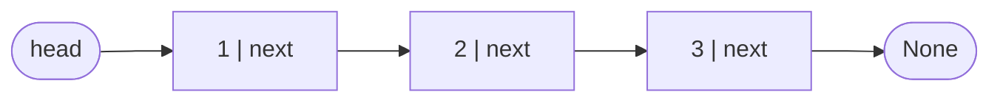
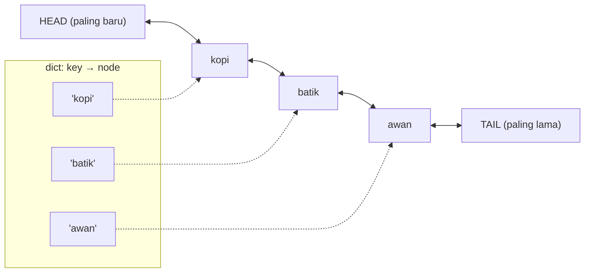

::part[Pelajari Konsepnya]{n="1"}

## 🎯 Yang akan kamu pelajari

- Perbedaan :term[linked list]{bahasa="senarai berantai — node yang saling terhubung lewat referensi"} dengan array, dan biaya tiap operasi
- Linked list satu arah vs dua arah, dan node **sentinel/dummy**
- Mengubah tautan tanpa kehilangan node (reversal)
- **Dua penunjuk dengan kecepatan berbeda**: cari tengah, deteksi loop, elemen ke-n dari akhir
- Kenapa sistem nyata masih pakai linked list (cache LRU, queue, free list)

## 🔤 Istilah penting

| Istilah | Artinya (sederhana) |
|---|---|
| **Linked list** | Item terhubung dengan referensi, bukan tersimpan berdampingan |
| **Node** | Satu item: nilai plus tautan ke item berikutnya |
| **Head / tail** | Node pertama / node terakhir |
| **Singly / doubly linked** | Tautan ke depan saja / tautan dua arah |
| **Traversal** | Berjalan di rantai mulai dari head |
| **Rewiring** | Mengubah tautan antar node |
| **Dummy (sentinel) node** | Node palsu di depan agar kasus tepi tidak perlu kode khusus |
| **Fast & slow pointers** | Dua penunjuk dengan kecepatan berbeda — cari tengah atau loop |
| **LRU cache** | Simpan item yang baru dipakai, buang yang paling lama tidak dipakai |

## 🧠 Ide besarnya

Array seperti **deretan loker yang dinomori**. Linked list seperti **perburuan harta karun**: setiap petunjuk (node) memiliki nilai dan memberi tahu di mana petunjuk selanjutnya. Kamu tidak bisa langsung melompat ke petunjuk #500 — kamu harus ikuti rantainya. Tapi memasukkan petunjuk baru di tengah dua petunjuk lain hanya berarti mengubah **satu catatan**; tidak ada yang perlu bergerak.

## ❓ Kenapa ini penting

Array membuat penyisipan atau penghapusan di tengah menjadi O(n), karena semuanya bergeser. Kalau kamu sudah **punya referensi** ke sebuah node, linked list menyisipkan atau menghapus di sampingnya dalam O(1). Itu membuat linked list menjadi tulang punggung dari

- `collections.deque` (linked list blok-blok),
- cache LRU (pindahkan item ke "paling baru" dalam O(1)),
- alokator memori dan penjadwal sistem operasi.

Di interview mereka tes satu hal khusus: bisakah kamu mengubah referensi dengan hati-hati tanpa kehilangan separuh rantai? Satu baris di tempat yang salah dan sisa rantai tidak bisa dijangkau — perburuan harta karun punya petunjuk yang hilang dan tidak ada yang bisa selesaikan.

## 📖 Langkah demi langkah

### 1. Node-nya

```python
@dataclass(eq=False)
class ListNode:
    val: int
    next: "ListNode | None" = None

head = ListNode(1, ListNode(2, ListNode(3)))    # 1 → 2 → 3 → None
```



### 2. Biaya dibanding array

| Operasi | Array (`list`) | Linked list satu arah |
|---|---|---|
| Akses berdasarkan index | **O(1)** | O(n) |
| Sisip/hapus di depan | O(n) | **O(1)** |
| Sisip/hapus setelah node yang diketahui | O(n) | **O(1)** |
| Hapus node yang diketahui (doubly linked) | O(n) | **O(1)** |
| Cari berdasarkan nilai | O(n) | O(n) |
| Memori per item | kecil | referensi tambahan per node |
| Ramah cache CPU | bagus | buruk (node tersebar di memori) |

### 3. Traversal

```python
current = head
while current is not None:
    print(current.val)
    current = current.next
```

Selalu tanya: *apa yang terjadi saat `head` adalah `None`? Saat ada satu node?*

### 4. Reversal — simpan, ubah tautan, maju

```python
def reverse_list(head):
    previous = None
    current = head
    while current is not None:
        following = current.next     # 1. save the rest
        current.next = previous      # 2. rewire
        previous = current           # 3. advance both
        current = following
    return previous                  # new head
```

```text
None ← 1    2 → 3       previous=1, current=2
None ← 1 ← 2    3       previous=2, current=3
None ← 1 ← 2 ← 3        previous=3, current=None → return 3
```

Gambar kotak dan panah di kertas untuk setiap masalah penunjuk. Pewawancara mengharapkannya.

### 5. Head dummy (sentinel)

Node dummy itu **petunjuk cadangan di awal** agar "hapus item pertama" berhenti jadi kasus spesial — kode yang bekerja di tengah sekarang bekerja di mana-mana.

Menghapus atau menyisipkan di **head** biasanya butuh kode khusus. Node dummy di depan membuat head berperilaku seperti node lainnya:

```python
dummy = ListNode(0, head)
# ... work with dummy.next, trail.next, etc.
return dummy.next
```

Ide yang sama di merge: bangun hasil setelah `dummy`, tambahkan ke `tail`, kembalikan `dummy.next`.

### 6. Dua penunjuk dengan kecepatan berbeda

Dua pelari di lintasan: kalau yang cepat pernah menyusul yang lambat, lintasan harus loop. Kalau sampai ujung, yang lambat persis di tengah.

Gerakkan satu penunjuk 1 langkah dan yang lain 2 langkah:

| Pertanyaan | Trik |
|---|---|
| **Tengah** | saat `fast` sampai ujung, `slow` di tengah |
| **Ada loop?** (Floyd tortoise and hare) | kalau ada loop, `fast` akhirnya menyusul `slow` dan mereka bertemu; kalau `fast` kena `None`, tidak ada loop |
| **Ke-n dari akhir** | gerakkan `lead` n langkah duluan, lalu gerakkan keduanya; saat `lead` sampai ujung, `trail` tepat sebelum target |

Semua dalam O(n) waktu dan **O(1) ruang** — `set` yang dikunjungi juga deteksi loop, tapi pakai O(n) memori.

### 7. Doubly linked list

Setiap node punya `prev` dan `next`. Dengan referensi ke node, kamu bisa lepaskannya dalam O(1):

```python
node.prev.next = node.next
node.next.prev = node.prev
```

Tambah node sentinel `head` dan `tail` dan kamu tidak pernah cek `None` di tepi.

### 8. Cache LRU = hash map + doubly linked list



- `get`: dict temukan node dalam O(1) → lepaskan dan pindah ke depan dalam O(1).
- `put` saat penuh: hapus node sebelum `TAIL` dalam O(1) dan hapus key-nya.

Tidak ada struktur tunggal yang memberi O(1) untuk keduanya "cari" dan "ubah urutan" — menggabungnya memberikan. Ini adalah salah satu pertanyaan design interview paling umum, dan persis cara cache seperti `functools.lru_cache` Python bekerja di dalam.

### Pilih setup-mu

Setiap pilihan di sini adalah trade-off:

| Pilihan | ✅ | ❌ |
|---|---|---|
| Array list | indexing cepat, compact, ramah cache | perubahan tengah/depan lambat |
| Linked list | O(1) sisip/hapus di posisi yang diketahui | O(n) indexing, memori tambahan, iterasi lambat dalam praktik |
| Doubly linked | O(1) hapus node yang diketahui, traversal mundur | lebih banyak memori, lebih banyak penunjuk untuk konsisten |
| Rekursi di list | elegan | recursion limit Python putus di list panjang |
| Set dikunjungi untuk loop | sederhana | O(n) memori |

- ✅ Sering sisip/hapus saat kamu sudah punya node (LRU, penjadwal, riwayat undo dengan splicing).
- ✅ Implementasi queue/deque dari awal, atau di bahasa level rendah.
- 🚫 Di kode aplikasi Python sehari-hari — `list`, `deque` dan `dict` lebih cepat dan sederhana.
- 🚫 Saat butuh akses random berdasarkan index.

## ⚠️ Kesalahan umum

- Kehilangan sisa rantai dengan menimpa `next` terlalu cepat.
- Lupa kasus list kosong atau node tunggal.
- `while current.next:` crash saat `current` adalah `None`.
- Di cache LRU, update dict tapi lupa pindah atau hapus node (atau sebaliknya).

## 🏆 Praktik terbaik

- [ ] **Gambar dulu**: kotak dan panah sebelum coding; jalan lewat dengan 0, 1, 2 node.
- [ ] **Simpan sebelum menimpa**: simpan `current.next` sebelum ubah tautan.
- [ ] Gunakan **dummy head** (dan penunjuk `tail`) untuk hindari kasus khusus head.
- [ ] Gunakan **dua penunjuk dengan kecepatan berbeda** untuk tengah, loop dan ke-n dari akhir — sebutkan O(1) ruang.
- [ ] Pilih solusi **iteratif** di Python untuk list panjang (kedalaman rekursi).
- [ ] Simpan update `prev`/`next` di method helper kecil (`_unlink`, `_push_front`) agar invariant tetap benar.
- [ ] Di kode Python nyata, ambil `deque`, `OrderedDict` atau `functools.lru_cache` — implementasi dengan tangan untuk belajar dan di interview.

::part[Jelaskan & Rancang]{n="2"}

## 🗣️ Jelaskan

Jelaskan ke teman kenapa pemain musik "putar selanjutnya" (sisipkan lagu tepat setelah yang sekarang) instan dengan linked list, tapi lompat ke lagu #1.000 lambat — pakai analogi perburuan harta karun.

## 📐 Rancang

Layanan AI CareerPilot (Phase 3) cache CV-to-job match scores karena setiap score butuh panggilan LLM. Memori memungkinkan 10.000 entry. Rancang cache-nya: struktur data, apa key-nya, cara `get`/`put` bekerja dalam O(1), apa yang terjadi saat eviction, dan satu alasan kebijakan LRU mungkin pilihan yang salah di sini.

:::quiz
Tunjukkan rancangan yang mungkin

**Key**: `(cv_hash, job_id, model_version)` — hash teks CV berarti CV yang diedit dapat entry baru; include versi model menginvalidasi score saat model berubah.

**Struktur**: `dict[key → node]` + doubly linked list dengan sentinel `head`/`tail`; setiap node simpan key, score dan `created_at`.
- `get(key)`: dict lookup → kalau ketemu, lepaskan dan push ke depan → kembalikan score. O(1).
- `put(key, score)`: kalau ada, update dan pindah ke depan; kalau tidak ada kalau size == 10.000, hapus `tail.prev` dan hapus dict key-nya; sisipkan node baru di depan. O(1).

**Tambahan**: TTL (misalnya 7 hari) — `get` pada entry yang kadaluarsa menghapusnya dan kembalikan miss.

**Kenapa LRU mungkin salah**: ledakan pencarian sekali-jalan (pengguna browsing 500 job sekali) bisa hapus entry berharga yang dipakai harian tapi tidak disentuh menit terakhir. **LFU** (least frequently used) atau LRU + frequency (seperti Redis `allkeys-lfu`) cocok lebih baik. Juga, dengan beberapa proses API, cache dalam-proses tidak dishare — Redis jadi pilihan production (Module 5).
:::

### 📝 Checklist review mandiri

- [ ] Key ambil semuanya yang ubah hasilnya
- [ ] Keduanya get dan put adalah O(1)
- [ ] Eviction hapus dari list dan dict
- [ ] Kebijakan alternatif atau TTL dipertimbangkan

::ai-review{task="design"}

::part[Latihan Kecil]{n="3"}

:::problem{id="dsa-s2-linked-list-basics" title="Linked List Basics" difficulty="easy" path="exercises/dsa/stage-2/13-linked-list-basics"}
Reverse sebuah list dengan relink node, cari tengah, dan deteksi loop dengan O(1) memori.
:::

:::problem{id="dsa-s2-merge-sorted-lists" title="Merge Two Sorted Lists" difficulty="medium" path="exercises/dsa/stage-2/14-merge-sorted-lists"}
Merge dengan relink node menggunakan dummy head — stabil untuk nilai sama.
:::

:::problem{id="dsa-s2-remove-nth-from-end" title="Remove the N-th From the End" difficulty="medium" path="exercises/dsa/stage-2/15-remove-nth-from-end"}
Dua penunjuk n langkah terpisah, dalam satu pass — termasuk hapus head.
:::

:::problem{id="dsa-s2-lru-cache" title="LRU Cache" difficulty="hard" path="exercises/dsa/stage-2/16-lru-cache"}
Tantangan: O(1) get dan put dengan dict dan doubly linked list yang dibangun tangan.
:::

:::hints
- `reverse_list`: tiga variabel — `previous`, `current`, `following`.
- `middle_node`: loop saat `fast is not None and fast.next is not None`.
- `merge_sorted`: saat satu list habis, attach sisa yang lain dalam satu langkah.
- `remove_nth_from_end`: mulai kedua penunjuk di dummy node; setelah gerakkan `lead` n langkah, gerakkan keduanya sampai `lead.next is None`; lalu `trail.next = trail.next.next`.
- `LRUCache`: tulis `_unlink(node)` dan `_push_front(node)` duluan dan tes di pikiran; `get` dan `put` jadi beberapa baris.
:::

## ✅ Cek cepat

:::quiz
Kenapa Floyd cycle detection pakai O(1) memori sementara visited set pakai O(n)?

Ia hanya simpan dua penunjuk terlepas dari panjang list; visited set simpan setiap node yang dilewati.
:::

:::quiz
Kenapa cache LRU butuh dict dan doubly linked list?

Dict temukan node berdasarkan key dalam O(1); doubly linked list pindah atau hapus node itu (dan temukan yang paling lama) dalam O(1). Tidak ada yang bisa lakukan keduanya sendiri.
:::


## 📚 Lanjut belajar

- [Python Tutor — visualisasi ubah tautan langkah demi langkah](https://pythontutor.com/)
- [Python docs: functools.lru_cache](https://docs.python.org/3/library/functools.html#functools.lru_cache)

## 📣 Stage 2 selesai — bagikan

:::linkedin{type="dsa"}
🧩 DSA Stage 2 selesai: array, hash map, stack & queue, dan linked list.

Pola yang klik: [cth. "monotonic stack ubah 'cari nilai lebih besar berikutnya' dari O(n²) jadi O(n)"].

Favorit build: cache LRU dari awal — dict untuk temukan item dalam O(1) plus doubly linked list untuk lacak apa yang dipakai paling baru. Itu cara cache nyata tentukan apa di-evict.

Selanjutnya: dua penunjuk, sliding window, prefix sum dan binary search. 🚀

#DataStructures #Algorithms #Python #LearningInPublic
:::
