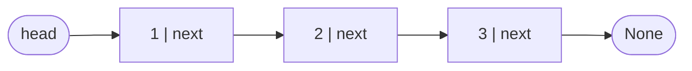
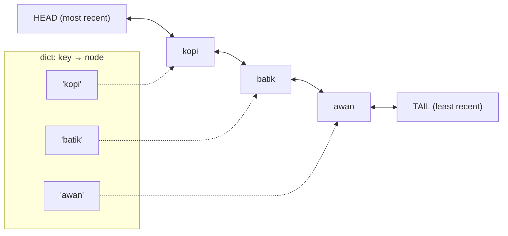

::part[Learn the Concept]{n="1"}

## 🎯 What you'll learn

- How a :term[linked list]{bahasa="senarai berantai — node yang saling terhubung lewat referensi"} differs from an array, and the cost of each operation
- Singly vs doubly linked lists, and **sentinel/dummy** nodes
- Pointer rewiring without losing nodes (reversal)
- **Fast & slow pointers**: middle, cycle detection, n-th from the end
- Why real systems still use linked lists (LRU caches, queues, free lists)

## 🧠 The big idea

An array is a row of **numbered lockers**. A linked list is a **treasure hunt**: each clue (node) holds a value and tells you where the next clue is. You can't jump to clue #500 — you follow the chain. But inserting a new clue between two others only means changing **one note**; nobody has to move.

## ❓ Why does this exist?

Arrays make inserting or removing in the middle O(n) because items shift. If you already **hold a reference** to a node, a linked list inserts or removes next to it in O(1). That makes linked lists the backbone of:
- `collections.deque` (a linked list of blocks),
- LRU caches (move an item to "most recent" in O(1)),
- memory allocators and OS schedulers.

In interviews, linked lists test whether you can manipulate references carefully without losing data.

## 💥 What happens if we DON'T handle pointers carefully?

```python
def reverse(head):
    current = head
    while current:
        current.next = previous     # 🐛 we just lost the rest of the list
        ...
```

Overwrite `current.next` before saving it and every node after `current` becomes unreachable. A single wrong line loses data or creates an infinite loop.

## 📖 How it works, step by step

### 1. The node

```python
@dataclass(eq=False)
class ListNode:
    val: int
    next: "ListNode | None" = None

head = ListNode(1, ListNode(2, ListNode(3)))    # 1 → 2 → 3 → None
```



### 2. Costs compared with arrays

| Operation | Array (`list`) | Singly linked list |
|---|---|---|
| Access by index | **O(1)** | O(n) |
| Insert/remove at front | O(n) | **O(1)** |
| Insert/remove after a known node | O(n) | **O(1)** |
| Remove a known node (doubly linked) | O(n) | **O(1)** |
| Search by value | O(n) | O(n) |
| Memory per item | small | extra reference(s) per node |
| CPU cache friendliness | great | poor (nodes scattered in memory) |

### 3. Traversal

```python
current = head
while current is not None:
    print(current.val)
    current = current.next
```

Always ask: *what happens when `head` is `None`? When there's one node?*

### 4. Reversal — save, rewire, advance

```python
def reverse_list(head):
    previous = None
    current = head
    while current is not None:
        following = current.next     # 1. save the rest
        current.next = previous      # 2. rewire
        previous = current           # 3. advance both
        current = following
    return previous                  # new head
```

```text
None ← 1    2 → 3       previous=1, current=2
None ← 1 ← 2    3       previous=2, current=3
None ← 1 ← 2 ← 3        previous=3, current=None → return 3
```

Draw boxes and arrows on paper for every pointer problem. Interviewers expect it.

### 5. The dummy (sentinel) head

Removing or inserting at the **head** usually needs special-case code. A dummy node in front makes the head behave like any other node:

```python
dummy = ListNode(0, head)
# ... work with dummy.next, trail.next, etc.
return dummy.next
```

Same idea in merging: build the result after `dummy`, append to `tail`, return `dummy.next`.

### 6. Fast & slow pointers

Move one pointer 1 step and another 2 steps:

| Question | Trick |
|---|---|
| **Middle** node | when `fast` reaches the end, `slow` is in the middle |
| **Cycle?** (Floyd's tortoise and hare) | if there's a loop, `fast` eventually laps `slow` and they meet; if `fast` hits `None`, no cycle |
| **N-th from the end** | move `lead` n steps ahead, then move both; when `lead` reaches the end, `trail` is right before the target |

All in O(n) time and **O(1) space** — a visited `set` also detects cycles, but uses O(n) memory.

### 7. Doubly linked lists

Each node has `prev` and `next`. With a reference to a node, you can unlink it in O(1):

```python
node.prev.next = node.next
node.next.prev = node.prev
```

Add sentinel `head` and `tail` nodes and you never check for `None` at the edges.

### 8. LRU cache = hash map + doubly linked list



- `get`: dict finds the node in O(1) → unlink and move to front in O(1).
- `put` when full: remove the node before `TAIL` in O(1) and delete its key.

Neither structure alone gives O(1) for both "find" and "reorder" — combining them does. This is one of the most common interview design questions, and exactly how caches like Python's `functools.lru_cache` work internally.

## ⚖️ Trade-offs

| Choice | ✅ | ❌ |
|---|---|---|
| Array list | fast indexing, compact, cache-friendly | slow middle/front changes |
| Linked list | O(1) insert/remove at known positions | O(n) indexing, extra memory, slow iteration in practice |
| Doubly linked | O(1) removal of any known node, backward traversal | more memory, more pointers to keep consistent |
| Recursion on lists | elegant | Python's recursion limit breaks on long lists |
| Visited set for cycles | simple | O(n) memory |

## ✅ When to use it / 🚫 When NOT to use it

- ✅ Frequent insertions/removals where you already hold the node (LRU, schedulers, undo histories with splicing).
- ✅ Implementing queues/deques from scratch, or in lower-level languages.
- 🚫 In everyday Python app code — `list`, `deque` and `dict` are faster and simpler.
- 🚫 When you need random access by index.

## 🏆 Best practices

- [ ] **Draw it**: boxes and arrows before coding; step through with 0, 1, 2 nodes.
- [ ] **Save before you overwrite**: store `current.next` before rewiring.
- [ ] Use a **dummy head** (and a `tail` pointer) to avoid head special cases.
- [ ] Use **fast/slow pointers** for middle, cycle and n-th-from-end — mention O(1) space.
- [ ] Prefer **iterative** solutions in Python for long lists (recursion depth).
- [ ] Keep `prev`/`next` updates in small helper methods (`_unlink`, `_push_front`) so invariants stay correct.
- [ ] In real Python code, reach for `deque`, `OrderedDict` or `functools.lru_cache` — implement by hand to learn and in interviews.

## 🏭 How it's used in industry

- Caches: Redis's LRU/LFU eviction, CDN caches, database buffer pools use recency lists.
- `collections.deque`, OS process and I/O queues, memory allocator free lists.
- Blockchains and Git commits form linked structures (each item references its parent).
- Undo/redo histories and playlists in apps.

## ⚠️ Common mistakes

- Losing the rest of the list by overwriting `next` too early.
- Forgetting the empty list or single-node case.
- `while current.next:` crashing when `current` is `None`.
- In an LRU cache, updating the dict but forgetting to move or remove the node (or vice versa).

::part[Explain & Design]{n="2"}

## 🗣️ Explain it

Explain to a friend why a music player's "play next" (insert a song right after the current one) is instant with a linked list, but jumping to song #1,000 is slow — use the treasure hunt analogy.

## 📐 Design it

CareerPilot's AI service (Phase 3) caches CV-to-job match scores because each score costs an LLM call. Memory allows 10,000 entries. Design the cache: data structures, what the key is, how `get`/`put` work in O(1), what happens on eviction, and one reason an LRU policy might be the wrong choice here.

:::quiz
Show a possible design

**Key**: `(cv_hash, job_id, model_version)` — hashing the CV text means an edited CV gets a new entry; including the model version invalidates scores when the model changes.

**Structures**: `dict[key → node]` + doubly linked list with sentinel `head`/`tail`; each node stores key, score and `created_at`.
- `get(key)`: dict lookup → if found, unlink and push to front → return score. O(1).
- `put(key, score)`: if present, update and move to front; else if size == 10,000, remove `tail.prev` and delete its dict key; insert new node at front. O(1).

**Extra**: a TTL (e.g. 7 days) — a `get` on an expired entry removes it and returns a miss.

**Why LRU might be wrong**: a burst of one-off lookups (a user browsing 500 jobs once) can evict valuable entries that are used daily but weren't touched in the last few minutes. **LFU** (least frequently used) or LRU + frequency (like Redis `allkeys-lfu`) can fit better. Also, with several API processes, an in-process cache isn't shared — Redis would be the production choice (Module 5).
:::

### 📝 Self-review checklist

- [ ] Key captures everything that changes the result
- [ ] Both get and put are O(1)
- [ ] Eviction removes from both the list and the dict
- [ ] Alternative policy or TTL considered

::ai-review{task="design"}

::part[Practice Problems]{n="3"}

:::problem{id="dsa-s2-linked-list-basics" title="Linked List Basics" difficulty="easy" path="exercises/dsa/stage-2/13-linked-list-basics"}
Reverse a list by relinking nodes, find the middle, and detect a cycle with O(1) memory.
:::

:::problem{id="dsa-s2-merge-sorted-lists" title="Merge Two Sorted Lists" difficulty="medium" path="exercises/dsa/stage-2/14-merge-sorted-lists"}
Merge by relinking nodes with a dummy head — stable for equal values.
:::

:::problem{id="dsa-s2-remove-nth-from-end" title="Remove the N-th From the End" difficulty="medium" path="exercises/dsa/stage-2/15-remove-nth-from-end"}
Two pointers n steps apart, in one pass — including removing the head.
:::

:::problem{id="dsa-s2-lru-cache" title="LRU Cache" difficulty="hard" path="exercises/dsa/stage-2/16-lru-cache"}
Stretch: O(1) get and put with a dict and a hand-built doubly linked list.
:::

:::hints
- `reverse_list`: three variables — `previous`, `current`, `following`.
- `middle_node`: loop while `fast is not None and fast.next is not None`.
- `merge_sorted`: when one list runs out, attach the rest of the other in one step.
- `remove_nth_from_end`: start both pointers at a dummy node; after moving `lead` n steps, move both until `lead.next is None`; then `trail.next = trail.next.next`.
- `LRUCache`: write `_unlink(node)` and `_push_front(node)` first and test them mentally; `get` and `put` become a few lines.
:::

## ✅ Quick check

:::quiz
Why does Floyd's cycle detection use O(1) memory while a visited set uses O(n)?

It only keeps two pointers regardless of list length; a visited set stores every node it passes.
:::

:::quiz
Why does an LRU cache need both a dict and a doubly linked list?

The dict finds a node by key in O(1); the doubly linked list moves or removes that node (and finds the least recent one) in O(1). Neither can do both alone.
:::

## 📖 Kamus (glossary)

| Term | Bahasa Indonesia |
|---|---|
| Node | Simpul |
| Singly / doubly linked list | Senarai berantai tunggal / ganda |
| Sentinel / dummy node | Simpul penjaga (bantuan) |
| Fast & slow pointers | Penunjuk cepat dan lambat |
| Cycle | Siklus / putaran |
| LRU (Least Recently Used) | Yang paling lama tidak digunakan |

## 📚 Keep learning

- [Python Tutor — visualize pointer rewiring step by step](https://pythontutor.com/)
- [Python docs: functools.lru_cache](https://docs.python.org/3/library/functools.html#functools.lru_cache)

## 📣 Stage 2 done — share it

:::linkedin{type="dsa"}
🧩 DSA Stage 2 done: arrays, hash maps, stacks & queues, and linked lists.

The pattern that clicked: [e.g. "a monotonic stack turns 'find the next bigger value' from O(n²) into O(n)"].

Favorite build: an LRU cache from scratch — a dict to find items in O(1) plus a doubly linked list to track what was used most recently. It's how real caches decide what to evict.

Next: two pointers, sliding windows, prefix sums and binary search. 🚀

#DataStructures #Algorithms #Python #LearningInPublic
:::
