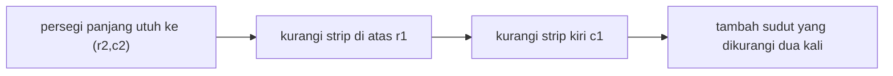

::part[Pelajari Konsepnya]{n="1"}

## 🎯 Yang akan kamu pelajari

- Membangun array :term[prefix sum]{bahasa="jumlah awalan — total kumulatif dari awal sampai posisi tertentu"} dan rumus `prefix[j + 1] - prefix[i]`
- Menukar preprocessing O(n) dengan pertanyaan O(1)
- **Prefix sum + hash map** untuk subarray dengan total tepat — alat yang kerja dengan angka negatif
- Mengubah soal (0 → −1) supaya jadi "jumlah sama dengan 0"
- Prefix sum 2D dengan inclusion–exclusion
- 🧭 Cara mengenali masalah prefix sum

## 🔤 Istilah penting

| Istilah | Artinya (sederhana) |
|---|---|
| **Prefix sum** | Total berjalan dari awal sampai setiap posisi |
| **Range query** | "Berapa total antara A dan B?" |
| **Precompute** | Hitung sekali di awal, jawab cepat nanti |
| **`prefix[j+1] - prefix[i]`** | Rumus yang kasih total rentang dalam satu langkah |
| **Exact-sum subarray** | Rentang yang totalnya sama dengan target |
| **Transform** | Tulis ulang nilai (0 → −1) supaya soal jadi "jumlah sama dengan 0" |
| **2D prefix sum** | Trik yang sama atas grid persegi panjang |
| **Difference array** | Trik terbalik: banyak perubahan rentang, satu kali lewat di akhir |

## 🧠 Ide besarnya

Rekening bank menunjukkan **saldo berjalan** setelah setiap transaksi. Untuk tahu berapa yang kamu belanjakan antara tanggal 5 dan 20, kamu tidak perlu menjumlahkan 15 transaksi — cukup kurangi dua saldo: `saldo_tanggal_20 − saldo_tanggal_4`.

Array prefix sum **adalah** saldo berjalan itu.

## ❓ Kenapa ini penting

Dashboard, analitik dan game selalu tanya "total antara A dan B": revenue antara dua tanggal, aplikasi dalam persegi peta, poin di rentang level. Menjumlahkan setiap rentang itu O(panjang) per pertanyaan, dan dengan ribuan pertanyaan jadi lambat.

Hitung total berjalan sekali dalam O(n), dan setiap pertanyaan nanti tinggal pengurangan satu — persis seperti baca dua saldo rekening daripada tambah lima belas transaksi lagi.

## 📖 Langkah demi langkah

### 1. Bangun

```python
prefix = [0]
for value in nums:
    prefix.append(prefix[-1] + value)
# nums   =    [2, 4, 1, 5]
# prefix = [0, 2, 6, 7, 12]      prefix[i] = sum(nums[:i])
```

Nol di depan berarti "jumlah tidak ada" dan hilangkan edge case.

### 2. Tanya rentang manapun

```python
def range_sum(i, j):          # inclusive i..j
    return prefix[j + 1] - prefix[i]

range_sum(1, 3)  # prefix[4] - prefix[1] = 12 - 2 = 10  → 4 + 1 + 5 ✅
```

### 3. Subarray dengan total tepat (plus negatif): prefix + hash map

Pasangan ini yang perlu diingat: sliding window tangani pertanyaan "paling" di angka positif, sementara prefix sum plus hash map tangani pertanyaan "tepat", bahkan dengan negatif.

*Berapa banyak subarray yang jumlahnya k?* Subarray `i..j` jumlahnya `k` tepat saat `prefix[j + 1] - prefix[i] == k`, yaitu `prefix[i] == prefix[j + 1] - k`. Jalan sekali, hitung prefix sum yang lebih awal di kamus:

```python
seen = {0: 1}                     # the empty prefix
prefix = count = 0
for value in nums:
    prefix += value
    count += seen.get(prefix - k, 0)     # how many starts make a sum of k
    seen[prefix] = seen.get(prefix, 0) + 1
```

Ini kerja dengan angka **negatif**, di mana sliding window gagal. Versi:
- **terpanjang** subarray dengan jumlah k → simpan **index pertama** tiap prefix daripada hitung
- jumlah habis dibagi m → pakai `prefix % m` sebagai kunci

### 4. Ubah soalnya

"Rentang terpanjang dengan 0 dan 1 sama" → peta `0 → −1`; sekarang itu "subarray terpanjang dengan jumlah 0" → prefix sama tandai ujungnya.

Gerakkan ini — **tulis ulang soal sampai jadi pola yang dikenal** — itu keterampilan interview utama.

### 5. Prefix sum 2D

Tambah dua persegi panjang dan kurangi tumpang tindih sama dengan hitung tamu pesta menurut meja: tambah bagian, lalu hilangkan yang dihitung dua kali.

`P[r + 1][c + 1]` = jumlah persegi panjang dari `(0, 0)` ke `(r, c)`:

```text
P[r+1][c+1] = grid[r][c] + P[r][c+1] + P[r+1][c] − P[r][c]
region(r1, c1, r2, c2) = P[r2+1][c2+1] − P[r1][c2+1] − P[r2+1][c1] + P[r1][c1]
```



Pemrosesan gambar sebut ini **integral image** (dipakai di face detection klasik).

### 6. Trik terbalik: difference array

Banyak **update** rentang ("tambah 5 ke hari 10–20") lalu satu baca akhir? Simpan `diff[start] += 5`, `diff[end + 1] -= 5`, dan ambil prefix sum di akhir. O(1) per update.

:::tip[🧭 Cara kenali prefix sum]
- Banyak pertanyaan **jumlah rentang** atas data yang **tidak berubah** (atau jarang berubah).
- "Hitung/terpanjang subarray dengan jumlah **tepat** k" — apalagi dengan angka **negatif**.
- "Jumlah X dan Y sama", "jumlah habis dibagi m" → ubah, lalu prefix nilai sama.
- Total persegi panjang di grid.
- Banyak **penambah** rentang lalu baca → difference array.

Data berubah antar pertanyaan terus-terusan? → pohon Fenwick / pohon segment (di luar stage ini) atau aggregate database.
:::

### Pilih setup kamu

Setiap pilihan di sini adalah trade-off:

| Cara | Bangun | Tanya | Update | Memori |
|---|---|---|---|---|
| Jumlah setiap rentang | — | O(panjang) | O(1) | O(1) |
| Prefix sum | O(n) | **O(1)** | O(n) (ulang bangun) | O(n) |
| Fenwick / pohon segment | O(n) | O(log n) | O(log n) | O(n) |
| Prefix + hash map (k tepat) | — | satu kali lewat O(n) | — | O(n) |

- ✅ Analitik banyak baca atas array statis, time series, grid.
- ✅ Kondisi subarray jumlah dengan nilai negatif.
- 🚫 Update sering campur dengan pertanyaan.
- 🚫 Kondisi yang bukan jumlah (max/min rentang → tabel jarang, deque, pohon).

## ⚠️ Kesalahan umum

- `prefix[j] - prefix[i]` saat rentang termasuk `j` (harus `j + 1`).
- Lupa `{0: 1}` dan subarray yang mulai index 0 terlewat.
- Update hash map **sebelum** cari `prefix - k` (hitung subarray kosong saat k = 0).
- Pakai sliding window untuk jumlah tepat dengan negatif.

## 🏆 Praktik terbaik

- [ ] Pakai nol depan (`prefix` panjang n + 1) untuk hindari kasus spesial rentang mulai 0.
- [ ] Tulis rumus tepat dengan batas inclusive/exclusive sebagai komentar — off-by-one #1 bug.
- [ ] Mulai hash map dengan `{0: 1}` (hitung) atau `{0: -1}` (index pertama).
- [ ] Bilang trade-off: O(n) memori untuk O(1) pertanyaan; biaya ulang bangun saat update.
- [ ] Hati integer overflow di bahasa lain (Python int tanpa batas; Java/Go/SQL `INT` tidak).
- [ ] Di sistem nyata, pertimbangkan precompute aggregate di database (window function, materialized view).

::part[Jelaskan & Rancang]{n="2"}

## 🗣️ Jelaskan

Jelaskan ke bukan pemrogram bagaimana aplikasi bisa tampilkan "total langkah antara dua tanggal" langsung untuk setahun data langkah, pakai analogi saldo rekening berjalan.

## 📐 Rancang

Halaman stats CareerPilot tampilkan "aplikasi kirim antara dua tanggal" dan "perubahan bersih aplikasi aktif" untuk riwayat pengguna sampai 3 tahun data harian. Pengguna ubah rentang tanggal terus-terusan dengan slider; data baru tiba sekali sehari. Rancang precompute, simpan dan tanya, dan bandingkan dengan tanya database setiap slider gerak.

:::quiz
Lihat contoh rancangan

**Precompute sekali per hari** (saat data baru tiba): untuk setiap pengguna, array `cumulative[d]` = aplikasi kirim hari `0..d-1` sejak buat akun (panjang ≈ 1,096). Simpan di cache (Redis list/JSON) atau tabel `daily_cumulative`.

**Tanya** hari `a..b` inclusive: `cumulative[b + 1] − cumulative[a]` → O(1), jadi slider bisa update langsung di klien kalau array dikirim sekali (~1,100 integer, beberapa KB). Yang sama untuk perubahan bersih: simpan cumulative `+1` aplikasi aktif baru, `−1` ditutup.

**Update**: hari baru → tambah satu nilai (O(1)). Edit tanggal lama (pengguna perbaiki tanggal aplikasi lama) → ulang bangun array itu (O(hari), murah) — jarang.

**Versus tanya DB setiap slider**: `SELECT count(*) WHERE applied_on BETWEEN :a AND :b` oke dengan index untuk pengguna sedikit, tapi slider lepas puluhan request per detik; prefix sum precompute nyaris gratis dan kerja offline di browser. Di SQL kamu bisa juga hitung `SUM(count) OVER (ORDER BY day)` sekali dan cache.
:::

### 📝 Checklist review mandiri

- [ ] Batas inclusive/exclusive bilang tepat
- [ ] Jalan update untuk data baru dan tanggal lama
- [ ] Bandingkan dengan cara database, termasuk jumlah request

::ai-review{task="design"}

::part[Latihan Kecil]{n="3"}

:::problem{id="dsa-s3-prefix-sum-basics" title="Dasar Prefix Sum" difficulty="easy" path="exercises/dsa/stage-3/09-prefix-sum-basics"}
Total berjalan, banyak pertanyaan rentang inclusive dalam O(n + q), dan index pivot terkiri.
:::

:::problem{id="dsa-s3-net-change-periods" title="Periode dengan Perubahan Bersih Tepat" difficulty="medium" path="exercises/dsa/stage-3/10-subarray-sum-equals-k"}
Hitung subarray dengan jumlah tepat k — nilai negatif termasuk — dengan prefix sum dan kamus.
:::

:::problem{id="dsa-s3-heatmap-regions" title="Total Region Heatmap" difficulty="medium" path="exercises/dsa/stage-3/11-matrix-region-sums"}
Prefix sum 2D: total persegi panjang O(1) setelah precompute sekali.
:::

:::problem{id="dsa-s3-longest-balanced" title="Rentang Seimbang Terpanjang" difficulty="hard" path="exercises/dsa/stage-3/12-longest-balanced"}
Rentang: ubah 0 → −1 dan cari rentang zero-sum terpanjang pakai index prefix pertama.
:::

:::hints
- `pivot_index`: jumlah kiri tumbuh saat jalan; jumlah kanan adalah `total - kiri - nums[i]`.
- `count_periods`: cari `prefix - k` **sebelum** tambah prefix sekarang ke kamus.
- `RegionSums`: alokasi `(baris + 1) × (kolom + 1)` nol jadi rumus tidak pernah index −1.
- `longest_balanced`: simpan hanya **index pertama** setiap jumlah prefix — yang kemudian buat rentang lebih pendek.
:::

## ✅ Cek cepat

:::quiz
Kenapa prefix sum + hash map kerja dengan angka negatif saat sliding window tidak?

Tidak bergantung jumlah tumbuh saat rentang tumbuh; ia cek setiap posisi akhir untuk prefix awal yang beda persis k, terlepas tanda.
:::

:::quiz
Berapa `sum(nums[2..5])` inclusive dalam hal `prefix` (dengan nol depan)?

`prefix[6] - prefix[2]`.
:::


## 📚 Lanjut belajar

- [Dokumentasi PostgreSQL: Window function (total berjalan)](https://www.postgresql.org/docs/current/tutorial-window.html)
- [Dokumentasi Python: itertools.accumulate](https://docs.python.org/3/library/itertools.html#itertools.accumulate)
