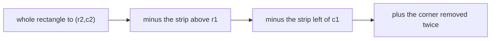

::part[Learn the Concept]{n="1"}

## 🎯 What you'll learn

- Building a :term[prefix sum]{bahasa="jumlah awalan — total kumulatif dari awal sampai posisi tertentu"} array and the `prefix[j + 1] - prefix[i]` formula
- Trading O(n) preprocessing for O(1) queries
- **Prefix sum + hash map** for exact-sum subarrays — the tool that works with negative numbers
- Transforming problems (0 → −1) so they become "sum equals 0"
- 2D prefix sums with inclusion–exclusion
- 🧭 How to recognize a prefix sum problem

## 🔤 Key words

| Word | In simple words | Bahasa Indonesia |
|---|---|---|
| **Prefix sum** | A running total from the start up to each position | Total berjalan |
| **Range query** | "What's the total between A and B?" | Pertanyaan rentang |
| **Precompute** | Do the work once up front, answer fast later | Hitung sekali di awal |
| **`prefix[j+1] - prefix[i]`** | The formula that gives any range total in one step | Rumus total rentang |
| **Exact-sum subarray** | A stretch whose total equals a target | Rentang dengan total tertentu |
| **Transform** | Rewriting values (0 → −1) so the question becomes "sum equals 0" | Mengubah bentuk soal |
| **2D prefix sum** | The same trick over a grid rectangle | Versi dua dimensi |
| **Difference array** | The reverse trick: many range updates, one final pass | Larik selisih |

## 🧠 The big idea

Your bank statement shows a **running balance** after every transaction. To know how much you spent between the 5th and the 20th, you don't add 15 transactions — you subtract two balances: `balance_on_20th − balance_on_4th`.

A prefix sum array **is** that running balance.

## ❓ Why it matters

Dashboards, analytics and games ask "total between A and B" constantly: revenue between two dates, applications inside a map rectangle, points across a range of levels. Adding up each range is O(length) per question, and with thousands of questions that gets slow.

Precompute the running totals once in O(n), and every later question is a single subtraction — exactly like reading two balances on a bank statement instead of re-adding fifteen transactions.

## 📖 Step by step

### 1. Build it

```python
prefix = [0]
for value in nums:
    prefix.append(prefix[-1] + value)
# nums   =    [2, 4, 1, 5]
# prefix = [0, 2, 6, 7, 12]      prefix[i] = sum(nums[:i])
```

The leading `0` means "sum of nothing" and removes edge cases.

### 2. Query any range

```python
def range_sum(i, j):          # inclusive i..j
    return prefix[j + 1] - prefix[i]

range_sum(1, 3)  # prefix[4] - prefix[1] = 12 - 2 = 10  → 4 + 1 + 5 ✅
```

### 3. Exact-sum subarrays (with negatives): prefix + hash map

This is the pairing to remember: sliding window handles "at most" questions on positive numbers, while prefix sums plus a hash map handle "exactly" questions, even with negatives.

*How many subarrays sum to k?* A subarray `i..j` sums to `k` exactly when `prefix[j + 1] - prefix[i] == k`, i.e. `prefix[i] == prefix[j + 1] - k`. Walk once, counting earlier prefix sums in a dict:

```python
seen = {0: 1}                     # the empty prefix
prefix = count = 0
for value in nums:
    prefix += value
    count += seen.get(prefix - k, 0)     # how many starts make a sum of k
    seen[prefix] = seen.get(prefix, 0) + 1
```

This works with **negative** numbers, where sliding windows fail. Variants:
- **longest** subarray with sum k → store the **first** index of each prefix instead of a count
- sum divisible by m → use `prefix % m` as the key

### 4. Transform the problem

"Longest stretch with equal 0s and 1s" → map `0 → −1`; now it's "longest subarray with sum 0" → equal prefix sums mark the ends.

This move — **rewrite the question until it becomes a known pattern** — is the key interview skill.

### 5. 2D prefix sums

Adding two rectangles and subtracting the overlap is the same idea as counting a wedding's guests by table: add the sections, then remove the people you counted twice.

`P[r + 1][c + 1]` = sum of the rectangle from `(0, 0)` to `(r, c)`:

```text
P[r+1][c+1] = grid[r][c] + P[r][c+1] + P[r+1][c] − P[r][c]
region(r1, c1, r2, c2) = P[r2+1][c2+1] − P[r1][c2+1] − P[r2+1][c1] + P[r1][c1]
```



Image processing calls this an **integral image** (used in classic face detection).

### 6. The reverse trick: difference arrays

Many range **updates** ("add 5 to days 10–20") then one final read? Store `diff[start] += 5`, `diff[end + 1] -= 5`, and take a prefix sum at the end. O(1) per update.

:::tip[🧭 How to spot prefix sums]
- Many **range sum** queries on data that **doesn't change** (or changes rarely).
- "Count/longest subarrays with sum **exactly** k" — especially with **negative** numbers.
- "Equal number of X and Y", "sum divisible by m" → transform, then equal prefix values.
- Rectangle totals in a grid.
- Many range **increments** followed by reads → difference array.

Data changes between queries all the time? → a Fenwick tree / segment tree (beyond this stage) or a database aggregate.
:::

### Choosing your setup

Every option here is a trade-off:

| Approach | Build | Query | Update | Memory |
|---|---|---|---|---|
| Sum each range | — | O(length) | O(1) | O(1) |
| Prefix sums | O(n) | **O(1)** | O(n) (rebuild) | O(n) |
| Fenwick / segment tree | O(n) | O(log n) | O(log n) | O(n) |
| Prefix + hash map (exact k) | — | one pass O(n) | — | O(n) |

- ✅ Read-heavy analytics over static arrays, time series, grids.
- ✅ Subarray sum conditions with negative values.
- 🚫 Frequent updates mixed with queries.
- 🚫 Conditions that aren't sums (max/min of a range → sparse tables, deques, trees).

## ⚠️ Common mistakes

- `prefix[j] - prefix[i]` when the range is inclusive of `j` (should be `j + 1`).
- Forgetting `{0: 1}` and missing subarrays that start at index 0.
- Updating the hash map **before** looking up `prefix - k` (counts the empty subarray when k = 0).
- Using a sliding window for exact sums with negatives.

## 🏆 Best practices

- [ ] Use a leading `0` (`prefix` of length n + 1) to avoid special cases for ranges starting at 0.
- [ ] Write the exact formula with inclusive/exclusive bounds as a comment — off-by-one is the #1 bug.
- [ ] Initialize the hash map with `{0: 1}` (counts) or `{0: -1}` (first index).
- [ ] State the trade-off: O(n) memory for O(1) queries; rebuild cost on updates.
- [ ] Watch integer overflow in other languages (Python ints are unbounded; Java/Go/SQL `INT` aren't).
- [ ] In real systems, consider precomputing cumulative aggregates in the database (window functions, materialized views).

::part[Explain & Design]{n="2"}

## 🗣️ Explain it

Explain to a non-programmer how an app can show "total steps between any two dates" instantly for a year of step data, using the running bank balance analogy.

## 📐 Design it

CareerPilot's stats page shows "applications submitted between any two dates" and "net change in active applications" for a user's history of up to 3 years of daily data. Users change the date range constantly with a slider; new data arrives once a day. Design the precomputation, storage and query, and compare with querying the database on every slider move.

:::quiz
Show a possible design

**Precompute once per day** (when new data arrives): for each user, an array `cumulative[d]` = applications submitted on days `0..d-1` since account creation (length ≈ 1,096). Store it in a cache (Redis list/JSON) or a `daily_cumulative` table.

**Query** for days `a..b` inclusive: `cumulative[b + 1] − cumulative[a]` → O(1), so the slider can update instantly on the client if the array is sent once (~1,100 integers, a few KB). The same for net change: store cumulative `+1` for new active, `−1` for closed.

**Updates**: new day → append one value (O(1)). A backdated edit (user fixes an old application's date) → rebuild that user's array (O(days), cheap) — rare.

**Versus DB per slider move**: `SELECT count(*) WHERE applied_on BETWEEN :a AND :b` is fine with an index for a few users, but a slider fires dozens of requests per second; precomputed prefix sums cost almost nothing and work offline in the browser. In SQL you could also compute `SUM(count) OVER (ORDER BY day)` once and cache it.
:::

### 📝 Self-review checklist

- [ ] Inclusive/exclusive bounds stated precisely
- [ ] Update path for new and backdated data
- [ ] Compared with the database approach, including request volume

::ai-review{task="design"}

::part[Practice Problems]{n="3"}

:::problem{id="dsa-s3-prefix-sum-basics" title="Prefix Sum Basics" difficulty="easy" path="exercises/dsa/stage-3/09-prefix-sum-basics"}
Running totals, many inclusive range queries in O(n + q), and the leftmost pivot index.
:::

:::problem{id="dsa-s3-net-change-periods" title="Periods With an Exact Net Change" difficulty="medium" path="exercises/dsa/stage-3/10-subarray-sum-equals-k"}
Count subarrays with sum exactly k — negative values included — with prefix sums and a dict.
:::

:::problem{id="dsa-s3-heatmap-regions" title="Heatmap Region Totals" difficulty="medium" path="exercises/dsa/stage-3/11-matrix-region-sums"}
2D prefix sums: O(1) rectangle totals after one precomputation.
:::

:::problem{id="dsa-s3-longest-balanced" title="Longest Balanced Stretch" difficulty="hard" path="exercises/dsa/stage-3/12-longest-balanced"}
Stretch: transform 0 → −1 and find the longest zero-sum stretch using first-seen prefix indices.
:::

:::hints
- `pivot_index`: left sum grows as you go; right sum is `total - left - nums[i]`.
- `count_periods`: look up `prefix - k` **before** adding the current prefix to the dict.
- `RegionSums`: allocate `(rows + 1) × (cols + 1)` zeros so the formula never indexes −1.
- `longest_balanced`: store only the **first** index of each prefix sum — later ones would make stretches shorter.
:::

## ✅ Quick check

:::quiz
Why does prefix sum + hash map work with negative numbers when a sliding window doesn't?

It doesn't rely on the sum growing as the range grows; it checks every end position for earlier prefix sums that differ by exactly k, regardless of sign.
:::

:::quiz
What's `sum(nums[2..5])` inclusive in terms of `prefix` (with a leading 0)?

`prefix[6] - prefix[2]`.
:::


## 📚 Keep learning

- [PostgreSQL docs: Window functions (running totals)](https://www.postgresql.org/docs/current/tutorial-window.html)
- [Python docs: itertools.accumulate](https://docs.python.org/3/library/itertools.html#itertools.accumulate)
