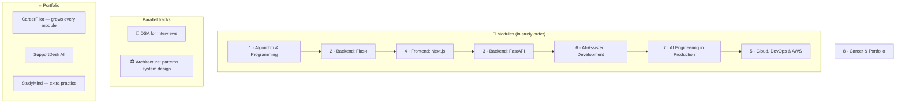

# The FSSE Handbook — A Simple Explanation

## What is this?

A personal, local study app for becoming an **AI full-stack software engineer**. It follows a standard full-stack curriculum structure and fills every lesson with **original**, beginner-friendly material — plus extra modules the job market asks for today.

You run it on your own computer (`npm run dev`) and read it in the browser. Your progress stays in your browser.

## Who is it for?

Someone who:
- is learning (or has learned) full-stack development and wants **deeper understanding**,
- wants to understand code written with AI tools, not just generate it,
- wants a **portfolio** and a clear path to a first developer job.

## What's inside?

| Part | What you get |
|---|---|
| **8 modules** | Core curriculum (Modules 1, 2, 4, 6, 8) plus bonus modules: FastAPI (3), Cloud & AWS (5), AI Engineering (7) |
| **DSA track** | Data structures & algorithm patterns for coding interviews, in Python, with spaced review |
| **Architecture track** | Clean code → design patterns → system design, learned when you need each idea |
| **Projects** | CareerPilot (7 phases, CLI → AI microservices on AWS), SupportDesk AI, StudyMind |
| **Career** | Portfolio, LinkedIn, CV, interviews |

## How is a lesson built?

Every lesson has three parts:

1. **Learn the Concept** — why it exists, what goes wrong without it, how it works, trade-offs, when (not) to use it, **best practices**, industry use, common mistakes.
2. **Explain & Design** — explain it in your own words and design a small solution, with a self-review checklist.
3. **Toy Exercise** — build something small; automatic tests tell you when it works.

Key terms are underlined with a **Bahasa Indonesia** explanation, and each lesson ends with a small glossary (*Kamus*).

## Labels

| Label | Meaning |
|---|---|
| 🟢 Core · 🔵 Recommended · ⚪ Optional · ➖ Not needed | Importance for a job role (Backend, Frontend, Full-Stack, AI Engineer, Cloud/DevOps, or ⭐ AI Full-Stack) |
| 🚫🤖 No-AI · 🤖✅ AI-allowed | Whether you may use AI for an exercise |
| 🔥 Bonus | Extra material, beyond the core curriculum outline |
| 🟢 Free · 🟡 Small cost · 🔴 Concept only | AWS cost of a hands-on cloud lesson |

## How to study with it

1. **Set your target role** in Settings.
2. Each week, take the **placement check** first. Passed → skim and do exercises. Not yet → study the week.
3. Follow **This Week**: ~18 hours (Mon–Fri 2 h module + 1 h DSA; Saturday architecture + project; Sunday review and a LinkedIn post).
4. **Brain first, AI second**: solve No-AI exercises yourself, then ask AI to review.
5. Mark DSA problems as solved — the **review queue** brings them back after 1, 3, 7, 14 and 30 days.
6. Build **CareerPilot** phase by phase and post your progress on LinkedIn.
7. Export a **progress backup** from Settings every week or two.

## Job-ready milestones

| Milestone | Apply for | Roughly (at 18 h/week) |
|---|---|---|
| 🎯 1 · Junior Full-Stack | Junior backend / frontend / full-stack | ~4–5 months |
| 🎯 2 · AI-Integrated Full-Stack | Full-stack with AI, junior applied AI engineer | ~7–8 months |
| 🎯 3 · Stronger Candidate | AI engineer, cloud-heavy teams | ~11–13 months |

You don't need to finish everything to get hired — **start applying at Milestone 1** and keep learning.

## Where things live

| You want to… | Look in |
|---|---|
| Run the app | [`README.md`](../README.md) |
| See the full plan and decisions | [`IMPLEMENTATION_PLAN.md`](IMPLEMENTATION_PLAN.md) |
| Learn how the app's code works | [`LEARN_THE_CODEBASE.md`](LEARN_THE_CODEBASE.md) |
| Add or edit a lesson | [`ADDING_CONTENT.md`](ADDING_CONTENT.md) |
| Understand why these topics | [`MARKET_CHECK.md`](MARKET_CHECK.md) |
| Do exercises | [`exercises/README.md`](../exercises/README.md) |

## Content policy

Every explanation, code sample, exercise, project brief and template here is original. Don't add paid course material (slides, lesson text, assignment briefs) to this repository.
