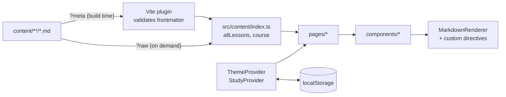

# Learn the Codebase

This app is also a **learning project**. This guide walks through it in the order the code actually runs, so you can connect every file to a React/TypeScript concept.

> Tip: open each file as you read. Every file starts with a comment saying **what it does** and **what it teaches**.

---

## 0. The big picture



| Folder | Role |
|---|---|
| `src/main.tsx` | Entry point |
| `src/routes.tsx` | URL → page mapping |
| `src/providers/` | Global state (theme, progress) |
| `src/hooks/` | Reusable logic + context accessors |
| `src/content/` | Loading, validating and querying lessons |
| `src/lib/` | Pure helpers: storage, roles, search, spaced repetition |
| `src/components/` | UI building blocks |
| `src/pages/` | One component per route |
| `src/config/` | Static data: navigation, role labels, LinkedIn tips |
| `scripts/` | Build-time tools (Vite plugin, content check, exercise check) |

---

## 1. Vite: the dev server and bundler

**Files:** `index.html`, `vite.config.ts`, `.env.example`

- The browser loads `index.html`, which loads `/src/main.tsx`. Vite translates TypeScript and JSX on the fly.
- `vite.config.ts` registers **plugins** (React, Tailwind, our lesson plugin) and reads ports from `.env` with `loadEnv`. `strictPort: true` fails loudly if a port is taken.
- The small inline `<script>` in `index.html` applies the dark theme **before** React loads to avoid a white flash.

**Concepts:** bundler, dev server, environment variables, plugins.

## 2. Booting React

**File:** `src/main.tsx`

```tsx
createRoot(rootElement).render(
  <StrictMode>
    <ThemeProvider>
      <StudyProvider>
        <RouterProvider router={router} />
      </StudyProvider>
    </ThemeProvider>
  </StrictMode>,
)
```

- `createRoot` attaches React to `<div id="root">`.
- **Providers** wrap the app so any component can read theme and study progress.
- `StrictMode` runs extra development checks.

**Concepts:** component tree, composition, providers.

## 3. Routing

**File:** `src/routes.tsx`, `src/components/layout/AppLayout.tsx`

- `createBrowserRouter` maps paths to page components.
- All pages are **children** of `AppLayout`, which renders the top bar and sidebar once, and the current page inside `<Outlet />`.
- `:moduleId` in a path becomes `useParams().moduleId` in the page.
- `LessonPage` serves module, track, project **and** guide lessons: the URL *is* the lesson id.

**Concepts:** nested routes, URL params, layout routes, error boundaries (`errorElement`).

## 4. Components and props

**Files:** `src/components/ui/PageHeader.tsx`, `RoleBadges.tsx`, `ProgressBar.tsx`

```tsx
type PageHeaderProps = { title: string; eyebrow?: string; description?: ReactNode }

export function PageHeader({ title, eyebrow, description }: PageHeaderProps) { … }
```

- A component is a function that returns JSX.
- **Props** are its inputs; the `type` describes them, and `?` makes one optional.
- `{eyebrow && <p>…</p>}` renders only when a value exists.

**Concepts:** props, optional props, conditional rendering, lists with `.map()` and `key`.

## 5. TypeScript types

**Files:** `src/types/content.ts`, `src/content/schema.ts`, `src/lib/roles.ts`

- **Union types** restrict values: `type Level = 'core' | 'recommended' | 'optional' | 'none'`.
- **`Record<K, V>`** forces an entry for every key (see `config/roles.ts`).
- **Zod** validates data at runtime and generates types with `z.infer` — one source of truth for "what a lesson looks like".
- `as const` and `satisfies` keep exact literal types while checking shapes.

**Concepts:** static vs runtime types, unions, generics (`readJSON<T>`), type narrowing.

## 6. State and hooks

**Files:** `src/providers/ThemeProvider.tsx`, `src/providers/StudyProvider.tsx`, `src/hooks/*`

| Hook | Where | Why |
|---|---|---|
| `useState` | everywhere | local state (e.g. sidebar open) |
| `useEffect` | `usePersistentState`, `NotesPanel`, `CodeBlock` | sync with outside systems (localStorage, timers, async highlighting) |
| `useSyncExternalStore` | `ThemeProvider` | subscribe to the OS dark-mode setting |
| `useMemo` / `useCallback` | providers | keep context values stable |
| `useContext` | `useTheme`, `useStudy` | read shared state |
| `useRef` | `LinkedInCard`, `useHotkey` | read DOM / keep latest callback |
| `use()` + `<Suspense>` | `LessonPage` | wait for the lesson body Promise |

Key ideas used throughout:
- **Derived state** is computed during render, not stored (`resolved` theme, search results, progress counts).
- **Functional updates** `setX(prev => …)` and **immutability** (`{ ...prev }`) in `StudyProvider`.
- A **custom hook** (`usePersistentState`) packages "state + localStorage" for reuse.

## 7. Styling with Tailwind CSS v4

**File:** `src/styles/index.css` (+ class names in components)

- `@import 'tailwindcss'` enables utility classes like `flex`, `rounded-xl`, `text-slate-600`.
- `@custom-variant dark` makes `dark:` classes follow the `.dark` class set by `ThemeProvider`.
- `@plugin '@tailwindcss/typography'` gives Markdown nice defaults via the `prose` class.
- Responsive prefixes: `lg:sticky`, `xl:grid` — mobile first, larger screens override.

## 8. How Markdown becomes a page

**Files:** `scripts/vite-plugin-lesson-meta.ts`, `src/content/parse.ts`, `src/content/index.ts`, `src/content/remark-directives.ts`, `src/components/markdown/*`

1. **Build time:** importing `file.md?meta` runs our Vite plugin → `buildLessonMeta` parses frontmatter, validates it with Zod, derives id/URL from the path, counts reading time → a small JSON object. Invalid lessons fail with a clear error.
2. **Startup:** `src/content/index.ts` collects all metadata with `import.meta.glob(..., { eager: true })` and validates `course.json`.
3. **Opening a lesson:** the body is loaded lazily with `?raw` (a separate chunk per lesson).
4. **Rendering:** `react-markdown` parses Markdown → our `remarkHandbookDirectives` plugin turns `:::tip`, `:term[…]`, `:::quiz`… into custom elements → `MarkdownRenderer` maps each to a React component (`Callout`, `Term`, `Quiz`, `ExerciseCard`…).
5. Code blocks go to `CodeBlock` (Shiki highlighting) or `Mermaid` (diagrams, loaded lazily). The Sandpack editor is also lazy-loaded.

**Concepts:** syntax trees (mdast/hast), plugins, code splitting, lazy loading.

## 9. Persistence and data safety

**Files:** `src/lib/storage.ts`, `src/lib/backup.ts`

- Every localStorage access is wrapped in `try/catch` — storage can be unavailable.
- `STORAGE_KEYS` lists all keys in one place.
- Backups validate the uploaded file and only restore known keys (never trust input).

## 10. Pure logic and tests

**Files:** `src/lib/*.test.ts`, `src/content/*.test.ts`

Business rules live in **pure functions** — `levelFor`, `countProgress`, `pickForBudget`, `recordReview` — so they're tested without a browser:

```bash
npm test
```

Notice `recordReview(item, outcome, today)` takes `today` as a parameter instead of calling `new Date()` inside: deterministic tests (see Architecture · *Coupling & Cohesion*).

## 11. Quality tools

| Tool | Command | Catches |
|---|---|---|
| TypeScript | `npm run typecheck` | type mistakes |
| ESLint (+ React Hooks rules) | `npm run lint` | bugs, hook misuse |
| Prettier | `npm run format` | inconsistent formatting |
| Vitest | `npm test` | broken logic |
| Content check | `npm run content:check` | invalid lessons, broken links, missing exercise folders |
| Exercise check | `bash scripts/check-exercises.sh` | exercises already solved or with broken solutions |

---

## Suggested exercises on this codebase

1. **Easy:** add a new icon to `Icon.tsx` and use it in the sidebar.
2. **Easy:** add a `note` of "Last visited" to the dashboard using a new `STORAGE_KEYS` entry.
3. **Medium:** add a new callout variant `:::bestpractice` (remark plugin + `Callout` variants + showcase guide).
4. **Medium:** show a "✅ Placement passed" badge on module week sections (`SectionedLessonList` + `useStudy().placements`).
5. **Hard:** implement the AI review with Ollama following `src/lib/ai-review/types.ts` (Plan §18).
