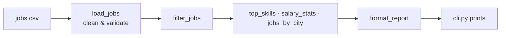

# CareerPilot CLI

Analyze job listings from a CSV file and see which skills are in demand, what roles pay, and where the jobs are.


## ✨ Features

- Top skills across listings, with case-insensitive normalization
- Salary statistics: average range and median maximum
- Filters by city, remote work and minimum salary
- Robust cleaning of messy CSV data (missing salaries, duplicate skills, extra spaces)

## 🧰 Tech Stack

| Area | Tool |
|---|---|
| Language | Python 3.12 |
| CLI | argparse (standard library) |
| Testing | pytest |

## 🏗️ Architecture



Business logic lives in `analyze.py` (pure functions, fully tested). `cli.py` only parses arguments and prints.

## 🚀 Getting Started

Prerequisites: Python 3.11+.

```bash
python -m venv .venv
source .venv/bin/activate
pip install pytest
```

## 💻 Usage

```bash
python cli.py data/jobs.csv --top 5
python cli.py data/jobs.csv --city jakarta --remote --min-salary 12000000
```

## 🧪 Testing

```bash
python -m pytest
```

## 🗺️ Roadmap

See the [project docs](docs/roadmap.md): Phase 2 turns this into a Flask REST API.
