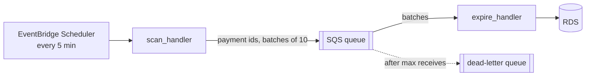

# M5 · W4 · 04 — Lambda background jobs: expire unpaid payments

> 🚫🤖 **No-AI** · ⏱️ ~2 h · SQS is mocked with **moto**

RevoShop creates Midtrans payments with an `expires_at` time, but an order only changes when a webhook arrives. If the webhook never comes, stock stays reserved forever. Build two Lambda handlers in `jobs.py`:



Dependencies are injected so handlers are testable: `Deps(repository, sqs, queue_url, clock)`.

## Repository protocol (provided by tests)
- `find_expired_pending(now, limit) -> list[int]` — payment ids with status `pending` and `expires_at <= now`
- `expire(payment_id, now) -> str` — **conditional** update; returns `"expired"`, `"already_final"` (paid/expired/refunded) or raises on database errors

## 1. `scan_handler(event, context, deps) -> dict`
- `ids = repository.find_expired_pending(clock(), limit=500)`
- send them with `sqs.send_message_batch` in batches of **10** entries: `Id` = `str(index within batch)`, `MessageBody` = `json.dumps({"payment_id": id})`
- any entry reported in the response's `Failed` list → raise `RuntimeError` (the scheduler retries the whole scan; duplicates are fine because `expire` is idempotent)
- return `{"found": len(ids), "enqueued": len(ids)}`

## 2. `expire_handler(event, context, deps) -> dict`
Processes an SQS event (`event["Records"]`, each with `messageId` and `body`) and returns a **partial batch response** `{"batchItemFailures": [{"itemIdentifier": messageId}, ...]}` (enable *ReportBatchItemFailures* on the event source mapping):
- body not valid JSON, or no integer `payment_id` → **don't** retry (log and skip — a poison message would otherwise loop until the DLQ)
- `repository.expire(...)` raises → that message fails (retried later)
- before each record, if `context.get_remaining_time_in_millis() < 5000`, mark **that record and all remaining ones** as failures and stop (never get killed mid-update)
- return counts too: `{"batchItemFailures": [...], "expired": n, "skipped": m}` where `skipped` counts `already_final` results and poison messages

```bash
cd exercises
uv run pytest m5/w4/04-lambda-payment-expiry
```
